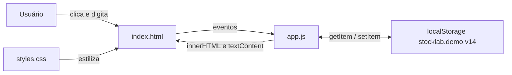
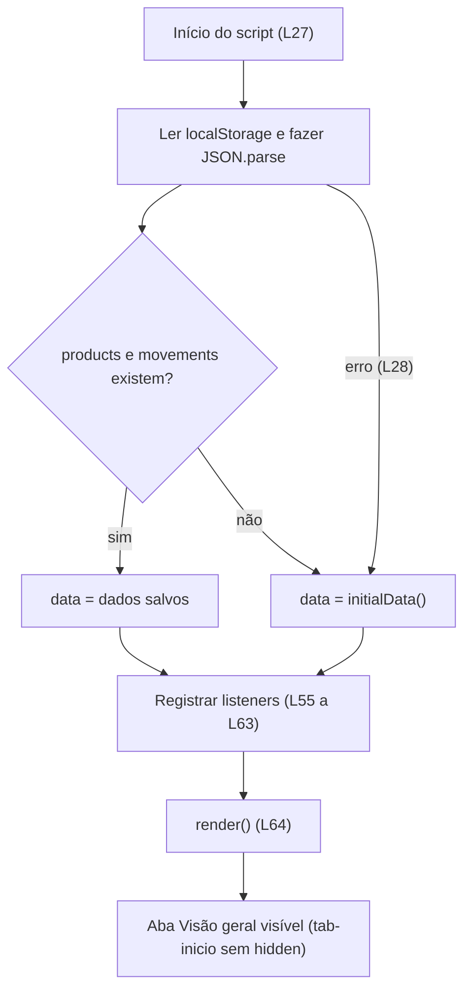
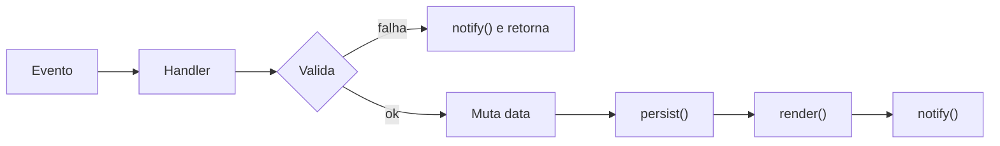

# Documentação do código — StockLab v1.4

Versão documentada: StockLab v1.4 (app.js 65 linhas, index.html 54 linhas, styles.css minificado)

O StockLab é um sistema fictício de controle de estoque para um comércio de bairro (`index.html` L46), feito só com HTML, CSS e JavaScript puros: sem backend, sem etapa de build e sem dependências externas. Os dados ficam apenas no navegador (`app.js` L4, L27–L29). Esta documentação descreve o que o código faz **hoje**, na v1.4, inclusive os defeitos; a lista completa está em [regras-de-negocio.md](regras-de-negocio.md).

## Índice

| Arquivo | Conteúdo |
|---|---|
| [README.md](README.md) | Esta visão geral: como executar, mapa dos arquivos, arquitetura, glossário e resumo de defeitos. |
| [app.js — referência](app-js.md) | Funções, estado, persistência e eventos do `app.js`, com linhas. |
| [Modelo de dados](modelo-de-dados.md) | Estruturas `products` e `movements`, chave do `localStorage` e dados de demonstração. |
| [Interface HTML](interface-html.md) | Estrutura do `index.html`: seções, ids, formulários e diálogos. |
| [CSS](css.md) | Variáveis, componentes, breakpoints e estados do `styles.css` (citado por seletor). |
| [Casos de uso](casos-de-uso.md) | Atores e casos de uso UC-01 a UC-12 com diagramas. |
| [Regras de negócio](regras-de-negocio.md) | Regras R01 a R29 como implementadas e defeitos D1 a D14. |

## Como abrir e executar

1. Extraia a pasta do projeto e abra `index.html` no Google Chrome ou Microsoft Edge (LEIA-ME.txt, passos 1 e 2).
2. Se o navegador restringir o armazenamento local para arquivos abertos via `file://`, use a extensão Live Server do VS Code ou um servidor HTTP simples, por exemplo `python3 -m http.server` na pasta do projeto e acesso a `http://localhost:8000` (LEIA-ME.txt, seção AMBIENTE).
3. Não é preciso instalar Node, banco de dados ou Docker.

Para voltar ao estado inicial: botão **Restaurar dados** (`index.html` L27, UC-10; pede confirmação em `app.js` L63) ou apagar a chave `stocklab.demo.v14` em DevTools > Application > Local Storage.

## Mapa dos arquivos

| Arquivo | Tamanho | Papel |
|---|---|---|
| `index.html` | 54 linhas | Estrutura da interface: 38 ids, 2 elementos `<dialog>` (`index.html` L51, L52), 4 seções de aba (L29, L39, L45, L46). Carrega `styles.css` (L8) e `app.js` (L9). |
| `styles.css` | 1 linha minificada, cerca de 9,6 KB | Aparência: 12 variáveis em `:root`, 2 breakpoints (`@media(max-width:1050px)` e `@media(max-width:700px)`). |
| `app.js` | 65 linhas | Regras da aplicação e armazenamento local. IIFE com `'use strict'` (L2–L3, L65); nada é exposto em `window`. |
| `LEIA-ME.txt` | texto | Instruções de execução e contexto do projeto. |
| `Roteiro_Alunos_StockLab.pdf` | PDF | Orientações da atividade; não é documentado aqui. |

## Arquitetura

O sistema tem três camadas:

- **Apresentação:** `index.html` (estrutura) e `styles.css` (aparência).
- **Lógica:** `app.js`, com o estado único `data` em memória (L26), funções de renderização e tratadores de eventos.
- **Armazenamento:** `localStorage` do navegador, na chave `stocklab.demo.v14` (L4).

O script é carregado com `<script defer src="app.js">` (`index.html` L9), portanto executa depois de o HTML ser analisado.

O padrão é de estado único mutável: toda alteração segue a sequência "validar, mutar `data`, `persist()` (L29), `render()` (L35–L45) e `notify()` (L32)". O `render()` redesenha as áreas dinâmicas por `innerHTML`, sem virtual DOM. Os eventos são ligados uma única vez (L55–L63); a tabela de produtos usa delegação de eventos em `#product-table` (L59). Valores de usuário inseridos em HTML passam por `escape` (L25).

### Diagrama 1 — Componentes

### Diagrama 2 — Inicialização

A carga ocorre em `app.js` L27–L28; os listeners em L55–L63; a primeira renderização em L64. A aba Visão geral já está visível pelo HTML, pois `#tab-inicio` não tem a classe `hidden` (`index.html` L29).

### Diagrama 3 — Ciclo de uma ação

Padrão seguido por `saveProduct` (L50), `removeProduct` (L51), `saveMovement` (L53) e pelo botão de restaurar (L63). `removeProduct` não tem etapa de validação.

> [!NOTE]
> **Comportamento atual**
> `app.js` L64: a carga chama `render()`, mas não `persist()`. Os dados de demonstração só são gravados no `localStorage` após a primeira ação que chame `persist()` (L50, L51, L53, L63).

## Glossário

| Termo | Significado no código |
|---|---|
| Produto | Item do catálogo com `id`, `name`, `sku`, `category`, `price` e `stock` (`app.js` L7–L14, L50). |
| SKU | Código do produto, texto de até 20 caracteres pelo HTML (`index.html` L51); a unicidade não é verificada (D8). |
| Movimentação | Registro de `entrada` ou `saida` com produto, quantidade, observação e data (`app.js` L17–L19, L53). |
| Entrada / saída | Valores do select `#move-type` (`index.html` L52). |
| Alerta | Produto com estoque menor que 5, incluindo os zerados (`app.js` L39, L40); alimenta o card "Produtos com alerta" e a lista "Estoque em atenção". |
| Situação | Rótulo do produto na tabela: Sem estoque (0), Estoque baixo (menor que 5) ou Disponível (`app.js` L34). |
| Toast | Aviso flutuante no canto inferior direito (`#toast`, `index.html` L28), exibido por `notify` por 3500 ms (`app.js` L32). |
| Aba | Cada uma das 4 seções: Visão geral, Produtos, Movimentações e Sobre o sistema; alternadas por `tab()` (`app.js` L33). |

## Resumo de defeitos conhecidos

Os seis primeiros defeitos catalogados são os seguintes. Lista completa D1 a D14 em [regras-de-negocio.md](regras-de-negocio.md).

| ID | Título | Linha | Plano v1.5 |
|---|---|---|---|
| D1 | Saída não reduz o estoque | `app.js` L53 | cartão #1 |
| D2 | Edição não grava o preço | `app.js` L50 | cartão #3 |
| D3 | "Valor em estoque" soma só os preços unitários (**corrigido na v1.5**) | `app.js` L38 (v1.4) | cartão #2 |
| D4 | Exclusão de produto sem confirmação | `app.js` L51, L59 | cartão #4 |
| D5 | Movimentação referencia o produto pelo nome | `app.js` L53, L51 | cartão #5 |
| D6 | "Produto atualizado." exibido mesmo se o id não for encontrado | `app.js` L50 | cartão #3 (citado) |

> [!WARNING]
> **Comportamento atual / defeito conhecido — D1: Saída não reduz o estoque**
> `app.js` L53: `if(type==='entrada')p.stock+=quantity;` — não existe ramo para `saida`.
> Efeito: a movimentação de saída é gravada no histórico e a mensagem de sucesso aparece, mas o saldo do produto permanece igual. A validação de estoque insuficiente na saída (L53) existe, porém não tem efeito prático. Tratado no plano v1.5, cartão #1.

## Atores

O código não possui autenticação, perfis nem verificação de permissão. **Operador** e **Gestor** são papéis apenas conceituais, sugeridos pelo texto "Público: Operadores e gestores" (`index.html` L46); qualquer pessoa que abra a página executa qualquer caso de uso. O navegador (`localStorage`) é o ator secundário (`app.js` L27, L29, L63). Detalhes em [casos-de-uso.md](casos-de-uso.md).

## Limites desta documentação

- Não cobre o PDF `Roteiro_Alunos_StockLab.pdf`.
- O CSS é citado por seletor, pois `styles.css` é um arquivo de uma linha só.
- Nenhum código foi executado para produzir este material; valores numéricos (por exemplo o total de 61 unidades e o valor exibido de R$ 4.382,10 na v1.4 nos dados de demonstração; na v1.5 o card mostra R$ 25.072,00) foram calculados à mão a partir de `initialData` (`app.js` L5–L21).
