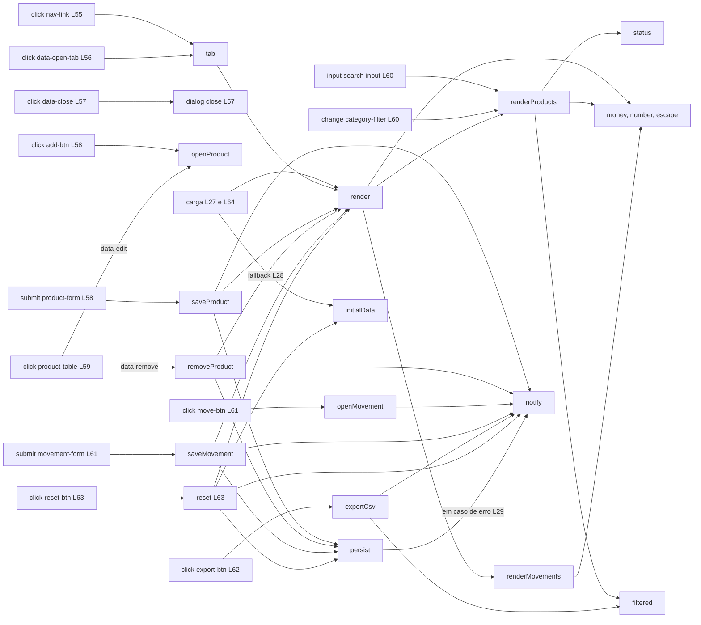
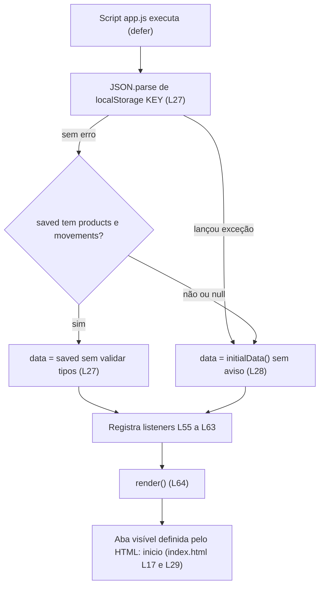
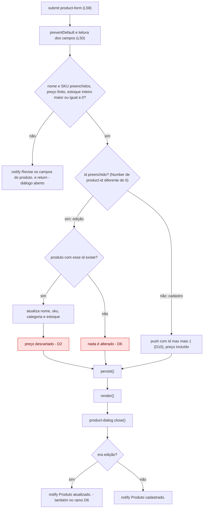
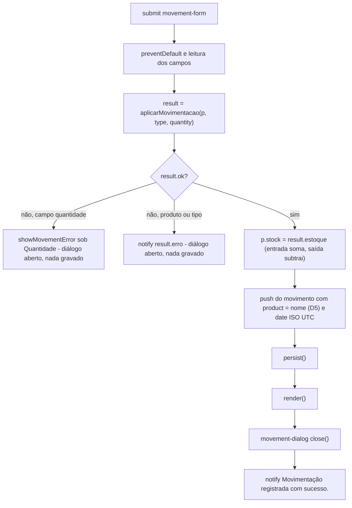
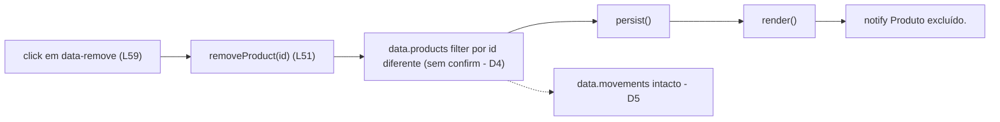
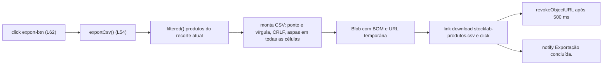
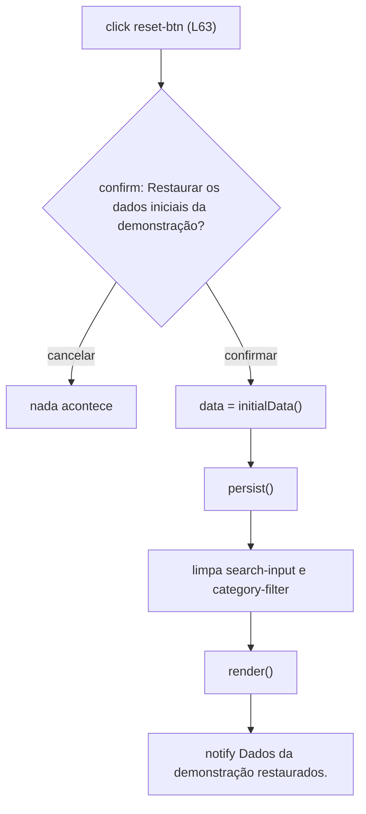
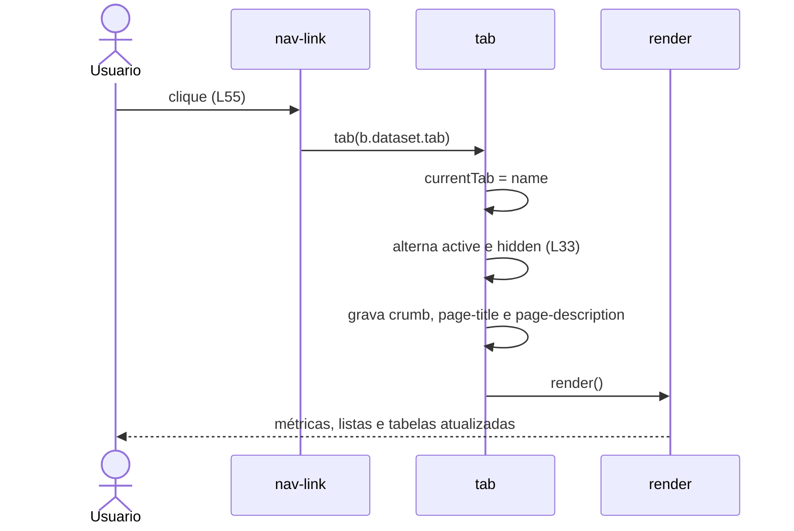

# app.js — Referência do código JavaScript

Versão documentada: StockLab v1.4 (app.js 65 linhas, index.html 54 linhas, styles.css minificado)

[Voltar ao README](README.md)

> **Nota de versão (v1.5).** As referências `Lnn` deste documento são da v1.4 original (commit `ceb1b68`); após a formatação
> Prettier da v1.5 os números de linha mudaram. Seções atualizadas na v1.5: 4.10 (`render`, `#metric-value`, issue #2), 4.17, 4.18,
> 5 (eventos do diálogo de movimentação), 7.3 e a subseção `regras.js` (4.22, com `aplicarMovimentacao` e
> `calcularValorEmEstoque`). A regra de movimentação e o cálculo do valor em estoque saíram do `app.js` e vivem em `regras.js` (a seção 1 continua
> válida para o restante: `app.js` não exporta nada nem escreve em `window`; apenas lê `window.StockLabRegras`).

Este documento descreve o que o `app.js` faz hoje, função por função, com a linha do código em cada afirmação.
Defeitos são descritos como estão, em caixas padronizadas, sem correção no texto. Os IDs `UC-xx`, `Rxx` e `Dx`
seguem o catálogo do conjunto (ver [casos-de-uso.md](casos-de-uso.md) e [regras-de-negocio.md](regras-de-negocio.md)).
A estrutura dos dados está em [modelo-de-dados.md](modelo-de-dados.md), os ids e a marcação do HTML em
[interface-html.md](interface-html.md) e as classes de estilo em [css.md](css.md).

## 1. Visão geral

- Todo o código está numa IIFE (função anônima autoinvocada) que vai de `app.js` L2 a L65, com `'use strict'` em L3.
  Nada é exportado e nada é escrito em `window`: não há globais criadas pelo arquivo.
- Não há módulos (`import`/`require`) nem chamadas de rede (`fetch`, `XMLHttpRequest`). O único armazenamento é o `localStorage` (L27, L29).
- O script é carregado com `defer` em `index.html` L9, portanto o DOM já existe quando o código roda. As chamadas `$('...')` de L58 a L63 e a primeira `render()` (L64) dependem disso.
- Estilo do código: funções pequenas, várias instruções por linha (L33, L50 e L53 concentram dezenas de instruções), HTML montado por template string e injetado com `innerHTML`.
- Não há autenticação, perfis nem checagem de permissão: qualquer usuário executa qualquer ação.

### 1.1 Dependências de runtime

| Recurso | Onde é usado |
|---|---|
| DOM: `document.getElementById`, `querySelectorAll`, `classList`, `dataset`, `closest`, `createElement`, `addEventListener` | L22, L33, L55–L63, L54 |
| `localStorage` (`getItem`, `setItem`) | L27, L29 |
| `JSON.parse` / `JSON.stringify` | L27, L29 |
| `Number.prototype.toLocaleString('pt-BR', ...)` e `Date.prototype.toLocaleDateString/toLocaleString('pt-BR')` | L23, L24, L43, L48 |
| `window.confirm` | L63 |
| `Blob`, `URL.createObjectURL`, `URL.revokeObjectURL` | L54 |
| `HTMLDialogElement.showModal()` e `close()` | L49, L50, L52, L53, L57 |
| `setTimeout` / `clearTimeout` | L32, L54 |

## 2. Mapa do arquivo por linhas

| Linhas | Conteúdo |
|---|---|
| L1 | Comentário de cabeçalho: `StockLab v1.4 - cenário fictício para continuidade de projeto.` |
| L2–L3 | Abertura da IIFE e `'use strict'` |
| L4 | Constante `KEY` (chave do `localStorage`) |
| L5–L21 | `initialData`: dados de demonstração (8 produtos, 3 movimentações) |
| L22–L25 | Helpers: `$`, `money`, `number`, `escape` |
| L26–L29 | Estado `data`, carga do `localStorage` (L27–L28) e `persist` (L29) |
| L30–L34 | Estado de UI (`currentTab`, `notificationTimer`), `notify` (L32), `tab` (L33), `status` (L34) |
| L35–L48 | Renderização: `render` (L35–L45), `filtered` (L46), `renderProducts` (L47), `renderMovements` (L48) |
| L49–L51 | Produtos: `openProduct`, `saveProduct`, `removeProduct` |
| L52–L53 | Movimentações: `openMovement`, `saveMovement` |
| L54 | Exportação: `exportCsv` |
| L55–L63 | Registro de listeners |
| L64 | Inicialização: `render()` |
| L65 | Fechamento da IIFE: `})();` |

## 3. Constantes e estado de módulo

| Nome | Linha | Tipo | Valor / papel |
|---|---|---|---|
| `KEY` | L4 | `const string` | `'stocklab.demo.v14'`, chave do `localStorage` (R01) |
| `data` | L26 | `let { products: Product[], movements: Movement[] }` | Estado único da aplicação. Atribuído na carga (L27–L28) e reatribuído em `removeProduct` (L51) e no reset (L63) |
| `currentTab` | L30 | `let string` | Inicia em `'inicio'` e é atribuída em `tab` (L33). **Variável escrita e não lida**: a busca no arquivo encontra apenas L30 e L33, nenhuma leitura |
| `notificationTimer` | L31 | `let number` | Id do `setTimeout` do toast, usado em L32 para reiniciar o tempo |
| `titles` | L33 | `const` local de `tab` | Objeto `{nome: [crumb, título, descrição]}` para as 4 abas (tabela na seção 4.8) |

Os helpers `$`, `money`, `number`, `escape`, `persist` e `status` são `const` com arrow function; `notify` e `tab` são
declarações `function`, assim como `render`, `filtered` e as demais funções de L35 a L54.

> [!NOTE]
> **Comportamento atual**
> `escape` (L25) e `status` (L34) sombreiam as globais do navegador `escape()` e `window.status`, mas só dentro da IIFE.
> Não há conflito prático, porque o código não usa as globais. Ao ler o código, `escape` significa "escapar HTML" e
> `status` significa "situação do estoque do produto".

## 4. Referência de funções

Convenção dos blocos: **Assinatura** em notação TypeScript inferida do uso (o código é JavaScript puro, sem tipos).
`Product` e `Movement` são descritos em [modelo-de-dados.md](modelo-de-dados.md).

### 4.1 `initialData`

- **Linhas:** L5–L21.
- **Assinatura:** `initialData(): { products: Product[]; movements: Movement[] }`
- **Parâmetros:** nenhum.
- **Retorno:** objeto novo a cada chamada, com 8 produtos (ids 1 a 8, L7–L14) e 3 movimentações (ids 1 a 3, L17–L19).
- **Lê:** nada.
- **Escreve / efeitos:** nenhum (função pura).
- **Chamada por:** fallback da carga (L28) e reset (L63).
- **Chama:** nada.

```js
const initialData = () => ({ products: [ {id:1,name:'Notebook Slim 14',sku:'INF-101',category:'Informática',price:2899.90,stock:7}, ... ], movements:[ ... ] });
```

As datas das movimentações de exemplo não têm fuso (`'2026-11-18T10:05:00'`, L17–L19). Resumo dos totais que o `render` calcula
sobre esses dados: 8 produtos, 61 unidades, 4 alertas e o valor em estoque R$ 25.072,00 (v1.4 exibia R$ 4.382,10; ver D3 em `render`).

> [!NOTE]
> **Comportamento atual — D13: dados de demonstração inconsistentes**
> `app.js` L7–L19: os estoques de exemplo não derivam das movimentações de exemplo. Por exemplo, "Monitor LED 24" tem
> estoque 2 e uma saída de 1 (L11, L19), e "Caneta gel azul" tem estoque 28 e uma entrada de 12 (L12, L18).
> Efeito: apenas informativo; os estoques não são recalculados a partir do histórico em nenhum ponto do código.

### 4.2 `$`

- **Linha:** L22.
- **Assinatura:** `$(id: string): HTMLElement | null`
- **Retorno:** o resultado de `document.getElementById(id)`.
- **Efeitos:** nenhum. Chamada em praticamente todas as linhas de L32 a L63.

```js
const $ = id => document.getElementById(id);
```

Não há checagem de nulo: se o elemento não existir, o acesso seguinte (`.textContent`, `.value`, `.addEventListener`) lança `TypeError` (seção 8).

### 4.3 `money`

- **Linha:** L23.
- **Assinatura:** `money(n: number | string): string`
- **Retorno:** valor em reais no formato pt-BR (por exemplo `R$ 2.899,90`); o tipo de espaço entre `R$` e o número depende do ambiente.
- **Chamada por:** L38 (métrica de valor) e L47 (coluna de preço da tabela).

```js
const money = n => Number(n).toLocaleString('pt-BR',{style:'currency',currency:'BRL'});
```

### 4.4 `number`

- **Linha:** L24.
- **Assinatura:** `number(n: number | string): string`
- **Retorno:** número com separador de milhar pt-BR.
- **Chamada por:** L36, L37, L39, L41, L43, L47, L48.

```js
const number = n => Number(n).toLocaleString('pt-BR');
```

### 4.5 `escape`

- **Linha:** L25.
- **Assinatura:** `escape(value: unknown): string`
- **Retorno:** `String(value)` com `& < > " '` trocados por `&amp; &lt; &gt; &quot; &#39;`.
- **Chamada por:** L41, L43, L47, L48, L52.

```js
const escape = value => String(value).replace(/[&<>"']/g, ch => ({'&':'&amp;', ... ,"'":'&#39;'}[ch]));
```

Todo texto digitado pelo usuário que volta ao HTML passa por `escape`: nome, SKU e categoria (L41, L47, L52), nome do produto na
movimentação (L43, L48) e observação (L48). Os pontos que entram no HTML sem `escape` são valores gerados pelo próprio código:
`p.id` em `data-edit`/`data-remove` (L47) e em `value` das opções (L52), o rótulo e a classe de `status` (L47) e os números formatados (R28).

### 4.6 `persist`

- **Linha:** L29.
- **Assinatura:** `persist(): void`
- **Lê:** `data`, `KEY`.
- **Escreve / efeitos:** `localStorage.setItem(KEY, JSON.stringify(data))`. Se lançar exceção, chama `notify('O navegador não conseguiu salvar os dados localmente.')`; a alteração fica só em memória (R04).
- **Chamada por:** `saveProduct` (L50), `removeProduct` (L51), `saveMovement` (L53) e o reset (L63).
- **Chama:** `notify`.

```js
const persist = () => {try {localStorage.setItem(KEY,JSON.stringify(data));}catch {notify('O navegador não conseguiu salvar os dados localmente.');}};
```

> [!NOTE]
> **Comportamento atual**
> `persist` é chamada antes do toast de sucesso nas quatro funções que a usam (L50, L51, L53, L63). Como `notify` só troca o texto de
> `#toast` (L32), a mensagem de erro de gravação é substituída, na mesma execução síncrona, pela mensagem de sucesso. Na prática o
> toast de erro de L29 fica sobrescrito antes de ser pintado, e o usuário vê "Produto cadastrado." (ou equivalente) mesmo sem a gravação ter ocorrido.

### 4.7 `notify`

- **Linha:** L32 (declaração `function`).
- **Assinatura:** `notify(message: string): void`
- **Parâmetros:** `message`, texto do toast.
- **Lê:** `#toast` (`index.html` L28), `notificationTimer`.
- **Escreve / efeitos:** `#toast.textContent = message`; adiciona a classe `visible`; `clearTimeout(notificationTimer)`; agenda a remoção de `visible` em 3500 ms (R29).
- **Chamada por:** L29, L50, L51, L52, L53, L54, L63.
- **Chama:** nada além de `$`.

```js
function notify(message) { const el=$('toast'); el.textContent=message; el.classList.add('visible'); clearTimeout(notificationTimer); notificationTimer=setTimeout(()=>el.classList.remove('visible'),3500); }
```

Mensagens enviadas a `notify` em todo o arquivo:

| Linha | Mensagem |
|---|---|
| L29 | "O navegador não conseguiu salvar os dados localmente." |
| L50 | "Revise os campos do produto." / "Produto atualizado." / "Produto cadastrado." |
| L51 | "Produto excluído." |
| L52 | "Cadastre um produto antes de movimentar." |
| L53 | "Verifique os dados da movimentação." / "A quantidade solicitada supera o estoque disponível." / "Movimentação registrada com sucesso." |
| L54 | "Exportação concluída." |
| L63 | "Dados da demonstração restaurados." |

### 4.8 `tab`

- **Linha:** L33 (declaração `function`).
- **Assinatura:** `tab(name: 'inicio' | 'produtos' | 'movimentacoes' | 'sobre'): void`
- **Parâmetros:** `name`, nome da aba.
- **Retorno:** nenhum.
- **Lê:** `.nav-link` (com `dataset.tab`), `.tab-content` (com `id`), `titles[name]`.
- **Escreve / efeitos, na ordem do código:**
  1. `currentTab = name`.
  2. Cada `.nav-link` recebe/perde `active` conforme `b.dataset.tab === name`.
  3. Cada `.tab-content` recebe/perde `hidden` conforme `s.id !== 'tab-' + name`.
  4. Desestrutura `[crumb, title, desc] = titles[name]` e grava `#crumb`, `#page-title` e `#page-description`.
  5. Chama `render()`.
- **Chamada por:** listeners de `.nav-link` (L55) e `[data-open-tab]` (L56). Não é chamada na carga (L64 chama `render`, não `tab`).
- **Chama:** `render`.

```js
function tab(name){ currentTab=name; for(const b of document.querySelectorAll('.nav-link')) b.classList.toggle('active',b.dataset.tab===name); ... render(); }
```

Textos do objeto `titles` (L33), formato `[crumb, título, descrição]`:

| Aba | crumb | título (`#page-title`) | descrição (`#page-description`) |
|---|---|---|---|
| `inicio` | Visão geral | Visão geral do estoque | Acompanhe os produtos, o saldo disponível e as últimas movimentações. |
| `produtos` | Produtos | Catálogo de produtos | Cadastre e mantenha as informações dos itens comercializados. |
| `movimentacoes` | Movimentações | Entradas e saídas | Consulte o histórico de movimentações e registre novas operações. |
| `sobre` | Sobre o sistema | Conheça o StockLab | Informações para a equipe responsável pela evolução desta solução. |

`tab` não altera `#search-input` nem `#category-filter`: os filtros sobrevivem à troca de aba. A aba exibida na carga é definida
pelo HTML (`nav-link active` em `index.html` L17; `tab-inicio` sem `hidden` em L29; as demais com `hidden` em L39, L45 e L46).

> [!WARNING]
> **Comportamento atual / defeito conhecido — D11: `tab()` com nome inexistente**
> `app.js` L33: `const [crumb,title,desc]=titles[name];` — se `name` não estiver em `titles`, `titles[name]` é `undefined` e a desestruturação lança `TypeError`.
> Efeito: as classes `active` e `hidden` já foram alteradas (passos 2 e 3) e `render()` não é chamado; todas as seções ficam ocultas. Não ocorre com o HTML atual, em que todos os `data-tab` (`index.html` L17–L20) e o `data-open-tab` (L37) usam nomes válidos. Sem cartão no plano v1.5.

### 4.9 `status`

- **Linha:** L34.
- **Assinatura:** `status(p: Product): [label: string, cssClass: 'zero' | 'low' | 'good']`
- **Lê:** `p.stock`.
- **Efeitos:** nenhum.
- **Chamada por:** `renderProducts` (L47).

```js
const status = p => p.stock===0 ? ['Sem estoque','zero'] : p.stock<5 ? ['Estoque baixo','low'] : ['Disponível','good'];
```

Regra (R20): estoque 0 vira "Sem estoque" (`zero`); estoque menor que 5 vira "Estoque baixo" (`low`); caso contrário "Disponível" (`good`).
O limite 5 é um literal repetido em L34, L39 e L40.

### 4.10 `render`

- **Linhas:** L35–L45.
- **Assinatura:** `render(): void`
- **Lê:** `data.products`, `data.movements`.
- **Escreve / efeitos (DOM):**
  - `#metric-products` ← `number(data.products.length)` (L36).
  - `#metric-units` ← `number(soma de p.stock)` (L37).
  - `#metric-value` ← `money(calcularValorEmEstoque(data.products))` (v1.5; v1.4: `money(soma de p.price)`, L38).
  - `#metric-alerts` ← `number(contagem de p.stock<5)` (L39).
  - `#low-stock-list` ← linhas `.item-row` dos produtos com `stock<5`, ordenados por estoque crescente, com `.qty-tag` "N unidade(s)"; lista vazia mostra "Nenhum produto em atenção neste momento." (L40–L41, R21).
  - `#recent-movements` ← as 4 últimas movimentações (`[...data.movements].reverse().slice(0,4)`, L42); lista vazia mostra "Ainda não há movimentações registradas." (L43, R23).
  - Chama `renderProducts()` e `renderMovements()` (L44).
- **Chamada por:** `tab` (L33), `saveProduct` (L50), `removeProduct` (L51), `saveMovement` (L53), reset (L63) e carga (L64).
- **Chama:** `number`, `money`, `escape`, `renderProducts`, `renderMovements`.
- Não usa `localStorage` nem toast. Recalcula tudo a cada chamada, inclusive a cada troca de aba.

```js
// v1.5 (issue #2)
$('metric-value').textContent = money(calcularValorEmEstoque(data.products));
// Histórico (v1.4, L38)
$('metric-value').textContent=money(data.products.reduce((sum,p)=>sum+p.price,0));
```

Detalhes do painel de movimentações recentes (L43): o ícone é `↗` com a classe `saida` quando `m.type==='saida'` e `↙` nos demais casos; o rótulo é
"Saída" ou "Entrada"; a data usa `toLocaleDateString('pt-BR')`; a quantidade vem com `-` para saída e `+` para qualquer outro tipo.
Com os dados de demonstração, a lista mostra, do mais recente ao mais antigo: Monitor LED 24 (saída, -1), Caneta gel azul (entrada, +12), Mouse sem fio Pro (saída, -2).
A lista de atenção mostra Webcam Full HD (0), Monitor LED 24 (2), Mouse sem fio Pro (3) e Caderno executivo A5 (4).

> [!NOTE]
> **Corrigido na v1.5 (issue #2) — D3: "Valor em estoque" soma preço × quantidade**
> O `render` usa `money(calcularValorEmEstoque(data.products))`: com os dados de demonstração o card mostra R$ 25.072,00 (v1.4: R$ 4.382,10, soma só de `p.price`). A legenda em `index.html` (card "Valor em estoque") agora é "Soma de preço × quantidade em estoque." (v1.4: "Avaliação do estoque atual"). Itens com `price`/`stock` inválidos são ignorados (ver 4.22). Cobertura: `test/unit/regras.test.js` (V1–V16) e `test/e2e/valor.e2e.test.js` (EV1–EV13). Editar só o preço ainda não muda o card porque a edição não grava o preço (D2, issue #3).

> [!WARNING]
> **Comportamento atual / defeito conhecido — D7: tipo desconhecido aparece como "Entrada" no painel**
> `app.js` L43: o teste é `m.type==='saida'`; qualquer outro valor cai no ramo de entrada (rótulo "Entrada", seta `↙`, sinal `+`).
> Efeito: uma movimentação com tipo diferente de `entrada`/`saida` seria exibida como entrada aqui e como saída no histórico (L48). O HTML só oferece `entrada` e `saida` (`index.html` L52), então hoje não ocorre pela interface. Sem cartão no plano v1.5.

### 4.11 `filtered`

- **Linha:** L46.
- **Assinatura:** `filtered(): Product[]`
- **Lê:** `#search-input.value` (com `trim()`), `#category-filter.value`, `data.products`.
- **Retorno:** produtos que satisfazem `(!cat || p.category===cat) && (!query || p.name.includes(query) || p.sku.includes(query))`.
- **Efeitos:** nenhum.
- **Chamada por:** `renderProducts` (L47) e `exportCsv` (L54).
- **Chama:** nada além de `$`.

```js
return data.products.filter(p=>(!cat||p.category===cat)&&(!query||p.name.includes(query)||p.sku.includes(query)));
```

A busca é por substring em nome OU SKU, combinada (E) com a categoria; categoria vazia significa todas (R24).

> [!WARNING]
> **Comportamento atual / defeito conhecido — D9: busca sensível a maiúsculas e acentos**
> `app.js` L46: `p.name.includes(query)` e `p.sku.includes(query)` — não há `toLowerCase()` nem normalização de acentos.
> Efeito: buscar "notebook" não encontra "Notebook Slim 14", e "informatica" não casa com "Informática" (esta última só afeta a busca de texto, pois a categoria é comparada por igualdade exata). Sem cartão no plano v1.5.

### 4.12 `renderProducts`

- **Linha:** L47.
- **Assinatura:** `renderProducts(): void`
- **Lê:** `filtered()`, `data.products.length`.
- **Escreve / efeitos (DOM):**
  - `#table-summary` ← `Exibindo X de Y produto(s)`.
  - `#product-table` ← uma `<tr>` por produto filtrado, com 6 células alinhadas ao cabeçalho de `index.html` L42: nome em `<strong>` e SKU em `<small>`; categoria; `money(price)`; `number(stock)`; `<span class="state-badge ${c}">` com o rótulo de `status`; e `.table-actions` com os botões `data-edit="${p.id}"` ("Editar") e `class="danger" data-remove="${p.id}"` ("Excluir"), ambos `type="button"`.
  - Lista vazia: `<tr><td colspan="6" style="text-align:center;padding:35px">Nenhum produto encontrado.</td></tr>`.
- **Chamada por:** `render` (L44) e pelos listeners de `#search-input` (`input`) e `#category-filter` (`change`) em L60.
- **Chama:** `filtered`, `status`, `escape`, `money`, `number`.

```js
$('table-summary').textContent=`Exibindo ${products.length} de ${data.products.length} produto(s)`;
```

Os filtros afetam só esta tabela e o CSV; as métricas e a lista de atenção não mudam (R25).

### 4.13 `renderMovements`

- **Linha:** L48.
- **Assinatura:** `renderMovements(): void`
- **Lê:** `data.movements`.
- **Escreve / efeitos (DOM):** `#movement-table` ← todas as movimentações em ordem inversa à de inserção (mais recente primeiro), com 5 células: data e hora (`toLocaleString('pt-BR')`), produto em `<strong>`, badge, quantidade e observação (`escape(m.note||'—')`). O badge é `good` com "Entrada" quando `m.type==='entrada'`, e `low` com "Saída" nos demais casos.
- **Lista vazia:** `<tr><td colspan="5">Nenhuma movimentação registrada.</td></tr>`.
- **Chamada por:** `render` (L44).
- **Chama:** `escape`, `number`.

```js
<span class="state-badge ${m.type==='entrada'?'good':'low'}">${m.type==='entrada'?'Entrada':'Saída'}</span>
```

> [!WARNING]
> **Comportamento atual / defeito conhecido — D7: tipo desconhecido aparece como "Saída" no histórico**
> `app.js` L48: o teste é `m.type==='entrada'`; qualquer outro valor cai no ramo "Saída" com badge `low`. No painel (L43) o mesmo tipo aparece como "Entrada".
> Efeito: inconsistência entre as duas telas para um tipo fora de `entrada`/`saida`; não ocorre pela interface atual (`index.html` L52). Sem cartão no plano v1.5.

### 4.14 `openProduct`

- **Linha:** L49.
- **Assinatura:** `openProduct(id?: number): void`
- **Parâmetros:** `id` opcional. Sem argumento, ou com id inexistente, abre em modo cadastro; com id existente, abre em modo edição.
- **Lê:** `data.products` (`find(x => x.id === id)`).
- **Escreve / efeitos (DOM):** `#product-form.reset()`; `#product-dialog-title` ← "Editar produto" ou "Novo produto"; preenche `#product-id` (`p?.id ?? ''`), `#input-name`, `#input-sku`, `#input-category` (padrão `'Informática'`), `#input-price` e `#input-stock` (vazios em cadastro); por fim `#product-dialog.showModal()`.
- **Chamada por:** `#add-btn` (L58, via `()=>openProduct()`) e delegação de `#product-table` (L59, com `Number(edit.dataset.edit)`).
- **Chama:** nada além de `$`.

```js
$('input-category').value=p?.category??'Informática';  ...  $('product-dialog').showModal();
```

O listener de L58 usa `()=>openProduct()` em vez de passar `openProduct` direto; assim o evento de clique não é recebido como `id`.
O campo `#product-id` (`type="hidden"`, `index.html` L51) é o que distingue cadastro de edição na hora de salvar.

### 4.15 `saveProduct`

- **Linha:** L50.
- **Assinatura:** `saveProduct(event: SubmitEvent): void`
- **Parâmetros:** `event`, o evento `submit` de `#product-form`; só `preventDefault()` é usado.
- **Retorno:** nenhum.
- **Lê:** `#product-id`, `#input-name` e `#input-sku` (com `trim()`), `#input-category` (sem `trim`), `#input-price` e `#input-stock` (via `Number`), `data.products`.
- **Escreve / efeitos:** em caso de sucesso, altera `data.products` (edição ou `push`), chama `persist()`, `render()`, `#product-dialog.close()` e `notify(id ? 'Produto atualizado.' : 'Produto cadastrado.')`. Em caso de erro de validação, apenas `notify('Revise os campos do produto.')`.
- **Chamada por:** evento `submit` de `#product-form` (L58).
- **Chama:** `notify`, `persist`, `render`.

Passo a passo (todos em L50):

1. `event.preventDefault()`.
2. `id = Number($('product-id').value)`. Valor vazio vira `0`, falsy, e significa cadastro.
3. Lê `name`, `sku` (com `trim()`), `category`, `price = Number(...)` e `stock = Number(...)`.
4. Validação: `!name || !sku || !Number.isFinite(price) || !Number.isInteger(stock) || stock<0`. Se falhar, `notify('Revise os campos do produto.')` e `return` (R05, R06, R07).
5. Se `id` é truthy (edição): `p = data.products.find(x=>x.id===id)`; se `p` existe, atualiza `name`, `sku`, `category` e `stock`.
6. Senão (cadastro): `data.products.push({id: Math.max(0, ...ids) + 1, name, sku, category, price, stock})` (R10).
7. `persist()`, `render()`, `close()` e o toast.

```js
if(id){const p=data.products.find(x=>x.id===id);if(p){p.name=name;p.sku=sku;p.category=category;p.stock=stock;}}else{data.products.push({id:Math.max(0,...data.products.map(p=>p.id))+1,name,sku,category,price,stock});}
```

**Interação com `<form method="dialog">` e `preventDefault()`.** O formulário é `method="dialog"` (`index.html` L51). Esse método, por padrão, fecharia o
`<dialog>` ao enviar; `event.preventDefault()` (L50) cancela esse comportamento. Por isso o diálogo só fecha pelo `$('product-dialog').close()` do passo 7,
ou seja, apenas quando a validação passa. Em caso de erro (passo 4) o diálogo continua aberto e o usuário vê o toast. Antes de o evento `submit` ser disparado,
o navegador já aplica as restrições do HTML: `required` em nome, SKU, preço e quantidade, `maxlength` 70 e 20, `min="0"` e `step` (`index.html` L51). Elas
impedem o envio com campos vazios, de modo que `Number('') === 0` (que passaria em `Number.isFinite` e `Number.isInteger`) só chegaria ao JS se o HTML fosse contornado.

> [!WARNING]
> **Comportamento atual / defeito conhecido — D2: edição não grava o preço**
> `app.js` L50: `if(p){p.name=name;p.sku=sku;p.category=category;p.stock=stock;}` — não há `p.price=price`; o preço só entra no `push` do cadastro.
> Efeito: o campo de preço aparece preenchido na edição (L49) e é validado com `Number.isFinite`, mas o valor digitado é descartado e o toast diz "Produto atualizado.". Tratado no plano v1.5, cartão #3.

> [!WARNING]
> **Comportamento atual / defeito conhecido — D6: "Produto atualizado." mesmo sem produto**
> `app.js` L50: o `if(p){...}` não tem `else`; depois dele o fluxo segue para `persist()`, `render()`, `close()` e `notify(id?'Produto atualizado.':...)`.
> Efeito: se o id do formulário não existir em `data.products`, nada é alterado, mas o usuário é informado de que o produto foi atualizado. Não ocorre pela interface atual, em que o id vem de um botão gerado a partir de `data.products`. Tratado no plano v1.5, cartão #3 (citado).

> [!WARNING]
> **Comportamento atual / defeito conhecido — D8: SKU duplicado permitido**
> `app.js` L50: não há comparação do `sku` com os existentes, nem no cadastro nem na edição.
> Efeito: dois produtos podem ter o mesmo SKU (R09). Sem cartão no plano v1.5.

> [!WARNING]
> **Comportamento atual / defeito conhecido — D10: id por máximo + 1 pode ser reutilizado**
> `app.js` L50: `id:Math.max(0,...data.products.map(p=>p.id))+1` (mesma técnica para movimentações em L53).
> Efeito: se o produto de maior id for excluído, o próximo cadastro recebe o mesmo id; como as movimentações guardam o nome e não o id (D5), o reuso não cria vínculo entre movimentações, mas o id deixa de identificar de forma única um produto ao longo do tempo. Sem cartão no plano v1.5.

### 4.16 `removeProduct`

- **Linha:** L51.
- **Assinatura:** `removeProduct(id: number): void`
- **Parâmetros:** `id`, id do produto.
- **Lê:** `data.products`.
- **Escreve / efeitos:** `data.products = data.products.filter(p => p.id !== id)`; `persist()`; `render()`; `notify('Produto excluído.')`. Não mexe em `data.movements`.
- **Chamada por:** delegação de `#product-table` (L59, com `Number(remove.dataset.remove)`).
- **Chama:** `persist`, `render`, `notify`.

```js
function removeProduct(id){data.products=data.products.filter(p=>p.id!==id);persist();render();notify('Produto excluído.');}
```

> [!WARNING]
> **Comportamento atual / defeito conhecido — D4: exclusão sem confirmação**
> `app.js` L51 e L59: o clique em "Excluir" chama `removeProduct` diretamente; não há `confirm` (o único `confirm` do arquivo está em L63, no reset).
> Efeito: um clique acidental apaga o produto imediatamente e persiste a remoção. Tratado no plano v1.5, cartão #4.

> [!WARNING]
> **Comportamento atual / defeito conhecido — D5: movimentações órfãs**
> `app.js` L51 e L53: a exclusão não toca em `data.movements`, e as movimentações guardam `product: p.name` (nome, não id).
> Efeito: o histórico continua exibindo o nome do produto excluído; após renomear um produto (edição, L50) o histórico mantém o nome antigo; produtos com nomes repetidos se confundem no histórico. Tratado no plano v1.5, cartão #5.

### 4.17 `openMovement`

- **Linha:** v1.4 L52 (referência original; a posição mudou com o Prettier).
- **Assinatura:** `openMovement(): void`
- **Lê:** `data.products`.
- **Escreve / efeitos:**
  - Se `data.products.length === 0`: `notify('Cadastre um produto antes de movimentar.')` e `return` (R13); o diálogo não abre.
  - Senão: `#movement-form.reset()`; `#move-product.innerHTML` ← uma `<option value="${p.id}">` por produto, com texto `${escape(p.name)} · ${escape(p.sku)}`; **(v1.5)** `clearMovementError()` e `updateMovementBalance()`; `#movement-dialog.showModal()`.
- **Chamada por:** `#move-btn`.
- **Chama:** `notify`, `escape`, `clearMovementError`, `updateMovementBalance`.

As opções são recriadas a cada abertura, e o `reset()` devolve `#move-type` ao primeiro item ("Entrada") e `#move-quantity` ao valor `1` (atributo `value="1"`).
Na v1.5 o diálogo abre sem erro visível e já com a prévia `#move-balance` preenchida (por exemplo, `Saldo atual: 3 un. · Após a entrada: 4 un.`).

#### Helpers do diálogo de movimentação (v1.5)

| Função | O que faz |
|---|---|
| `selectedMovementProduct()` | Devolve o produto de `#move-product` (`data.products.find(x => x.id === Number(...))`) ou `undefined`. |
| `clearMovementError()` | Esvazia e oculta `#move-quantity-error` (`textContent = ''`, `hidden = true`) e remove `aria-invalid` de `#move-quantity`. |
| `showMovementError(message)` | Mostra `message` em `#move-quantity-error` (via `textContent`), marca `#move-quantity` com `aria-invalid="true"` e devolve o foco a ele. |
| `updateMovementBalance()` | Escreve em `#move-balance` (via `textContent`) `Saldo atual: X un.` e, se `aplicarMovimentacao` aceitar a quantidade digitada, ` · Após a saída: Y un.` (ou `Após a entrada`). Sem produto, esvazia o texto. |
| `onMovementFieldChange()` | `clearMovementError()` e `updateMovementBalance()`; é o handler de `change` de `#move-product` e `#move-type` e de `input` de `#move-quantity`. |

### 4.18 `saveMovement`

- **Linha:** v1.4 L53 (referência original).
- **Assinatura:** `saveMovement(event: SubmitEvent): void`
- **Parâmetros:** `event`, o evento `submit` de `#movement-form`; só `preventDefault()` é usado.
- **Retorno:** nenhum.
- **Lê:** `#move-type`, `#move-quantity` (`Number`), `#move-note` (com `trim()`) e o produto `p = selectedMovementProduct()`.
- **Escreve / efeitos:** em caso de sucesso, `p.stock = result.estoque` (entrada soma, saída subtrai), `data.movements.push(...)`, `persist()`, `render()`, `#movement-dialog.close()` e `notify('Movimentação registrada com sucesso.')`. Em erro, nada é gravado nem persistido e o diálogo continua aberto.
- **Chamada por:** evento `submit` de `#movement-form`.
- **Chama:** `selectedMovementProduct`, `aplicarMovimentacao` (de `regras.js`), `showMovementError`, `notify`, `persist`, `render`.

Passo a passo (v1.5):

1. `event.preventDefault()` é a primeira instrução; depois lê tipo, quantidade (`Number(...)`), observação e produto.
2. `result = aplicarMovimentacao(p, type, quantity)`. Toda a validação (produto, tipo, quantidade inteira maior que zero e saída maior que o saldo) está na regra pura, na ordem produto, tipo, quantidade, saldo (R14, R15).
3. Se `!result.ok`: quando `result.campo === 'quantidade'`, `showMovementError(result.erro)` (mensagem sob o campo Quantidade, com foco e `aria-invalid`); nos demais casos (`produto`, `tipo`), `notify(result.erro)`. Em ambos, `return`: não há `push`, `persist` nem `close`.
4. `p.stock = result.estoque` (R16 para entrada; R17 para saída, que agora subtrai).
5. `data.movements.push({id: Math.max(0, ...ids) + 1, product: p.name, type, quantity, note, date: new Date().toISOString()})` (R10, R18), com os mesmos campos da v1.4. Como a regra só aceita `entrada` e `saida`, um tipo desconhecido não chega mais ao histórico por esta tela.
6. `persist()`, `render()`, `close()` e o toast de sucesso.

**Interação com `<form method="dialog">` e `preventDefault()`.** `#movement-form` é `method="dialog"`, e `event.preventDefault()` impede o fechamento automático; o diálogo só fecha pelo `close()` do passo 6.
Na v1.5 o formulário tem `novalidate`: o navegador não bloqueia mais quantidade vazia, `0`, negativa ou decimal com balão nativo (cujo texto varia entre Chrome e Firefox). Esses valores chegam ao JS e recebem a mesma mensagem, `Informe uma quantidade inteira maior que zero.`, em `#move-quantity-error` (`role="alert"`). Os atributos `required`, `min="1"` e `step="1"` continuam no input por semântica e teclado.
O erro some quando o usuário altera produto, tipo ou quantidade (`onMovementFieldChange`) e ao reabrir o diálogo.

> [!NOTE]
> **Corrigido na v1.5 (issue #1) — D1: saída agora reduz o estoque**
> `saveMovement` usa `aplicarMovimentacao` e grava `p.stock = result.estoque`: a saída subtrai e uma saída maior que o saldo é bloqueada com `Saída de X un. maior que o saldo atual (Y un.) de <produto>.`, sem alterar saldo nem histórico. Cobertura: `test/unit/regras.test.js` e `test/e2e/movimentacao.e2e.test.js`. Saldos gravados no navegador pela v1.4 continuam inflados até "Restaurar dados" (ver `LEIA-ME.txt`).

> [!WARNING]
> **Comportamento atual / defeito conhecido — D5: movimentação referencia o produto pelo nome**
> `app.js` L53: `product:p.name` — o registro guarda o nome no momento da operação, não o id.
> Efeito: renomear (L50) ou excluir (L51) o produto deixa o histórico com o nome antigo ou órfão, e dois produtos com o mesmo nome (L50 não checa nome repetido) são indistinguíveis no histórico. Tratado no plano v1.5, cartão #5.

> [!WARNING]
> **Comportamento atual / defeito conhecido — D7: tipo de movimentação não validado**
> `app.js` L53: `type=$('move-type').value` é usado sem checar se é `entrada` ou `saida`.
> Efeito: um tipo desconhecido é gravado sem alterar o estoque e sem passar pela checagem de saída; depois aparece como "Entrada" no painel (L43) e como "Saída" no histórico (L48). O HTML só oferece `entrada` e `saida` (`index.html` L52), então a interface atual não produz esse caso. Sem cartão no plano v1.5.

### 4.19 `exportCsv`

- **Linha:** L54.
- **Assinatura:** `exportCsv(): void`
- **Lê:** `filtered()` (respeita busca e categoria atuais).
- **Escreve / efeitos:** monta o CSV, cria `Blob` e URL temporária, cria um `<a>` com `download='stocklab-produtos.csv'`, chama `a.click()`, agenda `URL.revokeObjectURL` em 500 ms e chama `notify('Exportação concluída.')`. Não usa `localStorage`.
- **Chamada por:** `#export-btn` (L62).
- **Chama:** `filtered`, `notify`.

Montagem do arquivo (R26):

- Cabeçalho: `['Código','Nome','Categoria','Preço','Estoque']`; linhas: `[p.sku, p.name, p.category, p.price, p.stock]` (a coluna "Código" recebe o SKU).
- Cada célula vira `"` + valor com `"` duplicado + `"`; células unidas por `;` e linhas por `\r\n`.
- O conteúdo do `Blob` é `'' + csv` (BOM UTF-8), tipo `text/csv;charset=utf-8`.
- O `<a>` não é inserido no documento; o clique é disparado no elemento solto.
- Se o filtro não retornar produtos, o CSV contém só o cabeçalho.

```js
const csv=[header,...lines].map(a=>a.map(value=>'"'+String(value).replace(/"/g,'""')+'"').join(';')).join('\r\n');
```

> [!WARNING]
> **Comportamento atual / defeito conhecido — D12: preço bruto com ponto decimal no CSV**
> `app.js` L54: o preço entra como `p.price` e vira `String(value)`, por exemplo `2899.9`, entre aspas e sem formatação de moeda.
> Efeito: com separador `;` (convenção de planilha pt-BR), o valor `"2899.9"` pode não ser reconhecido como número em uma planilha configurada para vírgula decimal. Sem cartão no plano v1.5.

### 4.20 Handler de delegação da tabela de produtos

- **Linha:** L59 (arrow anônima no `click` de `#product-table`).
- **Assinatura:** `(e: MouseEvent): void`
- **Lê:** `e.target.closest('[data-edit]')` e `e.target.closest('[data-remove]')`.
- **Efeitos:** se achar `data-edit`, chama `openProduct(Number(edit.dataset.edit))`; se achar `data-remove`, chama `removeProduct(Number(remove.dataset.remove))`.
- **Chama:** `openProduct`, `removeProduct`.

```js
$('product-table').addEventListener('click',e=>{const edit=e.target.closest('[data-edit]'),remove=e.target.closest('[data-remove]');if(edit)openProduct(Number(edit.dataset.edit));if(remove)removeProduct(Number(remove.dataset.remove));});
```

A delegação existe porque os botões são recriados a cada `renderProducts` (L47); o listener fica no `<tbody>`, que é estável. São dois `if` independentes
(não `else if`), mas um clique só atinge um dos botões por vez.

### 4.21 Handler anônimo de reset

- **Linha:** L63 (arrow anônima no `click` de `#reset-btn`).
- **Assinatura:** `(): void`
- **Lê:** resultado de `confirm('Restaurar os dados iniciais da demonstração? As alterações feitas neste navegador serão perdidas.')`.
- **Escreve / efeitos (se confirmado):** `data = initialData()`; `persist()`; `#search-input.value = ''`; `#category-filter.value = ''`; `render()`; `notify('Dados da demonstração restaurados.')`. Se cancelado, nada acontece.
- **Chamada por:** clique em `#reset-btn` (`index.html` L27).
- **Chama:** `confirm`, `initialData`, `persist`, `render`, `notify`.

```js
if(confirm('Restaurar os dados iniciais da demonstração? ...')){data=initialData();persist();$('search-input').value='';$('category-filter').value='';render();notify('Dados da demonstração restaurados.');}
```

Não muda de aba (`tab` não é chamada) e não fecha diálogos (R27). Como `#reset-btn` fica no bloco `hero` do `index.html` (L27), fora das seções `.tab-content`, o botão está disponível em todas as abas; o mesmo vale para `#add-btn`.

### 4.22 `regras.js`: `aplicarMovimentacao` e `calcularValorEmEstoque` (v1.5)

`regras.js` (raiz do projeto) contém a regra de movimentação como função pura, sem DOM, sem `Date` e sem `localStorage`. É um UMD mínimo (IIFE): no navegador publica `window.StockLabRegras`; no Node, `module.exports`. É carregado por `<script defer src="regras.js">` antes de `app.js`, e `app.js` faz `const { aplicarMovimentacao, calcularValorEmEstoque } = window.StockLabRegras;` logo após `'use strict'`. Sem `import`/`export` (não funcionam via `file://`). O objeto exportado é congelado e expõe só `aplicarMovimentacao` e `calcularValorEmEstoque` (nesta ordem).

`aplicarMovimentacao(produto, tipo, quantidade)` não altera `produto` e valida nesta ordem: produto, tipo, quantidade, saldo.

| Situação | Retorno |
|---|---|
| Entrada válida | `{ ok: true, estoque: produto.stock + quantidade }` |
| Saída válida (`quantidade <= stock`) | `{ ok: true, estoque: produto.stock - quantidade }` |
| Produto inválido (não objeto, sem `name` texto ou `stock` inteiro >= 0) | `{ ok: false, estoque: null, campo: 'produto', erro: 'Selecione um produto válido.' }` |
| Tipo diferente de `'entrada'`/`'saida'` (exato, sem trim) | `{ ok: false, estoque: stock, campo: 'tipo', erro: 'Tipo de operação inválido.' }` |
| Quantidade que não é número inteiro seguro maior que zero (string, `NaN`, decimal, 0, negativa) | `{ ok: false, estoque: stock, campo: 'quantidade', erro: 'Informe uma quantidade inteira maior que zero.' }` |
| Saída maior que o saldo | `{ ok: false, estoque: stock, campo: 'quantidade', erro: 'Saída de X un. maior que o saldo atual (Y un.) de <produto>.' }` |

No sucesso o objeto tem só `ok` e `estoque`. O nome do produto entra cru na mensagem; a interface a exibe com `textContent`. O saldo nunca fica negativo (decisão provisória; a pergunta ao cliente segue pendente).

#### `calcularValorEmEstoque(produtos)` (issue #2)

Função pura que devolve o valor do estoque: Σ `price × stock`. Chamada por `render` para o card "Valor em estoque" e pensada para ser reutilizada no `GET /api/resumo` do back-end Node.

- **Entrada:** array de objetos com `price` e `stock`. Se não for array (`undefined`, `null`, objeto, texto, número, array-like), retorna `0`.
- **Saída:** número em reais, `>= 0`, finito, nunca `-0` nem `NaN`, com no máximo 2 casas decimais (é `centavos / 100`); pode ir direto para `money()` ou para JSON.
- **Cálculo em centavos inteiros:** cada preço vira `Math.round(price * 100)` e é multiplicado por `stock`; os centavos são somados e divididos por 100 uma única vez no fim. Assim não há erro de ponto flutuante (por exemplo `0.1 + 0.2` vale `0.3` e `89.9 × 3` vale `269.7`). Preço com mais de 2 casas (só por dado adulterado) é arredondado por unidade.
- **Itens inválidos são ignorados** (contribuem 0), sem coerção de tipo: elemento que não é objeto; `price` que não é número finito `>= 0` (inclusive strings numéricas como `'89.9'`, `null`, `NaN`, `Infinity`, negativos e valores cujos centavos não são inteiro seguro); `stock` que não é inteiro seguro `>= 0` (inclusive `'3'`, decimais e negativos). Os demais itens continuam somando.
- **Limite:** exato até `Number.MAX_SAFE_INTEGER` centavos (R$ 90.071.992.547.409,91); acima disso o resultado continua finito e `>= 0`, porém aproximado.
- Não altera a entrada (funciona com array e objetos congelados) e nunca lança.

Consequência conhecida: com dado adulterado a tabela de produtos pode exibir `money('89.9')` (R$ 89,90) ou `R$ NaN` no preço, mas o card não conta esse item; o saneamento de dados corrompidos é a issue #5.

## 5. Listeners (L55–L63)

| Linha | Seletor | Evento | Ação | UC |
|---|---|---|---|---|
| L55 | `.nav-link` (todos) | `click` | `tab(b.dataset.tab)` | UC-02 |
| L56 | `[data-open-tab]` (hoje só o botão "Ver todas" em `index.html` L37) | `click` | `tab(b.dataset.openTab)` | UC-02, UC-08 |
| L57 | `[data-close]` (botões de `index.html` L51 e L52) | `click` | `$(b.dataset.close).close()` | UC-11 |
| L58 | `#add-btn` | `click` | `openProduct()` | UC-04 |
| L58 | `#product-form` | `submit` | `saveProduct` | UC-04, UC-05 |
| L59 | `#product-table` (delegação) | `click` | `openProduct(Number(...))` ou `removeProduct(Number(...))` | UC-05, UC-06 |
| L60 | `#search-input` | `input` | `renderProducts` | UC-03 |
| L60 | `#category-filter` | `change` | `renderProducts` | UC-03 |
| L61 | `#move-btn` | `click` | `openMovement` | UC-07 |
| L61 | `#movement-form` | `submit` | `saveMovement` | UC-07 |
| v1.5 | `#move-product` | `change` | `onMovementFieldChange` | UC-07 |
| v1.5 | `#move-type` | `change` | `onMovementFieldChange` | UC-07 |
| v1.5 | `#move-quantity` | `input` | `onMovementFieldChange` | UC-07 |
| L62 | `#export-btn` | `click` | `exportCsv` | UC-09 |
| L63 | `#reset-btn` | `click` | arrow inline (seção 4.21) | UC-10 |

Os listeners são registrados uma única vez, na carga. Os de L55, L56 e L57 usam `forEach` sobre elementos já presentes no HTML estático.
UC-01 (consultar painel) não tem listener próprio: é a `render()` de L64 e a aba `inicio`. UC-12 (persistir) é chamado de dentro das funções, não por evento.

## 6. Grafo de chamadas

Origem: eventos (nós `EVT_`) e a inicialização. Destino: funções. Os helpers de formatação (`money`, `number`, `escape`) estão agrupados num só nó.



## 7. Fluxos

### 7.1 Inicialização

O script roda depois do parse do HTML (`defer`, `index.html` L9). A carga lê o `localStorage` (L27); se não houver dados válidos ou ocorrer erro, usa a demonstração sem aviso (L28).
Em seguida os listeners são registrados (L55–L63) e `render()` desenha a tela (L64). A carga não grava: a demonstração só é persistida na primeira ação que chame `persist()` (R03).



### 7.2 Salvar produto

Cobre UC-04 (cadastrar) e UC-05 (editar). O ramo de edição não grava o preço (D2) e, se o id não existir, ainda mostra "Produto atualizado." (D6).
O diálogo só fecha no fim do caminho de sucesso (`close()`); em erro de validação ele permanece aberto.



### 7.3 Registrar movimentação

Fluxo mais importante da aplicação (UC-07). Desde a v1.5, entrada soma e saída subtrai (D1 corrigido), com a validação centralizada em `aplicarMovimentacao`.
O registro grava o nome do produto (D5) e a data em ISO UTC.



### 7.4 Excluir produto

O clique em "Excluir" vai direto de `removeProduct` ao `filter`, sem confirmação (D4). As movimentações do produto permanecem como estão (D5).



### 7.5 Exportar CSV

O CSV usa `filtered()`, portanto reflete a busca e a categoria selecionadas no momento do clique. Não grava nada no `localStorage`.



### 7.6 Restaurar dados da demonstração

O botão pede confirmação com `confirm`. Se confirmado, os dados voltam ao estado inicial, são gravados e os filtros são limpos; a aba atual não muda.



### 7.7 Troca de aba

Os dois tipos de gatilho (menu lateral, L55, e botão "Ver todas", L56) chamam `tab(nome)`. A função alterna as classes, atualiza os três textos de cabeçalho
e termina com `render()`, que redesenha métricas, listas e tabelas. Um nome fora de `titles` interrompe no passo dos textos (D11).



## 8. Dependências do DOM

A tabela completa de ids, atributos `data-*` e elementos esperados pelo JS está em [interface-html.md](interface-html.md) (não repetida aqui).
Pontos relevantes para quem lê o JS:

- **Ids acoplados:** o JS usa os ids literais (`toast`, `crumb`, `page-title`, `metric-*`, `product-table`, `movement-table`, `*-dialog`, `*-form`, `input-*`, `move-*`, entre outros) e os ids `tab-<nome>` montados por template em L33. Renomear um id no HTML exige alterar o JS.
- **Atributos `data-*`:** `data-tab` (L33, L55), `data-open-tab` (L56), `data-close` (L57), `data-edit` e `data-remove` (gerados em L47, lidos em L59).
- **`$(id)` sem o elemento:** `document.getElementById` devolve `null` e o acesso seguinte lança `TypeError`. Não há checagem em nenhum ponto. Como o registro dos listeners é sequencial (L55–L63), um id ausente interrompe o script naquela linha e os listeners seguintes não são registrados.
- **Classes que o JS alterna:** `active` (L33, em `.nav-link`), `hidden` (L33, em `.tab-content`), `visible` (L32, em `#toast`).
- **Classes que o JS gera nos templates:**
  - painel (L41, L43): `item-row`, `item-name`, `item-sub`, `qty-tag`, `empty`, `movement-meta`, `movement-type` (com `saida` quando a movimentação é saída);
  - tabela de produtos (L47): `state-badge` com `good`, `low` ou `zero`, `table-actions` e `danger` (no botão Excluir);
  - histórico (L48): `state-badge` com `good` (entrada) ou `low` (demais).
- **Estilo inline gerado pelo JS:** apenas na linha de lista vazia da tabela de produtos (L47: `style="text-align:center;padding:35px"`).
- Os significados visuais das classes estão em [css.md](css.md).

## 9. Pontos de extensão (onde estão os valores fixos)

| Valor fixo | Onde está |
|---|---|
| Limite de estoque baixo (`5`) | L34 (`p.stock<5`), L39 (contagem) e L40 (lista): literal repetido em três lugares |
| Duração do toast (3500 ms) | L32 |
| Revogação da URL do CSV (500 ms) | L54 |
| Quantidade de movimentações no painel (4) | L42 (`slice(0,4)`) |
| Categoria padrão do cadastro (`'Informática'`) | L49 |
| Lista de categorias | Não está no JS: vem de `index.html` L41 (filtro) e L51 (formulário) |
| Tipos de movimentação | Não estão no JS: vêm de `index.html` L52; o JS compara com os literais `'entrada'` e `'saida'` em L43, L48 e L53 |
| Nome do arquivo CSV (`stocklab-produtos.csv`) | L54 |
| Colunas, separador (`;`), quebra de linha (`\r\n`) e BOM do CSV | L54 |
| Chave do `localStorage` | L4 (`KEY`) |
| Moeda e idioma (`BRL`, `pt-BR`) | L23, L24, L43, L48 |
| Textos de aba (`titles`) | L33 |
| Textos de toast e do `confirm` | Ver tabela da seção 4.7 e L63 |
| Dados de demonstração | L5–L21 |
