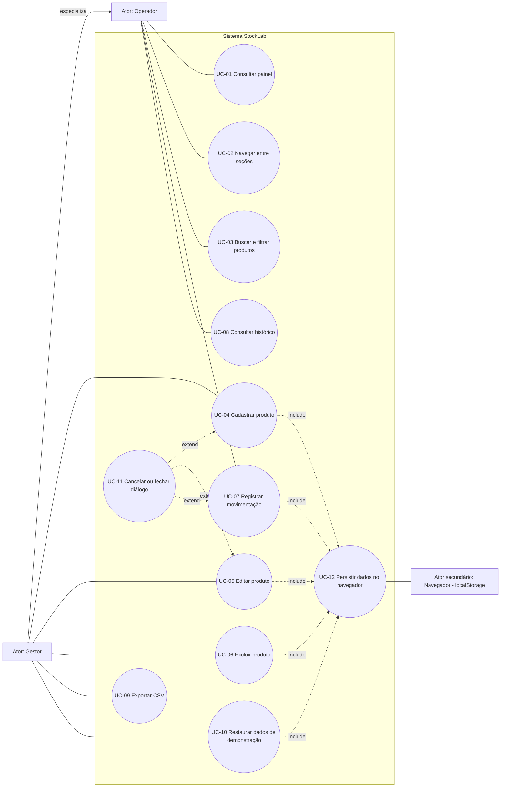
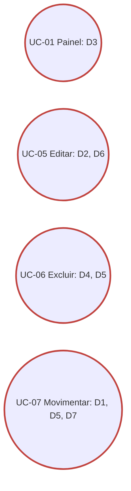
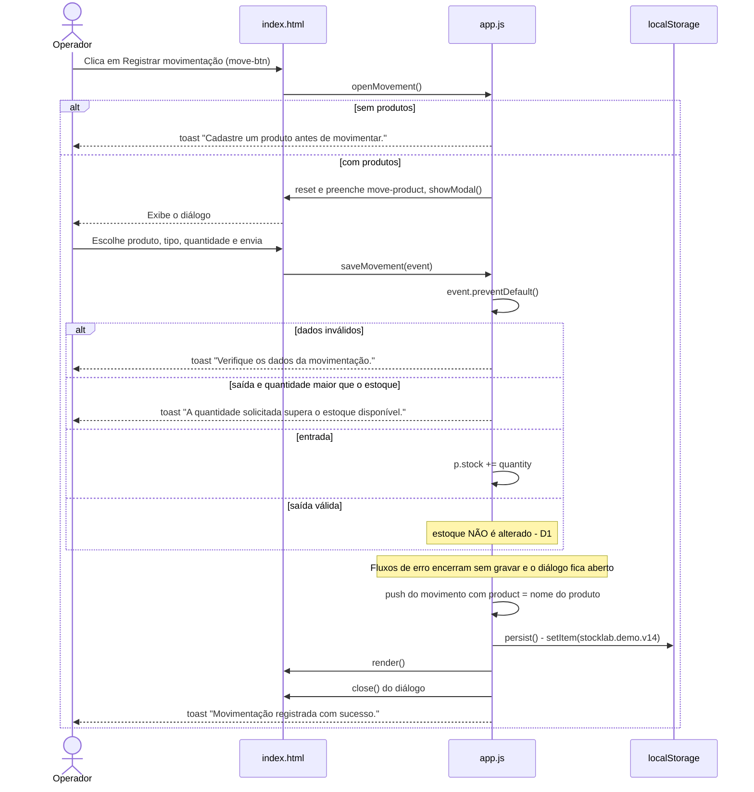
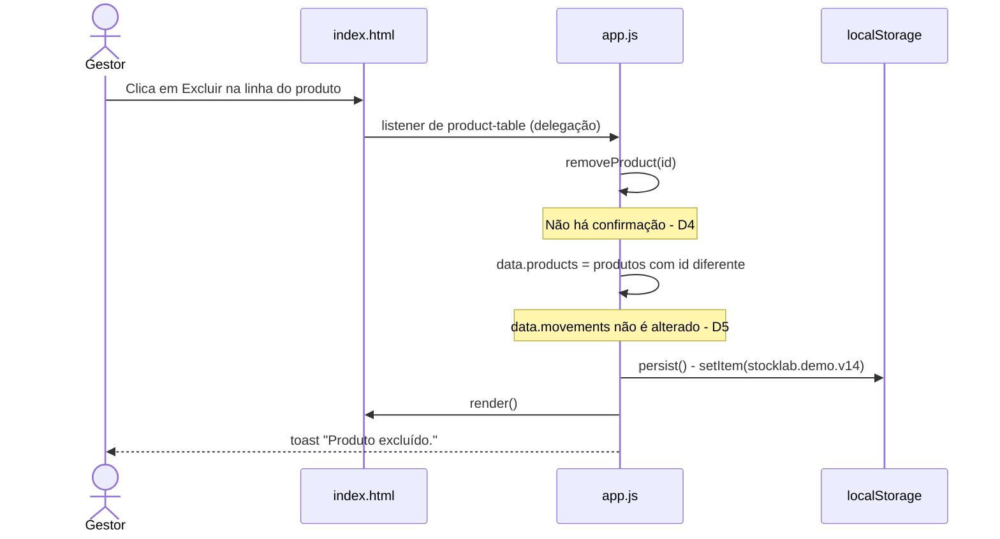
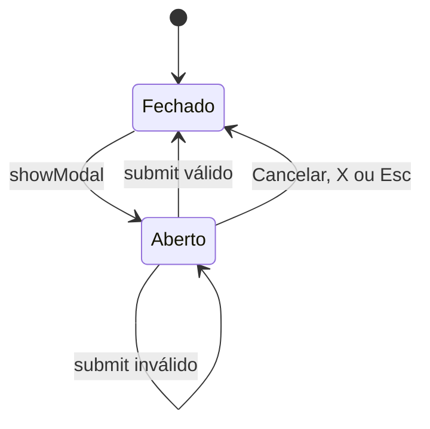

# Casos de uso do StockLab

Versão documentada: StockLab v1.4 (app.js 65 linhas, index.html 54 linhas, styles.css minificado)

[Voltar ao README](README.md)

## 1. Escopo

Este documento descreve os casos de uso **como estão implementados na v1.4**, não como deveriam ser. Cada passo cita a
linha do código (`app.js L53`, `index.html L51`). Onde o comportamento atual diverge do esperado, há uma caixa de defeito
com o identificador (D1 a D14) e, quando existe, o cartão do plano v1.5 (`docs/plano-v1.5.md`).

Documentos relacionados: regras citadas (R01 a R29) em [regras-de-negocio.md](regras-de-negocio.md); funções em
[app-js.md](app-js.md); estrutura de `data` em [modelo-de-dados.md](modelo-de-dados.md); elementos de tela em
[interface-html.md](interface-html.md).

## 2. Atores

| Ator | Tipo | Base no código/HTML |
|---|---|---|
| Operador | primário | `index.html` L46: "Público: Operadores e gestores"; LEIA-ME |
| Gestor | primário, especializa Operador (herda todos os casos de uso do Operador) | idem |
| Navegador (localStorage) | secundário / sistema externo | `app.js` L27, L29, L63 |

> [!NOTE]
> **Comportamento atual**
> O código não tem autenticação, perfis nem controle de acesso: não há login, papel de usuário nem verificação de
> permissão em nenhuma função de `app.js`. Qualquer pessoa com acesso ao navegador executa qualquer caso de uso. A
> separação Operador/Gestor vem apenas do texto "Público: Operadores e gestores" (`index.html` L46) e é **conceitual**,
> uma sugestão de responsabilidade de negócio. O avatar "SL" e o selo "Demonstração" (`index.html` L25) são decorativos.

Atribuição conceitual adotada neste documento:

- Operador: UC-01, UC-02, UC-03, UC-07, UC-08, UC-11.
- Gestor: herda tudo do Operador e acrescenta UC-04, UC-05, UC-06, UC-09, UC-10.
- UC-12 (persistência) é incluído pelos demais e se comunica com o Navegador.

## 3. Diagrama de casos de uso

O Mermaid não possui sintaxe nativa de diagrama de casos de uso; por isso usa-se `flowchart LR`.

Legenda:

- Elipse (círculo duplo): caso de uso. Retângulo: ator.
- Linha cheia sem seta: associação ator - caso de uso.
- Seta "especializa": generalização de atores (Gestor herda os casos de uso do Operador).
- Linha tracejada com rótulo `include`: o caso de origem sempre executa o UC-12 (origem aponta para o incluído).
- Linha tracejada com rótulo `extend`: o UC-11 estende o diálogo de UC-04, UC-05 ou UC-07 quando o usuário desiste. Na
  notação UML a seta de `extend` aponta do estendido para o estendido-base; aqui o desenho segue o modelo do projeto
  (origem UC-11, destino o caso estendido).

### 3.1 Matriz Ator x Caso de uso

X = associação direta, H = herdado (Gestor herda do Operador), - = sem associação.

| Caso de uso | Operador | Gestor | Navegador |
|---|---|---|---|
| UC-01 Consultar painel | X | H | - |
| UC-02 Navegar entre seções | X | H | - |
| UC-03 Buscar e filtrar produtos | X | H | - |
| UC-04 Cadastrar produto | - | X | - |
| UC-05 Editar produto | - | X | - |
| UC-06 Excluir produto | - | X | - |
| UC-07 Registrar movimentação | X | H | - |
| UC-08 Consultar histórico | X | H | - |
| UC-09 Exportar CSV | - | X | - |
| UC-10 Restaurar dados de demonstração | - | X | - |
| UC-11 Cancelar ou fechar diálogo | X | H | - |
| UC-12 Persistir dados no navegador | - | - | X |

### 3.2 Visão dos casos de uso afetados por defeitos

Casos de uso com borda vermelha têm ao menos um defeito conhecido associado (D1 a D12 conforme a tabela final).

Observação: UC-02 (D11), UC-03 (D9), UC-04 (D8, D10), UC-08 (D7) e UC-09 (D12) também têm itens de menor gravidade;
a marcação acima destaca os de gravidade Alta ou Média no fluxo principal.

## 4. Especificação dos casos de uso

Convenções: "toast" é a mensagem exibida em `#toast` por `notify` (`app.js` L32), visível por 3500 ms. "Estado `data`" é
o objeto `{products, movements}` mantido em memória (`app.js` L26).

### UC-01 — Consultar painel (Visão geral)

- **Atores:** Operador (Gestor herda).
- **Objetivo:** ver indicadores do estoque, alertas de reposição e as últimas movimentações.
- **Gatilho:** abertura da página (carga, `app.js` L64) ou clique em "Visão geral" (`index.html` L17).
- **Pré-condições:** nenhuma. Na carga a aba `inicio` é a única sem classe `hidden` (`index.html` L29, L39, L45, L46).

**Fluxo principal**

1. A página carrega `app.js` com `defer` (`index.html` L9) e o script obtém `data` do localStorage ou da demonstração (UC-12, `app.js` L27–L28).
2. O sistema chama `render()` (`app.js` L64).
3. O sistema escreve o total de produtos em `#metric-products` (`app.js` L36).
4. O sistema escreve a soma de `stock` em `#metric-units` (`app.js` L37).
5. O sistema escreve a soma de `price` em `#metric-value`, formatada em BRL (`app.js` L38).
6. O sistema conta produtos com `stock<5` em `#metric-alerts` (`app.js` L39).
7. O sistema lista em `#low-stock-list` os produtos com `stock<5`, ordenados por estoque crescente, com nome, SKU, categoria e "N unidade(s)" (`app.js` L40–L41).
8. O sistema lista em `#recent-movements` as 4 movimentações mais recentes, na ordem inversa da inserção, com seta, nome, tipo, data e quantidade com sinal (`app.js` L42–L43).
9. O sistema também re-renderiza a tabela de produtos e o histórico (`app.js` L44), embora estejam em abas ocultas.
10. O Operador clica em "Ver todas →" para abrir a aba de movimentações (`index.html` L37; listener `app.js` L56) (ver UC-02).

**Fluxos alternativos / de exceção**

- A1. Nenhum produto com `stock<5`: mostra "Nenhum produto em atenção neste momento." (`app.js` L41).
- A2. Nenhuma movimentação: mostra "Ainda não há movimentações registradas." (`app.js` L43).
- A3. localStorage ausente, inválido ou sem `products`/`movements`: o painel exibe a demonstração, sem aviso (`app.js` L27–L28).

**Pós-condições:** nenhuma alteração em `data` nem no localStorage (a carga não grava, `app.js` L64). Tela atualizada.

**Regras de negócio:** R02, R03, R20, R21, R22, R23, R28 (ver [regras-de-negocio.md](regras-de-negocio.md)).

**Rastreabilidade:** `render` L35–L45, `status` L34, `number` L24, `money` L23, `escape` L25; carga L64.

Valores com os dados de demonstração: 8 produtos, 61 unidades, "Valor em estoque" exibido R$ 4.382,10, 4 alertas
(Webcam Full HD 0, Monitor LED 24 com 2, Mouse sem fio Pro com 3, Caderno executivo A5 com 4).

> [!WARNING]
> **Comportamento atual / defeito conhecido — D3: "Valor em estoque" soma só os preços unitários**
> `app.js` L38: `data.products.reduce((sum,p)=>sum+p.price,0)` — não multiplica por `p.stock`.
> Efeito: com a demonstração o painel mostra R$ 4.382,10, enquanto preço x estoque daria R$ 25.072,00; o rótulo
> "Avaliação do estoque atual" (`index.html` L33) induz a leitura errada. Tratado no plano v1.5, cartão #2.

### UC-02 — Navegar entre seções

- **Atores:** Operador (Gestor herda).
- **Objetivo:** alternar entre Visão geral, Produtos, Movimentações e Sobre o sistema.
- **Gatilho:** clique em um botão `.nav-link` (`index.html` L17–L20) ou em "Ver todas →" (`data-open-tab`, `index.html` L37).
- **Pré-condições:** página carregada.

**Fluxo principal**

1. O Operador clica em um item do menu lateral (`index.html` L17–L20).
2. O listener chama `tab(b.dataset.tab)` (`app.js` L55); para "Ver todas →" o listener usa `data-open-tab` (`app.js` L56).
3. O sistema grava `currentTab=name` (`app.js` L33).
4. O sistema marca como `active` só o `.nav-link` da aba (`app.js` L33).
5. O sistema oculta (`hidden`) todos os `.tab-content` exceto `tab-<nome>` (`app.js` L33).
6. O sistema atualiza `#crumb`, `#page-title` e `#page-description` com o objeto `titles` (`app.js` L33).
7. O sistema chama `render()`, recalculando métricas e tabelas (`app.js` L33).

**Fluxos alternativos / de exceção**

- A1. Nome de aba inexistente: `titles[name]` é `undefined` e a desestruturação lança `TypeError` depois de as classes terem
  sido alteradas e antes de `render()` (`app.js` L33). Não ocorre com o HTML atual, pois os quatro valores de
  `data-tab` existem (`index.html` L17–L20, L37).

**Pós-condições:** aba escolhida visível; `data` e localStorage inalterados. Filtros de busca e categoria são preservados
(os inputs não são limpos). Diálogos abertos não são afetados.

**Regras de negócio:** R25 (filtros preservados entre abas: `render()` chama `renderProducts` que relê os filtros, `app.js` L44, L46).

**Rastreabilidade:** `tab` L33; listeners L55, L56; `titles` L33.

> [!NOTE]
> **Comportamento atual — D11: `tab()` com nome inexistente**
> `app.js` L33: `const [crumb,title,desc]=titles[name]` lança `TypeError` para um nome fora de `inicio`, `produtos`,
> `movimentacoes`, `sobre`, após as classes `active`/`hidden` já terem mudado. Não ocorre com o HTML atual. Sem cartão no plano.

### UC-03 — Buscar e filtrar produtos

- **Atores:** Operador (Gestor herda).
- **Objetivo:** reduzir a tabela de produtos por texto e/ou categoria.
- **Gatilho:** digitar em `#search-input` ("Buscar produto ou código", `index.html` L41) ou mudar `#category-filter` (`index.html` L41).
- **Pré-condições:** aba "Produtos" visível (os controles estão em `index.html` L39–L41).

**Fluxo principal**

1. O Operador digita no campo de busca; o evento `input` chama `renderProducts` (`app.js` L60).
2. O sistema lê o texto (com `trim`) e a categoria (`app.js` L46).
3. O sistema filtra `data.products` por categoria igual (se escolhida) E texto contido no nome ou no SKU (`app.js` L46).
4. O sistema atualiza `#table-summary` com "Exibindo X de Y produto(s)" (`app.js` L47).
5. O sistema reescreve `#product-table` com nome, SKU, categoria, preço, estoque, selo de situação e botões "Editar" e "Excluir" (`app.js` L47).
6. Ao trocar a categoria, o evento `change` repete os passos 2 a 5 (`app.js` L60).

**Fluxos alternativos / de exceção**

- A1. Nenhum resultado: linha única "Nenhum produto encontrado." com `colspan="6"` (`app.js` L47).
- A2. Texto vazio ou só espaços: não filtra por texto (`!query`, `app.js` L46).

**Pós-condições:** apenas a tabela de produtos e o resumo mudam. Métricas e alertas do painel não usam os filtros
(`app.js` L36–L41). Os filtros não são gravados no localStorage.

**Regras de negócio:** R20, R24, R25, R28.

**Rastreabilidade:** `filtered` L46; `renderProducts` L47; `status` L34; listeners L60; HTML L41–L43.

> [!NOTE]
> **Comportamento atual — D9: busca sensível a maiúsculas e acentos**
> `app.js` L46: `p.name.includes(query)||p.sku.includes(query)` — sem normalização. Buscar "notebook" não encontra
> "Notebook Slim 14"; buscar "inf-101" não encontra o SKU "INF-101".
> Sem cartão no plano.

### UC-04 — Cadastrar produto

- **Atores:** Gestor.
- **Objetivo:** incluir um novo produto no catálogo.
- **Gatilho:** botão "＋ Novo produto" (`#add-btn`, `index.html` L27); está no cabeçalho e aparece em todas as abas.
- **Pré-condições:** nenhuma.

**Fluxo principal**

1. O Gestor clica em "＋ Novo produto"; o listener chama `openProduct()` sem id (`app.js` L58).
2. O sistema limpa o formulário (`reset`), define o título "Novo produto", esvazia `#product-id` e os campos, define categoria "Informática" e abre o diálogo com `showModal()` (`app.js` L49; diálogo em `index.html` L51).
3. O Gestor preenche nome (obrigatório, `maxlength=70`), código SKU (obrigatório, `maxlength=20`), categoria, preço unitário (`type=number`, `step=0.01`, `min=0`, obrigatório) e quantidade (`step=1`, `min=0`, obrigatória) (`index.html` L51).
4. O Gestor clica em "Salvar produto" (`index.html` L51). O navegador valida `required`, `maxlength` e `min` antes de disparar `submit`.
5. O evento `submit` chama `saveProduct`, que executa `preventDefault()` (`app.js` L58, L50).
6. O sistema lê os campos, aplica `trim` a nome e SKU e converte preço e estoque com `Number` (`app.js` L50).
7. O sistema valida: nome e SKU não vazios, preço finito, estoque inteiro maior ou igual a 0 (`app.js` L50).
8. Como `#product-id` está vazio, `Number('')` vale 0 e o ramo de criação é executado (`app.js` L50).
9. O sistema inclui `{id: maior id + 1, name, sku, category, price, stock}` em `data.products` (`app.js` L50).
10. O sistema chama `persist()` (UC-12), `render()`, fecha o diálogo com `close()` e exibe o toast "Produto cadastrado." (`app.js` L50).

**Fluxos alternativos / de exceção**

- A1. Campo obrigatório vazio, valor abaixo do mínimo ou texto acima do limite: o navegador bloqueia o envio e mostra a própria mensagem de validação; `app.js` não é chamado (`index.html` L51).
- A2. Validação do JS falha (por exemplo nome só com espaços, que passa no `required` do HTML mas some no `trim`): toast "Revise os campos do produto." e o diálogo permanece aberto (`app.js` L50).
- A3. Gestor cancela: ver UC-11.
- A4. Falha ao gravar no localStorage: toast "O navegador não conseguiu salvar os dados localmente." (UC-12); a alteração fica só em memória, e em seguida o toast "Produto cadastrado." substitui a mensagem de erro, pois `notify` é chamado de novo na mesma execução (`app.js` L29, L50).

**Pós-condições:** `data.products` ganha um item; localStorage atualizado (se possível); tabela e painel re-renderizados; diálogo fechado.

**Regras de negócio:** R05, R06, R07, R08, R09, R10 (ver [regras-de-negocio.md](regras-de-negocio.md)).

**Rastreabilidade:** `openProduct` L49; `saveProduct` L50; `persist` L29; listener L58; HTML L27, L51.

> [!NOTE]
> **Comportamento atual — D8: SKU duplicado permitido**
> `app.js` L50: o ramo de criação não procura SKU existente. Efeito: dois produtos com o mesmo código convivem no catálogo
> e no CSV. Sem cartão no plano.

> [!NOTE]
> **Comportamento atual — D10: ids por maior id mais 1**
> `app.js` L50: `Math.max(0,...data.products.map(p=>p.id))+1`. Se o produto de maior id for excluído, o próximo cadastro
> reutiliza esse id. Como o histórico guarda o nome e não o id (D5), o impacto prático é baixo. Sem cartão no plano.

### UC-05 — Editar produto

- **Atores:** Gestor.
- **Objetivo:** alterar dados de um produto existente.
- **Gatilho:** botão "Editar" na linha do produto (`data-edit`, `app.js` L47), tratado por delegação (`app.js` L59).
- **Pré-condições:** existe ao menos um produto exibido na aba "Produtos".

**Fluxo principal**

1. O Gestor clica em "Editar"; o listener em `#product-table` localiza `[data-edit]` e chama `openProduct(Number(id))` (`app.js` L59).
2. O sistema limpa o formulário, localiza o produto e preenche id, nome, SKU, categoria, **preço** e estoque, com título "Editar produto" (`app.js` L49).
3. O sistema abre o diálogo (`app.js` L49).
4. O Gestor altera os campos e clica em "Salvar produto" (`index.html` L51). O navegador valida `required`, `maxlength` e `min`.
5. `saveProduct` executa `preventDefault()` e valida nome, SKU, preço finito e estoque inteiro maior ou igual a 0 (`app.js` L50).
6. Com `#product-id` preenchido, o sistema localiza o produto e atribui **nome, SKU, categoria e estoque** (`app.js` L50).
7. O sistema chama `persist()` (UC-12), `render()`, fecha o diálogo e exibe "Produto atualizado." (`app.js` L50).

**Fluxos alternativos / de exceção**

- A1. Validação do HTML falha: envio bloqueado pelo navegador (`index.html` L51).
- A2. Validação do JS falha: toast "Revise os campos do produto."; diálogo permanece aberto (`app.js` L50).
- A3. Id não encontrado em `data.products` (por exemplo produto removido por outro caminho): nada é alterado, mas o fluxo segue e exibe "Produto atualizado." (`app.js` L50). Na prática só ocorreria se o produto fosse excluído com o diálogo aberto.
- A4. Cancelar: ver UC-11.

**Pós-condições:** campos nome, SKU, categoria e estoque atualizados; **preço permanece o valor anterior**; localStorage
atualizado; movimentações já gravadas continuam com o nome antigo (ver D5).

**Regras de negócio:** R05, R06, R07, R08, R11, R18 (efeito sobre o histórico).

**Rastreabilidade:** `openProduct` L49; `saveProduct` L50; listener L59; HTML L51.

> [!WARNING]
> **Comportamento atual / defeito conhecido — D2: Edição não grava o preço**
> `app.js` L50: `if(p){p.name=name;p.sku=sku;p.category=category;p.stock=stock;}` — não há `p.price=price`.
> Efeito: o campo de preço é preenchido (L49), exigido pelo HTML e validado (`Number.isFinite(price)`, L50), mas o valor
> digitado é descartado; o usuário vê "Produto atualizado." e a tabela continua com o preço antigo. Tratado no plano v1.5, cartão #3.

> [!WARNING]
> **Comportamento atual / defeito conhecido — D6: "Produto atualizado." mesmo se o id não for encontrado**
> `app.js` L50: `if(p){...}` sem `else`; depois `persist();render();close();notify(id?'Produto atualizado.':...)`.
> Efeito: mensagem de sucesso sem alteração. Citado no plano v1.5, cartão #3.

### UC-06 — Excluir produto

- **Atores:** Gestor.
- **Objetivo:** remover um produto do catálogo.
- **Gatilho:** botão "Excluir" (`class="danger"`, `data-remove`, `app.js` L47), por delegação (`app.js` L59).
- **Pré-condições:** produto exibido na tabela.

**Fluxo principal**

1. O Gestor clica em "Excluir"; o listener localiza `[data-remove]` e chama `removeProduct(Number(id))` (`app.js` L59).
2. O sistema substitui `data.products` por todos os produtos de id diferente (`app.js` L51).
3. O sistema chama `persist()` (UC-12) e `render()` (`app.js` L51).
4. O sistema exibe o toast "Produto excluído." (`app.js` L51).

**Fluxos alternativos / de exceção**

- A1. Não há. Nenhuma confirmação é pedida e não há como desfazer; a única recuperação é UC-10 (que apaga também todas as outras alterações).
- A2. Falha ao gravar: toast de erro de UC-12, logo substituído por "Produto excluído." (`app.js` L29, L51).

**Pós-condições:** o produto some de `data.products`, da tabela, das métricas e do alerta; `data.movements` não muda,
então as movimentações do produto excluído continuam exibindo o nome gravado.

**Regras de negócio:** R12, R18; ver também R10.

**Rastreabilidade:** `removeProduct` L51; `persist` L29; listener L59; botão L47.

> [!WARNING]
> **Comportamento atual / defeito conhecido — D4: Exclusão de produto sem confirmação**
> `app.js` L51 e L59: o clique chama `removeProduct` diretamente; não existe `confirm` (que só é usado em L63).
> Efeito: um clique errado apaga o produto imediatamente. Tratado no plano v1.5, cartão #4.

> [!WARNING]
> **Comportamento atual / defeito conhecido — D5: movimentação referencia o produto pelo nome**
> `app.js` L51 e L53: a exclusão não toca `data.movements`, e a movimentação guarda `product:p.name` (L53).
> Efeito: o histórico mantém o nome do produto excluído (órfão); produtos de nome repetido se confundem no histórico.
> Tratado no plano v1.5, cartão #5.

### UC-07 — Registrar movimentação (entrada/saída)

- **Atores:** Operador (Gestor herda).
- **Objetivo:** registrar uma entrada ou saída de um produto.
- **Gatilho:** botão "＋ Registrar movimentação" (`#move-btn`, `index.html` L45), na aba "Movimentações".
- **Pré-condições:** aba "Movimentações" visível. Ao menos um produto cadastrado (verificado em `app.js` L52).

**Fluxo principal (comum)**

1. O Operador clica em "＋ Registrar movimentação"; o listener chama `openMovement` (`app.js` L61).
2. O sistema verifica que há produtos (`app.js` L52).
3. O sistema limpa o formulário, preenche `#move-product` com uma opção por produto ("nome · SKU", valor = id) e abre o diálogo (`app.js` L52; diálogo em `index.html` L52). Valores iniciais: tipo "Entrada" (primeira opção) e quantidade 1 (`value="1"`).
4. O Operador escolhe produto, tipo (Entrada ou Saída), quantidade (`min=1`, `step=1`, obrigatória) e, opcionalmente, observação (`maxlength=80`) (`index.html` L52).
5. O Operador clica em "Registrar movimentação" (`index.html` L52). O navegador valida `required` e `min`.
6. `saveMovement` executa `preventDefault()` (`app.js` L61, L53).
7. O sistema lê produto, tipo, quantidade e observação (com `trim`) e localiza o produto pelo id (`app.js` L53).
8. O sistema valida: produto encontrado e quantidade inteira maior ou igual a 1 (`app.js` L53).
9. O sistema, conforme o tipo, segue o sub-fluxo abaixo.
10. O sistema inclui em `data.movements` `{id: maior id + 1, product: p.name, type, quantity, note, date: new Date().toISOString()}` (`app.js` L53).
11. O sistema chama `persist()` (UC-12), `render()`, fecha o diálogo e exibe "Movimentação registrada com sucesso." (`app.js` L53).

**Sub-fluxo Entrada** (`type==='entrada'`)

- E1. Antes de gravar a movimentação, o sistema soma a quantidade ao estoque: `p.stock+=quantity` (`app.js` L53).
- Resultado: movimento gravado e estoque do produto aumentado.

**Sub-fluxo Saída** (`type==='saida'`)

- S1. O sistema compara a quantidade com o estoque atual; se `quantity>p.stock`, interrompe (alternativo A2) (`app.js` L53).
- S2. Se a quantidade cabe no estoque, **nenhuma subtração é feita**: o código só trata `entrada` (`app.js` L53).
- Resultado real: movimento gravado como saída e estoque **inalterado**.

**Fluxos alternativos / de exceção**

- A1. Nenhum produto cadastrado: toast "Cadastre um produto antes de movimentar." e o diálogo não abre (`app.js` L52).
- A2. Saída maior que o estoque: toast "A quantidade solicitada supera o estoque disponível." e o diálogo permanece aberto (`app.js` L53).
- A3. Dados inválidos (produto não encontrado, quantidade não inteira ou menor que 1, caso o HTML seja contornado): toast "Verifique os dados da movimentação." e o diálogo permanece aberto (`app.js` L53).
- A4. Tipo diferente de `entrada` e `saida` (só ocorre se o HTML for contornado): não é validado; não altera o estoque e é gravado com o tipo informado (`app.js` L53).
- A5. Cancelar: ver UC-11.
- A6. Falha ao gravar: toast de erro de UC-12, logo substituído por "Movimentação registrada com sucesso." (`app.js` L29, L53).

**Pós-condições:**

- Entrada: `data.movements` ganha um item e o estoque do produto aumenta.
- Saída válida: `data.movements` ganha um item e o estoque **não muda**.
- localStorage atualizado; painel, tabela de produtos e histórico re-renderizados; diálogo fechado.

**Regras de negócio:** R13, R14, R15, R16, R17, R18, R19, R10.

**Rastreabilidade:** `openMovement` L52; `saveMovement` L53; `persist` L29; listener L61; HTML L45, L52.

> [!WARNING]
> **Comportamento atual / defeito conhecido — D1: Saída não reduz o estoque**
> `app.js` L53: `if(type==='entrada')p.stock+=quantity;` — não existe ramo para `saida`.
> Efeito: a saída é registrada no histórico e aparece no painel com sinal "-", mas o estoque do produto não diminui;
> a verificação de quantidade contra o estoque (R15) passa a ser ineficaz, pois o saldo nunca cai. Tratado no plano v1.5, cartão #1.

> [!WARNING]
> **Comportamento atual / defeito conhecido — D5: movimentação guarda o nome, não o id**
> `app.js` L53: `product:p.name`. Efeito: renomear (UC-05) ou excluir (UC-06) o produto deixa o histórico desatualizado
> ou órfão; produtos de mesmo nome não se distinguem. Tratado no plano v1.5, cartão #5.

> [!NOTE]
> **Comportamento atual — D7: tipo de movimentação não validado no JS**
> `app.js` L53 não valida `type`. Um tipo desconhecido aparece como "Entrada" no painel (L43, pois só `saida` é
> tratado como saída) e como "Saída" no histórico (L48, pois só `entrada` é tratado como entrada). O HTML só oferece
> `entrada` e `saida` (`index.html` L52). Sem cartão no plano.

### UC-08 — Consultar histórico de movimentações

- **Atores:** Operador (Gestor herda).
- **Objetivo:** ver todas as entradas e saídas registradas.
- **Gatilho:** clique em "Movimentações" (`index.html` L19) ou "Ver todas →" (`index.html` L37).
- **Pré-condições:** nenhuma.

**Fluxo principal**

1. O Operador abre a aba "Movimentações" (UC-02) (`app.js` L55, L56).
2. `tab()` chama `render()`, que chama `renderMovements()` (`app.js` L33, L44).
3. O sistema monta a tabela em ordem inversa à de inserção (a mais recente primeiro), com data e hora locais (`toLocaleString('pt-BR')`), produto (nome gravado), selo "Entrada" ou "Saída", quantidade e observação (`app.js` L48; cabeçalhos em `index.html` L45).
4. Observação vazia é exibida como "—" (`app.js` L48).

**Fluxos alternativos / de exceção**

- A1. Sem movimentações: linha "Nenhuma movimentação registrada." (`app.js` L48).

**Pós-condições:** nenhuma alteração de estado.

**Regras de negócio:** R18, R19, R23 (para o painel), R28.

**Rastreabilidade:** `renderMovements` L48; `render` L44; HTML L45.

> [!NOTE]
> **Comportamento atual — D7: tipo desconhecido no histórico**
> `app.js` L48: `m.type==='entrada'?'Entrada':'Saída'` exibe qualquer tipo diferente de `entrada` como "Saída" (e no
> painel, L43, o mesmo tipo seria "Entrada"). Não ocorre com o HTML atual (`index.html` L52). Sem cartão no plano.

Nota sobre dados de exemplo: as movimentações da demonstração têm data sem fuso (`2026-11-18T10:05:00`, `app.js` L17–L19),
enquanto as novas são gravadas em ISO UTC com `Z` (`app.js` L53). Além disso, os estoques da demonstração não derivam
dessas movimentações (D13, informativo, `app.js` L7–L19).

### UC-09 — Exportar CSV de produtos

- **Atores:** Gestor.
- **Objetivo:** baixar um arquivo CSV com os produtos exibidos na tabela.
- **Gatilho:** botão "⇩ Exportar CSV" (`#export-btn`, `index.html` L40), listener em `app.js` L62.
- **Pré-condições:** aba "Produtos" visível.

**Fluxo principal**

1. O Gestor (opcionalmente) aplica busca e categoria (UC-03).
2. O Gestor clica em "⇩ Exportar CSV" (`app.js` L62).
3. `exportCsv` obtém os produtos filtrados com `filtered()` (`app.js` L54).
4. O sistema monta o cabeçalho `Código;Nome;Categoria;Preço;Estoque` e uma linha por produto com SKU, nome, categoria, preço e estoque (`app.js` L54).
5. O sistema coloca todas as células entre aspas duplas (escapando `"` como `""`), separa por `;` e as linhas por CRLF (`app.js` L54).
6. O sistema cria um `Blob` com BOM UTF-8 e tipo `text/csv;charset=utf-8`, gera uma URL temporária e dispara o download de `stocklab-produtos.csv` por um link `<a>` criado em memória (`app.js` L54).
7. O sistema revoga a URL após 500 ms e exibe o toast "Exportação concluída." (`app.js` L54).

**Fluxos alternativos / de exceção**

- A1. Nenhum produto no recorte (filtro sem resultado ou catálogo vazio): o arquivo contém apenas o cabeçalho, e o toast "Exportação concluída." é exibido do mesmo jeito (`app.js` L54).
- A2. Bloqueio de download pelo navegador: o código não trata; o toast ainda aparece (`app.js` L54).

**Pós-condições:** arquivo baixado no dispositivo; `data` e localStorage inalterados.

**Regras de negócio:** R25, R26.

**Rastreabilidade:** `exportCsv` L54; `filtered` L46; listener L62; HTML L40.

> [!NOTE]
> **Comportamento atual — D12: preço bruto com ponto decimal no CSV**
> `app.js` L54: o preço entra como `p.price` convertido por `String`, por exemplo `2899.9`, sem formatação pt-BR.
> Em planilhas pt-BR com separador `;`, esse valor pode não ser lido como número. Sem cartão no plano.

### UC-10 — Restaurar dados da demonstração

- **Atores:** Gestor.
- **Objetivo:** voltar ao conjunto de dados inicial (8 produtos e 3 movimentações).
- **Gatilho:** botão "↻ Restaurar dados" (`#reset-btn`, `index.html` L27), disponível em todas as abas.
- **Pré-condições:** nenhuma.

**Fluxo principal**

1. O Gestor clica em "↻ Restaurar dados"; o listener é uma função inline (`app.js` L63).
2. O sistema exibe `confirm('Restaurar os dados iniciais da demonstração? As alterações feitas neste navegador serão perdidas.')` (`app.js` L63).
3. O Gestor confirma.
4. O sistema substitui `data` por `initialData()` (`app.js` L63; dados em L5–L21).
5. O sistema chama `persist()` (UC-12) (`app.js` L63).
6. O sistema limpa `#search-input` e `#category-filter` (`app.js` L63).
7. O sistema chama `render()` e exibe o toast "Dados da demonstração restaurados." (`app.js` L63).

**Fluxos alternativos / de exceção**

- A1. O Gestor cancela o `confirm`: nada acontece (sem toast, sem alteração) (`app.js` L63).
- A2. Falha ao gravar: toast de erro de UC-12, logo substituído por "Dados da demonstração restaurados." (`app.js` L29, L63).

**Pós-condições:** `data` igual à demonstração; localStorage sobrescrito; filtros limpos. A aba atual não muda e
diálogos eventualmente abertos não são fechados (o código não chama `tab()` nem `close()`).

**Regras de negócio:** R01, R27.

**Rastreabilidade:** arrow inline L63; `initialData` L5–L21; `persist` L29; HTML L27.

Observação: o texto do `confirm` fala em "neste navegador", coerente com o armazenamento local (R01).

### UC-11 — Cancelar / fechar diálogo

- **Atores:** Operador (Gestor herda).
- **Objetivo:** abandonar o cadastro, a edição ou a movimentação sem salvar.
- **Gatilho:** botão "Cancelar" ou botão "✕" (aria-label "Fechar") dos diálogos (`index.html` L51, L52), ambos com `data-close`; ou tecla Esc.
- **Pré-condições:** diálogo de produto ou de movimentação aberto (UC-04, UC-05 ou UC-07).

**Fluxo principal**

1. O usuário clica em "Cancelar" ou em "✕". Ambos têm `type="button"` e `data-close="product-dialog"` ou `"movement-dialog"` (`index.html` L51, L52).
2. O listener chama `$(b.dataset.close).close()` (`app.js` L57).
3. O diálogo fecha sem validar nem gravar nada.

**Fluxos alternativos / de exceção**

- A1. Esc: o próprio navegador fecha o `<dialog>` aberto com `showModal()`; isso é comportamento nativo e não existe em `app.js`.
- A2. Clicar fora do diálogo: o código não trata esse caso (não há listener para isso em `app.js`).

**Pós-condições:** nenhuma alteração em `data` ou localStorage. O formulário não é limpo ao fechar; ele é limpo na
próxima abertura (`reset()` em `app.js` L49 e L52).

**Regras de negócio:** nenhuma específica.

**Rastreabilidade:** listener L57; botões `index.html` L51, L52.

### UC-12 — Persistir dados no navegador (incluído)

- **Atores:** Navegador (localStorage), acionado por UC-04, UC-05, UC-06, UC-07 e UC-10.
- **Objetivo:** manter `data` entre recarregamentos da página.
- **Gatilho:** inclusão a partir dos casos de uso que alteram dados (chamada a `persist()`); carga inicial no início do script.
- **Pré-condições:** nenhuma.

**Fluxo principal — gravação**

1. O caso de uso chamador executa `persist()` (`app.js` L50, L51, L53, L63).
2. O sistema serializa `data` como JSON `{products, movements}` e grava em `localStorage['stocklab.demo.v14']` (`app.js` L4, L29).

**Fluxo principal — carga**

1. Ao executar o script, o sistema lê a chave e faz `JSON.parse` (`app.js` L27).
2. Se o objeto lido tem `products` e `movements`, ele passa a ser `data` (`app.js` L27).
3. Caso contrário, `data` recebe `initialData()` (`app.js` L27).
4. A carga **não grava**: a demonstração só é persistida após a primeira ação que chama `persist()` (`app.js` L64).

**Fluxos alternativos / de exceção**

- A1. `JSON.parse` falha ou `localStorage` lança exceção: o `catch` usa `initialData()` e **não há aviso** ao usuário (`app.js` L28).
- A2. Falha ao gravar (cota excedida, armazenamento bloqueado): toast "O navegador não conseguiu salvar os dados localmente."; a alteração continua só em memória e se perde ao recarregar (`app.js` L29).
- A3. Os tipos dos campos lidos não são validados: um JSON com `products` e `movements` de formato inesperado seria aceito (`app.js` L27).

**Pós-condições:** localStorage reflete `data` (quando a gravação tem sucesso).

**Regras de negócio:** R01, R02, R03, R04.

**Rastreabilidade:** carga L27–L28; `persist` L29; chave L4.

## 5. Diagrama de sequência — Registrar movimentação (UC-07)

Leitura do diagrama: os dois primeiros ramos do segundo `alt` (dados inválidos e saída acima do estoque) encerram a
função com `return` em `app.js` L53, sem gravar e com o diálogo aberto. Os ramos de entrada e de saída válida seguem
para a gravação do movimento; a única diferença entre eles é a soma ao estoque, que só existe na entrada.

## 6. Diagrama de sequência — Excluir produto (UC-06)

## 7. Diagrama de estados dos diálogos

Vale para `product-dialog` (UC-04, UC-05) e `movement-dialog` (UC-07).

Notas:

- "submit inválido" cobre a validação do JS (toasts de `app.js` L50 e L53). A validação nativa do HTML (`required`, `min`, `maxlength`) bloqueia antes do evento `submit` e também mantém o diálogo aberto.
- Os formulários usam `method="dialog"` (`index.html` L51, L52), mas `event.preventDefault()` (`app.js` L50, L53) impede o fechamento automático: o diálogo só fecha pelo `close()` do JS em caso de sucesso.
- Esc fecha o `<dialog>` nativamente (comportamento do navegador, não de `app.js`).

## 8. Rastreabilidade final

| UC | Funções | Linhas (app.js) | Regras | Defeitos | Cartão plano v1.5 |
|---|---|---|---|---|---|
| UC-01 Consultar painel | `render`, `status`, `money`, `number`, `escape` | L23–L25, L34, L35–L45, L64 | R02, R03, R20, R21, R22, R23, R28 | D3 | #2 |
| UC-02 Navegar entre seções | `tab` | L33, L55, L56 | R25 | D11 | - |
| UC-03 Buscar e filtrar produtos | `filtered`, `renderProducts` | L46, L47, L60 | R20, R24, R25, R28 | D9 | - |
| UC-04 Cadastrar produto | `openProduct`, `saveProduct` | L49, L50, L58 | R05, R06, R07, R08, R09, R10 | D8, D10 | - |
| UC-05 Editar produto | `openProduct`, `saveProduct` | L49, L50, L59 | R05, R06, R07, R08, R11, R18 | D2, D6 | #3 |
| UC-06 Excluir produto | `removeProduct` | L51, L59 | R12, R18 | D4, D5 | #4, #5 |
| UC-07 Registrar movimentação | `openMovement`, `saveMovement` | L52, L53, L61 | R10, R13, R14, R15, R16, R17, R18, R19 | D1, D5, D7 | #1, #5 |
| UC-08 Consultar histórico | `renderMovements` | L48 | R18, R19, R23, R28 | D7 | - |
| UC-09 Exportar CSV | `exportCsv`, `filtered` | L46, L54, L62 | R25, R26 | D12 | - |
| UC-10 Restaurar dados | arrow inline, `initialData` | L5–L21, L63 | R01, R27 | - | - |
| UC-11 Cancelar / fechar diálogo | listener `[data-close]` | L57 | - | - | - |
| UC-12 Persistir dados | `persist`, carga | L4, L27–L29 | R01, R02, R03, R04 | - | - |

Observação: D13 (dados de demonstração inconsistentes, `app.js` L7–L19) e D14 (foco da busca sem indicador e variáveis
CSS sem uso, `styles.css .searchbox input` e `:root`) não pertencem a um caso de uso específico; ver
[app-js.md](app-js.md) e [css.md](css.md).
