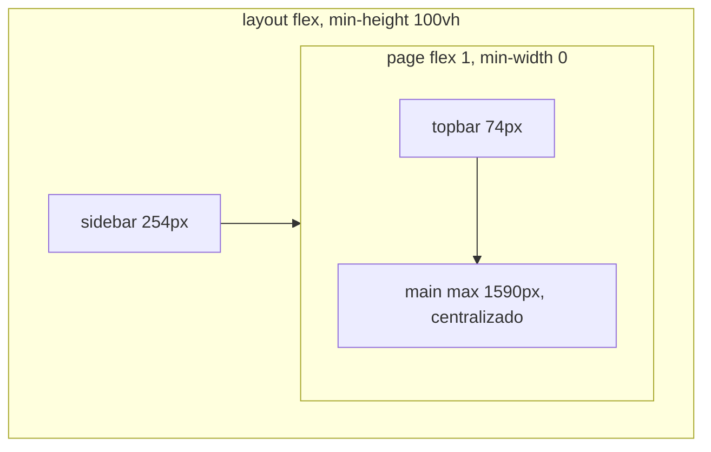
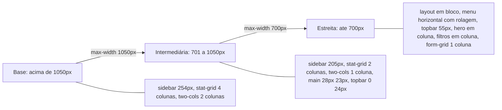

# CSS (`styles.css`)

Versão documentada: StockLab v1.4 (app.js 65 linhas, index.html 54 linhas, styles.css minificado)

Voltar ao [README](README.md).

Como o `styles.css` tem uma única linha minificada, todas as referências deste documento usam o **seletor**
no formato `styles.css .toast.visible`. Referências a `app.js` e `index.html` usam número de linha.

## 1. Visão geral

- Arquivo único (`index.html` L8: `<link rel="stylesheet" href="styles.css">`), minificado, escrito à mão, sem pré-processador, sem `@import` e sem framework.
- Apenas tema claro. Não há `@media (prefers-color-scheme: dark)` e o HTML declara `<meta name="color-scheme" content="light">` (`index.html` L6).
- Não há `@font-face` nem `<link>` de fonte: `Inter` só é usada se estiver instalada no sistema; senão cai na lista de reserva (ver seção 4).
- Só existem regras por classe ou por tag. Nenhum seletor `#id` (ver seção 9).
- Dois `@media(max-width:...)`, nenhum `min-width` (seção 8).
- Ordem das seções no arquivo: `:root` → `*` → `body` → layout/sidebar → topbar → hero e botões → cartões de métrica e painéis → listas, tabelas e filtros → `.hidden` → aba Sobre (`.info-panel`) → `footer` → diálogo → `.toast` → `.empty` → `@media(max-width:1050px)` → `@media(max-width:700px)`.
- Não há `transition`, `animation` nem `@keyframes` (seção 7).

## 2. Variáveis `:root`

Estão declaradas 12 variáveis em `styles.css :root`. Não existem variáveis de tipografia, espaçamento, raio ou breakpoint.

| Variável | Valor | Usada em |
|---|---|---|
| `--navy` | `#0d1730` | `styles.css .sidebar` (fundo) |
| `--navy2` | `#142240` | `styles.css .nav-link:hover, .nav-link.active` (fundo) |
| `--violet` | `#6459db` | `styles.css .button.primary` (fundo) |
| `--purple` | `#e9e7fd` | **sem uso** |
| `--bg` | `#f5f7fb` | `styles.css body` (fundo) |
| `--line` | `#e7eaf1` | bordas: `.topbar`, `.stat-card,.panel`, `.item-row`, `.table-footer`, `.info-grid div`, `.dialog-actions`, `.button.ghost` |
| `--text` | `#17223b` | `body` (cor), `.searchbox input`, `.dialog` |
| `--muted` | `#7a8499` | `.hero p, .panel-head p, .info-panel p` (cor) |
| `--white` | `#fff` | **sem uso** (o CSS usa `white` e `#fff` literais) |
| `--green` | `#167e59` | **sem uso** |
| `--red` | `#be4a42` | **sem uso** |
| `--shadow` | `0 7px 24px rgba(24,37,68,.045)` | `.stat-card,.panel` (`box-shadow`) |

> [!NOTE]
> **Comportamento atual** — Quatro variáveis são declaradas e nunca referenciadas por `var(...)`: `--purple`, `--white`, `--green`, `--red` (`styles.css :root`). Fazem parte do item D14. Não alteram a renderização; apenas indicam um sistema de variáveis incompleto, em que a maioria das cores é literal (seção 3).

## 3. Paleta

A maior parte das cores está escrita como literal hexadecimal dentro das regras, fora das variáveis da seção 2. As tabelas agrupam os valores por papel, com o seletor onde aparecem.

### 3.1 Base e escuros (sidebar)

| Cor | Seletor |
|---|---|
| `#0d1730` (`--navy`) | `.sidebar` |
| `#142240` (`--navy2`) | `.nav-link:hover`, `.nav-link.active` |
| `#13213d` | `.sidebar-bottom` (fundo) |
| `#243453` | `.sidebar-bottom` (borda) |
| `#dfe8ff` | `.sidebar` (texto) |
| `#a9b8d2` | `.nav-link` (texto) |
| `#7587a9` | `.nav-caption, .label-overline` |
| `#94a4c3` | `.brand small, .sidebar-bottom small` |
| `#dce7fc` | `.sidebar-bottom strong` |
| `#b1aafa` | `.brand-dot` |

### 3.2 Marca (violeta)

| Cor | Seletor |
|---|---|
| `#6459db` (`--violet`) | `.button.primary` |
| `#5145c6` | `.button.primary:hover` |
| `#7567ff` | `.brand-icon` (fundo) |
| `#837afb` | `.nav-link.active` (barra interna `inset 3px 0`) |
| `#625bd0` | `.eyebrow` |
| `#625bd3` | `.text-button, .link-action` |
| `#655cd1` | `.table-actions button` |
| `#eae8fd` / `#6758ca` | `.avatar` (fundo / texto) |
| `#f1efff` / `#7065de` | `.stat-icon` (fundo / texto) |
| `#eeefff` / `#7369d7` | `.tag.blue` (fundo / texto) |
| `#f6f4ff`, `#6d65a0`, `#857cec` | `.note` (fundo, texto, borda esquerda) |
| `#8275dd` | `.form-grid input, .form-grid select` (`outline-color`) |

### 3.3 Sucesso (verde)

| Cor | Seletor |
|---|---|
| `#e9f6f0` / `#168257` | `.demo` (fundo / texto) |
| `#eaf9f1` / `#147a54` | `.state-badge.good` |
| `#ecf9f3` / `#258969` | `.movement-type` (entrada) |
| `#37cc9a`, `#235043` | `.mini-pulse` (ponto e halo) |

### 3.4 Alerta (âmbar)

| Cor | Seletor |
|---|---|
| `#fff4e5` / `#c88521` | `.stat-icon.warn` |
| `#fff3e6` / `#bb7b28` | `.qty-tag` |
| `#fff3e1` / `#bd7c25` | `.state-badge.low` |
| `#fff3eb` / `#bd7951` | `.movement-type.saida` |

### 3.5 Erro (vermelho)

| Cor | Seletor |
|---|---|
| `#fff0ee` / `#c14440` | `.state-badge.zero` (fundo / texto) |
| `#c75c59` | `.table-actions button.danger` |

### 3.6 Cinzas de texto

| Cor | Seletor |
|---|---|
| `#26304a` | `td strong` |
| `#424e65` | `.breadcrumbs strong` |
| `#525e72` | `.form-grid label` |
| `#59637a` | `.button.ghost` |
| `#5b6577` | `td` |
| `#607086` | `.filters select` |
| `#6c7585` | `.close-btn` |
| `#727d92` | `.stat-heading` |
| `#8791a3` | `th` |
| `#929bac` | `.breadcrumbs` |
| `#9aa3b3` | `.stat-caption`, `.empty` |
| `#9aa5b5` | `.table-footer` |
| `#9ca4b1` | `.info-grid b` |
| `#9fa8b9` | `.searchbox span` |
| `#a0a6b2` | `.item-sub` |
| `#a7afbb` | `td small` |
| `#b0b7c3` | `footer` |
| `#c6ccd7` | `.breadcrumbs span` |

### 3.7 Superfícies e bordas

| Cor | Seletor |
|---|---|
| `#fff` / `white` | `.stat-card,.panel`, `.topbar`, `.button.ghost`, `.filters select`, `.form-grid input/select` |
| `#fafbfe` | `th` |
| `#f8f9fe` | `.button.ghost:hover` |
| `#f2f3f8` | `.close-btn` |
| `#eff1f5` | `td` (borda superior) |
| `#e3e6ee` | `.searchbox`, `.filters select` (borda) |
| `#dfe4ec` | `.form-grid input, .form-grid select` (borda) |
| `#172b44` | `.toast` (fundo) |

### 3.8 Sombras e overlay

| Valor | Seletor |
|---|---|
| `0 3px 8px #655ad92a` | `.button.primary` |
| `0 25px 80px #101b3359` | `.dialog` |
| `0 12px 35px #101c3c44` | `.toast` |
| `rgba(9,18,37,.56)` | `.dialog::backdrop` |

### 3.9 Estados de estoque

Três variantes de `.state-badge` representam a situação do produto. A classe é escolhida pela função `status` (`app.js` L34) e aplicada em `renderProducts` (`app.js` L47).

| Situação | Classe | Condição em `status()` (`app.js` L34) | Texto | Fundo / texto |
|---|---|---|---|---|
| Disponível | `good` (verde) | estoque maior ou igual a 5 | "Disponível" | `#eaf9f1` / `#147a54` (`styles.css .state-badge.good`) |
| Estoque baixo | `low` (âmbar) | estoque de 1 a 4 | "Estoque baixo" | `#fff3e1` / `#bd7c25` (`styles.css .state-badge.low`) |
| Sem estoque | `zero` (vermelho) | estoque igual a 0 | "Sem estoque" | `#fff0ee` / `#c14440` (`styles.css .state-badge.zero`) |

> [!NOTE]
> **Comportamento atual** — As classes `good` e `low` também são reutilizadas na tabela de movimentações para representar o tipo: `state-badge good` para "Entrada" e `state-badge low` (âmbar) para "Saída" (`app.js` L48). Ou seja, a cor âmbar significa "estoque baixo" na aba Produtos e "saída" na aba Movimentações. Já no painel da Visão geral o tipo usa `.movement-type` (verde) e `.movement-type.saida` (laranja-claro) (`app.js` L43).

## 4. Tipografia

- Família (`styles.css body`): `Inter, ui-sans-serif, -apple-system, BlinkMacSystemFont, "Segoe UI", Arial, sans-serif`. Nenhuma fonte é carregada pela página.
- Tamanho base: `body{font-size:14px}`. Botões, `select` e `input` usam `font:inherit` em `.nav-link`, `select` e `.searchbox input`. Os inputs de `.form-grid` e os botões `.button` não declaram `font:inherit`.

| Seletor | Tamanho | Peso | Observação |
|---|---|---|---|
| `h1` | 29px | padrão | `letter-spacing:-.75px`, `line-height:1.2` |
| `h2` | 16px | padrão | `line-height:1.3` |
| `h3` | 15px | padrão | |
| `.info-panel h2`, `.dialog-top h2` | 22px | padrão | |
| `.brand strong` | 21px | padrão | `letter-spacing:-.65px` |
| `.brand-icon` | 26px | 800 | `letter-spacing:-2px` |
| `.nav-link` | herda 14px | 600 | |
| `.nav-link span` | 21px | | ícone do menu |
| `.nav-caption`, `.label-overline` | 10px | 800 | `letter-spacing:1.3px` |
| `.eyebrow` | 10px | 800 | `letter-spacing:1.5px` |
| `.breadcrumbs` | 13px | | |
| `.avatar` | 12px | 800 | |
| `.pill` | 11px | 700 | |
| `.button` | 12px | 700 | |
| `.stat-heading` | 12px | 600 | |
| `.stat-number` | 28px | 800 | `letter-spacing:-.8px`, `overflow-wrap:anywhere` |
| `.stat-caption` | 11px | | |
| `.panel-head p` | 12px | | |
| `.tag` | 10px | 700 | |
| `.item-name` | 13px | 700 | |
| `.item-sub` | 11px | | |
| `.qty-tag`, `.state-badge` | 11px | 700 | |
| `.text-button`, `.link-action` | 12px | 700 | |
| `th` | 11px | 800 | `text-transform:uppercase`, `letter-spacing:.4px` |
| `td`, `td strong` | 12px | | |
| `td small` | 11px | | |
| `.table-actions button` | 12px | 700 | |
| `.table-footer` | 11px | | |
| `.info-grid b` | 11px | | |
| `.info-grid span` | 12px | 700 | |
| `.note` | 12px | | `line-height:1.5` |
| `.form-grid label` | 12px | 700 | |
| `.toast`, `.empty` | 12px | | |
| `footer` | 10px | | |

## 5. Layout

Em telas largas (acima de 1050px) o layout é um `flex` horizontal (`styles.css .layout`: `display:flex;min-height:100vh`). A sidebar tem largura fixa e a página ocupa o restante.

| Elemento | Regra (`styles.css`) |
|---|---|
| `.sidebar` | `width:254px; flex:0 0 254px; display:flex; flex-direction:column; padding:30px 15px 22px; min-height:100vh` |
| `.page` | `flex:1; min-width:0` |
| `.topbar` | `height:74px; padding:0 38px; border-bottom:1px solid var(--line)`; flex com `justify-content:space-between` |
| `.main` | `padding:36px 40px 20px; max-width:1590px; margin:auto` |
| `.hero` | flex, `justify-content:space-between`, `gap:20px`, `margin-bottom:27px` |
| `.stat-grid` | `grid-template-columns:repeat(4,minmax(0,1fr)); gap:18px; margin-bottom:23px` |
| `.two-cols` | `grid-template-columns:1fr 1fr; gap:20px` |
| `.form-grid` | `grid-template-columns:1fr 1fr; gap:15px`; `.form-grid .full` ocupa `1/-1` |
| `.info-grid` | `grid-template-columns:1fr 1fr; gap:13px; margin:22px 0 25px` |
| `.info-panel` | `padding:30px; max-width:850px` |
| `.dialog` | `max-width:530px; width:calc(100% - 36px)` |

Dimensões e espaçamentos relevantes: `.brand-icon` 43 x 43 px com raio 13px; `.nav-link` com `padding:14px 15px`, raio 10px, `gap:14px`; `.stat-card` com `padding:24px 22px` e raio 14px; `.panel` com raio 14px; `.panel-head` com `padding:24px 24px 18px`; `th` com `padding:14px 22px` e `td` com `padding:17px 22px`; `.toast` com `position:fixed; bottom:25px; right:27px; z-index:5`.

## 6. Componentes

A coluna "Gerado por" indica se a classe vem do HTML estático (`index.html`) ou é montada por `app.js`.

### 6.1 Sidebar e navegação

| Seletores | Papel visual | Gerado por |
|---|---|---|
| `.sidebar`, `.brand`, `.brand-icon`, `.brand-dot`, `.brand strong`, `.brand small` | Coluna escura com a marca "S." | HTML (`index.html` L13–L14) |
| `.nav-caption` | Rótulo caixa-alta "ESPAÇO DE TRABALHO" | HTML (L15) |
| `.navigation`, `.nav-link`, `.nav-link span` | Lista vertical de botões transparentes com ícone | HTML (L16–L20) |
| `.nav-link.active` | Item atual: fundo `--navy2`, texto branco, barra violeta interna | HTML inicial em "Visão geral" (L17); alternada por `tab()` (`app.js` L33) |
| `.sidebar-bottom`, `.mini-pulse` | Cartão "Ambiente local" com ponto verde | HTML (L22) |

### 6.2 Topbar

| Seletores | Papel visual | Gerado por |
|---|---|---|
| `.topbar`, `.breadcrumbs` (e `span`, `strong`), `.top-right` | Barra branca de 74px com trilha "Workspace / seção" | HTML (L25); o texto de `#crumb` é trocado por `tab()` (`app.js` L33) |
| `.pill`, `.demo` | Selo verde "● Demonstração" | HTML (L25) |
| `.avatar` | Círculo lilás "SL" | HTML (L25) |

### 6.3 Hero e botões

| Seletores | Papel visual | Gerado por |
|---|---|---|
| `.hero`, `.eyebrow`, `h1`, `.hero p`, `.hero-actions` | Cabeçalho da página e área de botões | HTML (L27); `#page-title` e `#page-description` são trocados por `tab()` (`app.js` L33) |
| `.button` | Botão base: `inline-flex`, raio 9px, 12px, peso 700, `white-space:nowrap` | HTML (L27, L40, L45, L51, L52) |
| `.button.primary` | Violeta com sombra; `:hover` escurece para `#5145c6` | HTML |
| `.button.ghost` | Branco com borda `--line`; `:hover` fundo `#f8f9fe` | HTML |
| `.button.compact` | Padding reduzido (`10px 12px`) | HTML (L40, L45) |

### 6.4 Cartões de métrica

| Seletores | Papel visual | Gerado por |
|---|---|---|
| `.stat-grid`, `.stat-card` | Grade de 4 cartões brancos | HTML (L30–L35) |
| `.stat-heading`, `.stat-icon`, `.stat-icon.warn` | Título com ícone quadrado; o ícone `warn` é âmbar | HTML |
| `.stat-number`, `.stat-caption` | Número grande e legenda | HTML; o texto dos `#metric-*` é preenchido por `render` (`app.js` L36–L39) |

### 6.5 Painéis e listas da Visão geral

| Seletores | Papel visual | Gerado por |
|---|---|---|
| `.two-cols`, `.panel`, `.panel-head`, `.panel-head p` | Duas colunas de painéis com cabeçalho | HTML (L36–L37) |
| `.tag`, `.tag.blue` | Etiqueta "Acompanhamento" | HTML (L36) |
| `.text-button` | Botão em forma de link "Ver todas →" | HTML (L37) |
| `.low-list`, `.movement-list` | Contêineres das listas (padding `0 24px 18px`) | HTML, vazios (L36–L37) |
| `.item-row`, `.item-name`, `.item-sub` | Linha de item com borda superior | JS: `app.js` L41 e L43 |
| `.qty-tag` | Etiqueta âmbar "N unidade(s)" | JS: `app.js` L41 |
| `.movement-meta`, `.movement-type`, `.movement-type.saida` | Ícone de tipo (verde para entrada, laranja-claro para saída) | JS: `app.js` L43 |
| `.empty` | Texto cinza de lista vazia | JS: `app.js` L41 e L43 |

### 6.6 Filtros

| Seletores | Papel visual | Gerado por |
|---|---|---|
| `.filters` | Barra flex com `gap:12px` | HTML (L41) |
| `.searchbox` (e `span`, `input`) | Caixa de busca com ícone, `max-width:430px`, input de 40px de altura | HTML (L41) |
| `.filters select`, `select` | Filtro de categoria, mínimo 42px de altura | HTML (L41) |

### 6.7 Tabelas, selos e ações de linha

| Seletores | Papel visual | Gerado por |
|---|---|---|
| `.table-wrap`, `table`, `th`, `td`, `td strong`, `td small` | Tabela com cabeçalho cinza em caixa-alta; `td` com `white-space:nowrap` | HTML (estrutura, L42 e L45); linhas montadas por `renderProducts` (`app.js` L47) e `renderMovements` (`app.js` L48) |
| `.state-badge` + `good` / `low` / `zero` | Selo de situação (seção 3.9) | JS: `app.js` L47 (situação) e L48 (tipo de movimentação) |
| `.table-actions`, `.table-actions button`, `.table-actions button.danger` | Botões "Editar" e "Excluir" sem borda (o segundo, vermelho) | JS: `app.js` L47 |
| `.table-footer` | Rodapé com resumo e texto fixo | HTML (L43); `#table-summary` preenchido em `app.js` L47 |

Observação: a linha de "nenhum resultado" usa estilo inline, sem classe (`app.js` L47: `style="text-align:center;padding:35px"`); a de movimentações não tem classe nem estilo (`app.js` L48).

### 6.8 Aba Sobre

| Seletores | Papel visual | Gerado por |
|---|---|---|
| `.info-panel`, `.label-overline` | Cartão largo (850px) com sobrelinha | HTML (L46) |
| `.info-grid` (e `div`, `b`, `span`) | Grade 2 x 2 de fichas com borda | HTML (L46) |
| `.note` | Bloco de destaque lilás com borda esquerda | HTML (L46) |
| `footer` | Rodapé centralizado, 10px, cinza claro | HTML (L47) |

### 6.9 Diálogos

| Seletores | Papel visual | Gerado por |
|---|---|---|
| `.dialog` | Modal de até 530px, raio 17px, sem padding nem borda, sombra forte | HTML (L51–L52) |
| `.dialog::backdrop` | Fundo `rgba(9,18,37,.56)` | gerado pelo navegador ao chamar `showModal()` (`app.js` L49, L52) |
| `.dialog-inner`, `.dialog-top`, `.close-btn`, `.dialog-actions` | Corpo, topo, botão de fechar e rodapé de ações | HTML |
| `.form-grid`, `.form-grid label`, `.form-grid input`, `.form-grid select`, `.form-grid .full` | Grade 2 colunas de campos; inputs com 44px de altura | HTML |

O `dialog` não declara `display`: abrir e fechar dependem do comportamento padrão do navegador (`showModal()` e `close()`).

### 6.10 Toast

| Seletores | Papel visual | Gerado por |
|---|---|---|
| `.toast` | `display:none`, fixo no canto inferior direito, fundo `#172b44`, `z-index:5` | HTML (`index.html` L28, `role="status" aria-live="polite"`) |
| `.toast.visible` | `display:block` | classe adicionada por `notify` (`app.js` L32) e removida após 3500 ms |

### 6.11 Estado vazio

`.empty` (12px, `#9aa3b3`, `padding:24px 0`) aparece em `app.js` L41 ("Nenhum produto em atenção neste momento.") e L43 ("Ainda não há movimentações registradas."). Não há uso estático no HTML.

## 7. Estados

| Estado | Seletor | Efeito | Aplicado por |
|---|---|---|---|
| hover | `styles.css .nav-link:hover` | fundo `--navy2`, texto `#fff` | navegador |
| hover | `styles.css .button.primary:hover` | fundo `#5145c6` | navegador |
| hover | `styles.css .button.ghost:hover` | fundo `#f8f9fe` | navegador |
| `.active` | `styles.css .nav-link.active` | igual ao hover, mais `box-shadow:inset 3px 0 #837afb` | `tab()` (`app.js` L33, `classList.toggle('active', ...)`) |
| `.hidden` | `styles.css .hidden` | `display:none!important` | `tab()` (`app.js` L33) nas seções `.tab-content`; as três abas não iniciais já vêm com a classe (`index.html` L39, L45, L46) |
| `.visible` | `styles.css .toast.visible` | `display:block` | `notify` (`app.js` L32), remoção após 3500 ms |
| `::backdrop` | `styles.css .dialog::backdrop` | fundo `rgba(9,18,37,.56)` | navegador, com `showModal()` |
| foco | `styles.css .form-grid input,.form-grid select` | só `outline-color:#8275dd`; mantém o contorno padrão do navegador | navegador |
| foco | `styles.css .searchbox input` | `outline:none` | navegador |
| variantes | `.tag.blue`, `.stat-icon.warn`, `.pill.demo`, `.state-badge.good/low/zero`, `.movement-type.saida`, `.table-actions button.danger` | cores alternativas por significado | HTML ou JS conforme seção 6 |

> [!WARNING]
> **Comportamento atual / defeito conhecido — D14: Foco da busca sem indicador**
> `styles.css .searchbox input{...outline:none...}` remove o contorno de foco do campo `#search-input` (`index.html` L41) e nenhuma outra regra o substitui (o `.searchbox` não tem `:focus-within`). Efeito: quem navega pelo teclado não vê onde está o foco na busca. As variáveis sem uso da seção 2 completam o D14. Sem cartão no plano v1.5.

Ausências confirmadas no arquivo: `:focus-visible`, `:disabled`, `:invalid`, `:required`, `:checked`, `[open]` para `dialog`, `transition`, `animation` e `@keyframes`. Os botões e campos não têm aparência própria para desabilitado ou inválido; a validação visual fica por conta do navegador.

## 8. Breakpoints

Há duas consultas `max-width`. A faixa de 700px **acumula** as regras de 1050px (ambas valem abaixo de 700px).

| Propriedade | Base (acima de 1050px) | até 1050px | até 700px |
|---|---|---|---|
| `.stat-grid` colunas | 4 | 2 | 2 (herdado), `gap:10px` |
| `.two-cols` | 2 colunas | 1 coluna | 1 coluna (herdado) |
| `.layout` | `display:flex` | `display:flex` | `display:block` |
| `.sidebar` largura | 254px (`flex:0 0 254px`) | 205px (`flex-basis:205px`) | `width:100%`, `min-height:auto`, `padding:14px` |
| `.brand` padding | `0 13px 40px` | igual | `0 5px 12px` |
| `.nav-caption`, `.sidebar-bottom` | visíveis | visíveis | `display:none` |
| `.navigation` | coluna | coluna | linha com `overflow:auto` |
| `.nav-link` | `padding:14px 15px`, 14px | igual | `padding:10px 11px`, 11px, `white-space:nowrap` |
| `.nav-link span` | 21px, `width:21px` | igual | 16px, `width:auto` |
| `.topbar` | altura 74px, `padding:0 38px` | `padding:0 24px` | altura 55px (padding 24px herdado) |
| `.main` padding | `36px 40px 20px` | `28px 23px` | `24px 15px` |
| `.hero` | linha | linha | coluna, `align-items:flex-start` |
| `.hero-actions` | flex, gap 10px | igual | `width:100%`, `justify-content:flex-start`; `.button` 11px |
| `.stat-card` padding | `24px 22px` | igual | `17px 14px` |
| `.stat-heading` / `.stat-number` | 12px / 28px | igual | 11px / 24px |
| `.panel-head` padding | `24px 24px 18px` | igual | `20px 16px 15px` |
| `.low-list`, `.movement-list` padding | `0 24px 18px` | igual | `0 16px 15px` |
| `.filters` | linha, `padding:3px 24px 18px` | igual | coluna, `padding:5px 16px 16px`; `select` com `width:100%` |
| `.form-grid` | 2 colunas | 2 colunas | 1 coluna; `.full` com `grid-column:auto` |

### 8.1 O que não muda a 700px

- `.info-grid` continua com 2 colunas (não há regra de 700px).
- `.dialog` usa `width:calc(100% - 36px)` com `max-width:530px` em todos os tamanhos.
- As tabelas não são reorganizadas: `.table-wrap{overflow:auto}` e `td{white-space:nowrap}` (e `th` também) mantêm as linhas numa só linha, o que gera **rolagem horizontal da tabela** em telas estreitas.
- `.topbar` continua em `display:flex` com `padding:0 24px`; só a altura muda.
- `.info-panel` (`padding:30px`) e `.dialog-inner` (`padding:29px`) mantêm o espaçamento.

## 9. Mapa HTML e CSS

### 9.1 Classes do HTML sem regra no CSS

| Classe | Onde | Situação |
|---|---|---|
| `tab-content` | `index.html` L29, L39, L45, L46 | Nenhum seletor `.tab-content`. É usada apenas como gancho de `app.js` (`querySelectorAll('.tab-content')`, `app.js` L33); a visibilidade vem de `.hidden`. |
| `spaced` | `index.html` L40 (`panel-head spaced`) | Nenhum seletor `.spaced`. |

### 9.2 Classes do CSS geradas apenas por JavaScript

Não aparecem no HTML estático; só existem se `app.js` as escrever.

| Classes | Linha em `app.js` |
|---|---|
| `item-row`, `item-name`, `item-sub`, `qty-tag`, `empty` | L41 |
| `item-row`, `item-name`, `item-sub`, `movement-meta`, `movement-type`, `movement-type saida`, `empty` | L43 |
| `state-badge` com `good`, `low`, `zero`, `table-actions`, `danger` | L47 |
| `state-badge` com `good` (entrada) e `low` (saída) | L48 |

Classes alternadas por JS sobre elementos do HTML: `active` (`app.js` L33), `hidden` (`app.js` L33) e `visible` (`app.js` L32).

### 9.3 Regra sem uso

`.link-action` (compartilha a regra de `styles.css .text-button,.link-action`) não aparece em `index.html` nem em `app.js` (busca por `link-action` retorna 0 ocorrências nos dois arquivos). Só `.text-button` é efetivamente usada (`index.html` L37).

### 9.4 Seletores por id

Nenhum seletor `#id` no CSS. Todos os ids do HTML servem de gancho para o JavaScript; o estilo depende só de classes e tags. A única exceção de estilo pontual é o atributo `style` inline em `app.js` L47.

### 9.5 Resumo dos defeitos e limitações do CSS

| ID | Descrição | Onde |
|---|---|---|
| D14 | Foco da busca sem indicador e quatro variáveis sem uso | `styles.css .searchbox input`, `styles.css :root` |
