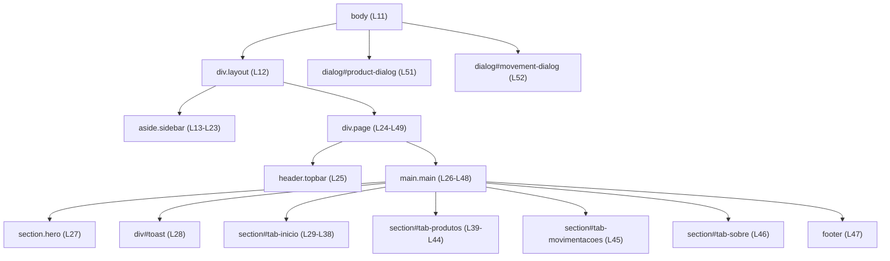
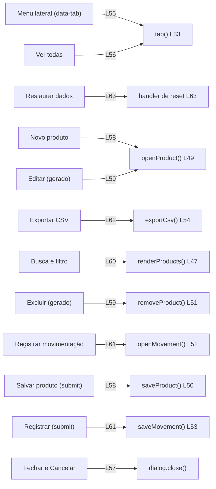

# Interface HTML (`index.html`)

Versão documentada: StockLab v1.4 (app.js 65 linhas, index.html 54 linhas, styles.css minificado)

[Voltar ao README](README.md) · Relacionados: [app-js.md](app-js.md), [css.md](css.md), [casos-de-uso.md](casos-de-uso.md), [regras-de-negocio.md](regras-de-negocio.md)

Este documento descreve a estrutura estática do `index.html`: regiões, abas, ids, atributos `data-*`, formulários, o mapa botão para função e o HTML que o `app.js` injeta em tempo de execução. As linhas citadas como `index.html Lnn` e `app.js Lnn` foram conferidas nos fontes. O `index.html` tem linhas muito longas: `L51` e `L52` contêm um diálogo inteiro cada.

## 1. Documento (L1–L10)

| Item | Valor | Linha |
|---|---|---|
| Doctype | `<!doctype html>` | index.html L1 |
| Idioma | `<html lang="pt-BR">` | index.html L2 |
| Codificação | `<meta charset="utf-8">` | index.html L4 |
| Viewport | `width=device-width, initial-scale=1` | index.html L5 |
| Esquema de cor | `<meta name="color-scheme" content="light">` | index.html L6 |
| Título | `StockLab \| Painel de estoque` | index.html L7 |
| Folha de estilo | `<link rel="stylesheet" href="styles.css">` | index.html L8 |
| Script | `<script defer src="app.js"></script>` (`defer` garante que o DOM exista quando o `app.js` roda). **v1.5:** `<script defer src="regras.js"></script>` foi inserido antes dele (regra pura `aplicarMovimentacao`, ver [app-js.md](app-js.md) 4.22), então o `app.js` passa a ser o segundo script | index.html L9 |

Nenhuma fonte, biblioteca ou recurso externo é referenciado no HTML. O CSS cita a família `Inter` na pilha de fontes, mas não há `@font-face` nem `<link>` para carregá-la (ver [css.md](css.md)).

## 2. Estrutura

### 2.1 Árvore

```text
body (L11)
└─ div.layout (L12)
   ├─ aside.sidebar (L13–L23)
   │  ├─ div.brand (L14)
   │  │  ├─ span.brand-icon  -> "S" + span.brand-dot "."
   │  │  └─ div > strong "StockLab" + small "Gestão simplificada"
   │  ├─ p.nav-caption (L15) "ESPAÇO DE TRABALHO"
   │  ├─ nav.navigation[aria-label="Menu principal"] (L16–L21)
   │  │  └─ 4x button.nav-link[data-tab] (L17–L20)
   │  └─ div.sidebar-bottom (L22)
   │     ├─ div.mini-pulse
   │     └─ div > strong "Ambiente local" + small "Dados neste navegador"
   └─ div.page (L24–L49)
      ├─ header.topbar (L25)
      │  ├─ div.breadcrumbs -> "Workspace" span "/" strong#crumb "Visão geral"
      │  └─ div.top-right -> span.pill.demo "● Demonstração" + span.avatar "SL"
      └─ main.main (L26–L48)
         ├─ section.hero (L27)
         │  ├─ div > div.eyebrow + h1#page-title + p#page-description
         │  └─ div.hero-actions -> button#reset-btn, button#add-btn
         ├─ div#toast.toast[role=status][aria-live=polite] (L28)
         ├─ section#tab-inicio.tab-content (L29–L38)            [visível]
         │  ├─ div.stat-grid (L30–L35) -> 4x div.stat-card
         │  │    (#metric-products, #metric-units, #metric-value, #metric-alerts)
         │  └─ div.two-cols (L36–L37)
         │     ├─ div.panel (L36): div.panel-head (div > h2 + p; span.tag.blue)
         │     │                   + div#low-stock-list.low-list
         │     └─ div.panel (L37): div.panel-head (div > h2 + p; button.text-button[data-open-tab])
         │                         + div#recent-movements.movement-list
         ├─ section#tab-produtos.tab-content.hidden (L39–L44)
         │  └─ div.panel (L40–L43)
         │     ├─ div.panel-head.spaced (L40): div > h2 + p; button#export-btn
         │     ├─ div.filters (L41): label.searchbox > span "⌕" + input#search-input; select#category-filter
         │     ├─ div.table-wrap (L42) > table > thead (6 th) + tbody#product-table
         │     └─ div.table-footer (L43): span#table-summary + span "StockLab • catálogo local"
         ├─ section#tab-movimentacoes.tab-content.hidden (L45)
         │  └─ div.panel > div.panel-head (div > h2 + p; button#move-btn)
         │     + div.table-wrap > table > thead (5 th) + tbody#movement-table
         ├─ section#tab-sobre.tab-content.hidden (L46)
         │  └─ div.panel.info-panel: label-overline, h2, p, div.info-grid (4x div > b + span),
         │     h3 "Solicitação da empresa", p, div.note
         └─ footer (L47)

dialog#product-dialog.dialog (L51)      [fora de .layout, filho direto de body]
└─ form#product-form.dialog-inner[method=dialog]
   ├─ div.dialog-top > div (span.label-overline + h2#product-dialog-title) + button.close-btn
   ├─ input#product-id[type=hidden]
   ├─ div.form-grid (5 campos visíveis)
   └─ div.dialog-actions (button.ghost "Cancelar" + button.primary[type=submit])

dialog#movement-dialog.dialog (L52)
└─ form#movement-form.dialog-inner[method=dialog]
   ├─ div.dialog-top > div (span.label-overline "OPERAÇÃO" + h2) + button.close-btn
   ├─ div.form-grid (4 campos)
   └─ div.dialog-actions (button.ghost "Cancelar" + button.primary[type=submit])
```

### 2.2 Regiões (diagrama)



## 3. Abas

A navegação por abas não usa roteamento: as quatro seções ficam no DOM e `tab(name)` (`app.js` L33) alterna a classe `hidden` em cada `.tab-content` (`hidden` quando `s.id !== 'tab-' + name`), a classe `active` nos botões `.nav-link` e os textos do cabeçalho.

| Aba (`data-tab`) | Botão (index.html) | Seção | Classe inicial | Breadcrumb (`#crumb`) | `#page-title` | `#page-description` |
|---|---|---|---|---|---|---|
| `inicio` | L17 "Visão geral" (`nav-link active`) | `#tab-inicio` (L29) | `tab-content` (visível) | Visão geral | Visão geral do estoque | Acompanhe os produtos, o saldo disponível e as últimas movimentações. |
| `produtos` | L18 "Produtos" | `#tab-produtos` (L39) | `tab-content hidden` | Produtos | Catálogo de produtos | Cadastre e mantenha as informações dos itens comercializados. |
| `movimentacoes` | L19 "Movimentações" | `#tab-movimentacoes` (L45) | `tab-content hidden` | Movimentações | Entradas e saídas | Consulte o histórico de movimentações e registre novas operações. |
| `sobre` | L20 "Sobre o sistema" | `#tab-sobre` (L46) | `tab-content hidden` | Sobre o sistema | Conheça o StockLab | Informações para a equipe responsável pela evolução desta solução. |

Textos de crumb, título e descrição: objeto `titles` em `app.js` L33. Os valores iniciais da aba `inicio` já estão escritos no HTML (L25 e L27); a carga da página chama só `render()` (`app.js` L64), não `tab()`.

> [!NOTE]
> **Comportamento atual**
> A classe `tab-content` não tem regra no CSS (ver [css.md](css.md)). A ocultação das abas depende exclusivamente da classe `.hidden` (`display:none !important`). Não há `aria-current` nem `role="tab"`: a aba ativa é indicada só pela classe `active` (`app.js` L33).

Ver UC-02 em [casos-de-uso.md](casos-de-uso.md). Um nome de aba inexistente em `tab()` é o defeito D11 (não ocorre com este HTML, pois os valores de `data-tab` e `data-open-tab` são os quatro acima).

## 4. Todos os ids (38)

Contagem conferida no HTML: 38 atributos `id`. Todos são hooks de JavaScript; não há seletor `#id` no CSS. Coluna JS: quem lê ou escreve no `app.js`.

| # | id | Elemento | Linha | Conteúdo inicial | Uso no `app.js` |
|---|---|---|---|---|---|
| 1 | `crumb` | `strong` do breadcrumb | L25 | "Visão geral" | escreve texto em `tab()` (L33) |
| 2 | `page-title` | `h1` | L27 | "Visão geral do estoque" | escreve texto em `tab()` (L33) |
| 3 | `page-description` | `p` | L27 | "Acompanhe os produtos, ..." | escreve texto em `tab()` (L33) |
| 4 | `reset-btn` | `button.button.ghost` (`title="Voltar aos dados iniciais"`) | L27 | "↻ Restaurar dados" | listener `click` (L63) |
| 5 | `add-btn` | `button.button.primary` | L27 | "＋ Novo produto" | listener `click` (L58) |
| 6 | `toast` | `div.toast` (`role=status`, `aria-live=polite`) | L28 | vazio | `notify()` escreve texto e alterna `visible` (L32) |
| 7 | `tab-inicio` | `section.tab-content` | L29 | visível | só pela comparação `s.id` em `tab()` (L33) |
| 8 | `metric-products` | `div.stat-number` | L31 | `-` | escreve em `render()` (L36) |
| 9 | `metric-units` | `div.stat-number` | L32 | `-` | escreve em `render()` (L37) |
| 10 | `metric-value` | `div.stat-number` | L33 | `-` | escreve em `render()` (L38) |
| 11 | `metric-alerts` | `div.stat-number` | L34 | `-` | escreve em `render()` (L39) |
| 12 | `low-stock-list` | `div.low-list` | L36 | vazio | escreve `innerHTML` (L41) |
| 13 | `recent-movements` | `div.movement-list` | L37 | vazio | escreve `innerHTML` (L43) |
| 14 | `tab-produtos` | `section.tab-content.hidden` | L39 | oculta | comparação `s.id` (L33) |
| 15 | `export-btn` | `button.button.ghost.compact` | L40 | "⇩ Exportar CSV" | listener `click` (L62) |
| 16 | `search-input` | `input[type=search]` | L41 | vazio | lê em `filtered()` (L46); listener `input` (L60); zera em L63 |
| 17 | `category-filter` | `select` | L41 | "Todas as categorias" (`value=""`) | lê em `filtered()` (L46); listener `change` (L60); zera em L63 |
| 18 | `product-table` | `tbody` | L42 | vazio | escreve `innerHTML` (L47); listener de delegação `click` (L59) |
| 19 | `table-summary` | `span` | L43 | vazio | escreve texto (L47) |
| 20 | `tab-movimentacoes` | `section.tab-content.hidden` | L45 | oculta | comparação `s.id` (L33) |
| 21 | `move-btn` | `button.button.primary.compact` | L45 | "＋ Registrar movimentação" | listener `click` (L61) |
| 22 | `movement-table` | `tbody` | L45 | vazio | escreve `innerHTML` (L48) |
| 23 | `tab-sobre` | `section.tab-content.hidden` | L46 | oculta | comparação `s.id` (L33) |
| 24 | `product-dialog` | `dialog.dialog` | L51 | fechado | `showModal()` (L49); `close()` (L50, L57) |
| 25 | `product-form` | `form[method=dialog]` | L51 | — | `reset()` (L49); listener `submit` (L58) |
| 26 | `product-dialog-title` | `h2` | L51 | "Novo produto" | escreve texto (L49) |
| 27 | `product-id` | `input[type=hidden]` | L51 | vazio | escreve (L49); lê (L50) |
| 28 | `input-name` | `input` | L51 | vazio | escreve (L49); lê (L50) |
| 29 | `input-sku` | `input` | L51 | vazio | escreve (L49); lê (L50) |
| 30 | `input-category` | `select` | L51 | "Informática" (1ª opção) | escreve (L49); lê (L50) |
| 31 | `input-price` | `input[type=number]` | L51 | vazio | escreve (L49); lê (L50) |
| 32 | `input-stock` | `input[type=number]` | L51 | vazio | escreve (L49); lê (L50) |
| 33 | `movement-dialog` | `dialog.dialog` | L52 | fechado | `showModal()` (L52); `close()` (L53, L57) |
| 34 | `movement-form` | `form[method=dialog]` | L52 | — | `reset()` (L52); listener `submit` (L61) |
| 35 | `move-product` | `select` | L52 | sem `<option>` estática | escreve `innerHTML` (L52); lê (L53) |
| 36 | `move-type` | `select` | L52 | "Entrada" (`value="entrada"`) | lê (L53) |
| 37 | `move-quantity` | `input[type=number]` | L52 | `value="1"` | lê (L53) |
| 38 | `move-note` | `input` | L52 | vazio | lê (L53) |

As seções `#tab-*` (7, 14, 20, 23) não são buscadas por `getElementById`: o `app.js` só compara o `id` delas com `tab-${name}` (L33).

## 5. Atributos `data-*`

| Atributo | Valor | Elemento | Linha | Origem | Listener |
|---|---|---|---|---|---|
| `data-tab` | `inicio` | `button.nav-link` "Visão geral" | index.html L17 | estático | `app.js` L55 -> `tab(b.dataset.tab)` |
| `data-tab` | `produtos` | `button.nav-link` "Produtos" | index.html L18 | estático | `app.js` L55 |
| `data-tab` | `movimentacoes` | `button.nav-link` "Movimentações" | index.html L19 | estático | `app.js` L55 |
| `data-tab` | `sobre` | `button.nav-link` "Sobre o sistema" | index.html L20 | estático | `app.js` L55 |
| `data-open-tab` | `movimentacoes` | `button.text-button` "Ver todas →" | index.html L37 | estático | `app.js` L56 -> `tab(b.dataset.openTab)` |
| `data-close` | `product-dialog` | `button.close-btn` "✕" e `button.ghost` "Cancelar" | index.html L51 (2 botões) | estático | `app.js` L57 -> `$(b.dataset.close).close()` |
| `data-close` | `movement-dialog` | `button.close-btn` "✕" e `button.ghost` "Cancelar" | index.html L52 (2 botões) | estático | `app.js` L57 |
| `data-edit` | id numérico do produto (`${p.id}`) | `button` "Editar" | gerado em `app.js` L47 | dinâmico | delegação em `#product-table`, `app.js` L59 -> `openProduct(Number(...))` |
| `data-remove` | id numérico do produto (`${p.id}`) | `button.danger` "Excluir" | gerado em `app.js` L47 | dinâmico | delegação em `#product-table`, `app.js` L59 -> `removeProduct(Number(...))` |

Os listeners de `data-tab`, `data-open-tab` e `data-close` são registrados uma vez, na carga (`querySelectorAll`, L55–L57), nos elementos que já existem. `data-edit` e `data-remove` pertencem a elementos recriados a cada `renderProducts()`, por isso usam delegação no `tbody` (L59, via `e.target.closest(...)`).

## 6. Formulários

Os dois formulários usam `<form method="dialog">` (index.html L51, L52). O `app.js` chama `event.preventDefault()` no início de `saveProduct` (L50) e `saveMovement` (L53), então o fechamento nativo nunca ocorre: o diálogo só fecha pelo `close()` do JS quando a validação passa (L50, L53). Em caso de erro de validação do JS, o diálogo permanece aberto e aparece um toast. As restrições do HTML (`required`, `min`, `maxlength`) são verificadas pelo navegador antes do evento `submit`.

### 6.1 Produto (`#product-form`, index.html L51)

Título do diálogo `#product-dialog-title`: estático "Novo produto" no HTML; `openProduct` troca para "Editar produto" ou "Novo produto" (`app.js` L49). Overline "CATÁLOGO". Botões: "Cancelar" (`type="button"`, `data-close`) e "Salvar produto" (`type="submit"`).

| id | Rótulo | Tipo | required | min | maxlength | step | Valor inicial (`openProduct`, L49) | Opções | Validação adicional no JS (L50) |
|---|---|---|---|---|---|---|---|---|---|
| `product-id` | (sem rótulo) | `hidden` | não | — | — | — | id do produto ou vazio | — | `Number(valor)`; 0 (vazio) = cadastro, diferente de 0 = edição |
| `input-name` | Nome do produto (`label.full`) | texto (padrão) | sim | — | 70 | — | nome ou vazio | — | `trim()`; vazio é rejeitado |
| `input-sku` | Código (SKU) | texto (padrão) | sim | — | 20 | — | SKU ou vazio | — | `trim()`; vazio é rejeitado |
| `input-category` | Categoria | `select` | não | — | — | — | categoria ou `'Informática'` | Informática, Escritório, Acessórios | nenhuma (sem checagem contra a lista) |
| `input-price` | Preço unitário (R$) | `number` | sim | 0 | — | 0.01 | preço ou vazio | — | `Number.isFinite(price)` |
| `input-stock` | Quantidade | `number` | sim | 0 | — | 1 | estoque ou vazio | — | `Number.isInteger(stock)` e `stock >= 0` |

Placeholders: nome "Ex.: Mouse sem fio" (L51), SKU "Ex.: ACE-015" (L51). Falha de validação mostra o toast "Revise os campos do produto." (`app.js` L50).

Observações:

- `#input-category` tem `<option>` sem atributo `value`: o valor enviado é o próprio texto da opção (index.html L51). Já `#category-filter` (L41) tem `value` explícito e uma primeira opção vazia "Todas as categorias".
- `openProduct` começa com `$('product-form').reset()` (L49) e depois preenche os campos; para cadastro, `p` é `undefined` e valem os padrões (`''`, `'Informática'`).

> [!WARNING]
> **Comportamento atual / defeito conhecido — D2: Edição não grava o preço**
> `app.js` L50: o ramo de edição faz `p.name=name;p.sku=sku;p.category=category;p.stock=stock;` e não atribui `p.price`. O campo `#input-price` é preenchido (L49), exigido pelo HTML e validado pelo JS (L50), mas o valor digitado é descartado na edição.
> Efeito: alterar o preço no diálogo "Editar produto" não tem efeito; só o cadastro grava o preço. Tratado no plano v1.5, cartão #3.

### 6.2 Movimentação (`#movement-form`, index.html L52)

> **Atualizado na v1.5 (issue #1).** O diálogo foi reescrito em várias linhas e as linhas citadas nesta seção são da v1.4. Mudanças: `#movement-form` ganhou `novalidate` (a validação é feita pelo JS, com a mesma mensagem em Chrome e Firefox); o campo Quantidade ficou em `div.field` com `label[for="move-quantity"]`, o input com `inputmode="numeric"` e `aria-describedby="move-balance move-quantity-error"`, e logo abaixo `p#move-quantity-error.field-error[role="alert"][hidden]` (fora do `<label>`); entre Quantidade e Observação entrou `p#move-balance.full.form-hint[aria-live="polite"]`, com a prévia `Saldo atual: X un. · Após a saída: Y un.`. Os demais ids e textos foram preservados. As mensagens de erro listadas abaixo foram substituídas pelas de `aplicarMovimentacao` (ver [regras-de-negocio.md](regras-de-negocio.md), D1).

Título `h2`: estático "Nova movimentação" (não é alterado por JS). Overline "OPERAÇÃO". Botões: "Cancelar" (`type="button"`, `data-close`) e "Registrar movimentação" (`type="submit"`).

| id | Rótulo | Tipo | required | min | maxlength | step | Valor inicial | Opções | Validação adicional no JS (L53) |
|---|---|---|---|---|---|---|---|---|---|
| `move-product` | Produto (`label.full`) | `select` | sim | — | — | — | preenchido por `openMovement` (L52) | uma `<option value="${p.id}">nome · SKU</option>` por produto | `Number(valor)` e `find` por id; produto inexistente é rejeitado |
| `move-type` | Tipo de operação | `select` | não | — | — | — | 1ª opção ("Entrada") | `entrada` "Entrada"; `saida` "Saída" | nenhuma validação de tipo (ver D7) |
| `move-quantity` | Quantidade | `number` | sim | 1 | — | 1 | `value="1"` (volta a 1 pelo `reset()`) | — | `Number.isInteger(quantity)` e `quantity >= 1`; para `saida`, `quantity <= p.stock` |
| `move-note` | Observação (`label.full`) | texto (padrão) | não | — | 80 | — | vazio | — | `trim()`; opcional |

Placeholder da observação: "Ex.: Reposição do fornecedor" (L52). Mensagens de toast de erro: "Verifique os dados da movimentação." e "A quantidade solicitada supera o estoque disponível." (`app.js` L53).

Observações:

- `#move-product` não tem opção estática; é preenchido em `openMovement` (`app.js` L52) com `escape(p.name) · escape(p.sku)`, e a opção carrega o id do produto como `value`. Se não houver produtos, o diálogo nem abre: toast "Cadastre um produto antes de movimentar." (L52).
- `#move-type` não tem `required`, mas sempre tem valor, porque a primeira opção ("entrada") fica selecionada por padrão.
- A movimentação grava o nome do produto, não o id (`product:p.name`, L53). Ver D5 em [app-js.md](app-js.md) e [modelo-de-dados.md](modelo-de-dados.md).

### 6.3 Filtros da aba Produtos (fora de formulário, L41)

| id | Tipo | Atributos | Opções | Evento |
|---|---|---|---|---|
| `search-input` | `input[type=search]` | placeholder e `aria-label` "Buscar produto ou código" | — | `input` -> `renderProducts` (L60) |
| `category-filter` | `select` | `aria-label="Filtrar categoria"` | `""` "Todas as categorias"; Informática; Escritório; Acessórios (todas com `value`) | `change` -> `renderProducts` (L60) |

Comparação de busca e categoria: `filtered()` (`app.js` L46). Ver UC-03 e D9 em [casos-de-uso.md](casos-de-uso.md).

## 7. Mapa botão para função

Eventos registrados no `app.js` L55–L63. Todos os botões abaixo ficam fora de `<form>`, exceto os de submit e os de fechar do diálogo (que têm `type="button"` ou `type="submit"` explícito, L51, L52).

| Texto visível | Seletor / id | Linha HTML | Evento | Função JS (linha do listener) | UC |
|---|---|---|---|---|---|
| ▦ Visão geral, ▤ Produtos, ⇅ Movimentações, ⓘ Sobre o sistema | `.nav-link[data-tab]` | L17–L20 | `click` | `tab(b.dataset.tab)` (L55) | UC-02 |
| Ver todas → | `[data-open-tab=movimentacoes]` | L37 | `click` | `tab('movimentacoes')` via `dataset.openTab` (L56) | UC-02 / UC-08 |
| ↻ Restaurar dados | `#reset-btn` | L27 | `click` | arrow inline com `confirm`, `initialData()`, `persist()`, limpa filtros, `render()` (L63) | UC-10 |
| ＋ Novo produto | `#add-btn` | L27 | `click` | `openProduct()` (L58) | UC-04 |
| ⇩ Exportar CSV | `#export-btn` | L40 | `click` | `exportCsv` (L62) | UC-09 |
| (campo de busca) | `#search-input` | L41 | `input` | `renderProducts` (L60) | UC-03 |
| (filtro de categoria) | `#category-filter` | L41 | `change` | `renderProducts` (L60) | UC-03 |
| Editar (gerado) | `[data-edit]` em `#product-table` | gerado em `app.js` L47 | `click` (delegação) | `openProduct(Number(id))` (L59) | UC-05 |
| Excluir (gerado) | `[data-remove]` em `#product-table` | gerado em `app.js` L47 | `click` (delegação) | `removeProduct(Number(id))` (L59) | UC-06 |
| ＋ Registrar movimentação | `#move-btn` | L45 | `click` | `openMovement` (L61) | UC-07 |
| Salvar produto | submit de `#product-form` | L51 | `submit` | `saveProduct` (L58) | UC-04 / UC-05 |
| Registrar movimentação (no diálogo) | submit de `#movement-form` | L52 | `submit` | `saveMovement` (L61) | UC-07 |
| ✕ e Cancelar | `[data-close]` | L51, L52 | `click` | `$(b.dataset.close).close()` (L57) | UC-11 |

> [!WARNING]
> **Comportamento atual / defeito conhecido — D4: Exclusão de produto sem confirmação**
> `app.js` L59 despacha o clique de "Excluir" direto para `removeProduct`, e `app.js` L51 filtra o produto fora de `data.products`, grava e mostra "Produto excluído." Não há `confirm` nem desfazer (o único `confirm` do arquivo está em L63, no "Restaurar dados").
> Efeito: um clique acidental apaga o produto na hora. As movimentações do produto não são alteradas (ver D5). Tratado no plano v1.5, cartão #4.



## 8. Conteúdo gerado dinamicamente

`render()` (`app.js` L35–L45) escreve nas métricas e nas listas; `renderProducts()` (L47) e `renderMovements()` (L48) escrevem as tabelas. Todo texto vindo de dados do usuário passa por `escape` (L25); números por `number()` e valores monetários por `money()` (L23, L24), ambos em `pt-BR`.

### 8.1 Métricas (`#metric-*`)

| id | Conteúdo escrito | Linha |
|---|---|---|
| `metric-products` | `number(data.products.length)` | `app.js` L36 |
| `metric-units` | `number(soma de p.stock)` | `app.js` L37 |
| `metric-value` | `money(soma de p.price)` | `app.js` L38 |
| `metric-alerts` | `number(produtos com stock < 5)` | `app.js` L39 |

Estado vazio: com lista de produtos vazia, as métricas mostram `0` e `R$ 0,00` (resultado das somas), não o `-` inicial do HTML. O `-` só aparece antes da primeira execução de `render()` (L64).

> [!WARNING]
> **Comportamento atual / defeito conhecido — D3: "Valor em estoque" soma só os preços unitários**
> `app.js` L38: `data.products.reduce((sum,p)=>sum+p.price,0)` — não multiplica por `p.stock`.
> Efeito: na demonstração o cartão mostra R$ 4.382,10 em vez de R$ 25.072,00. Tratado no plano v1.5, cartão #2.

### 8.2 `#low-stock-list` (`app.js` L40–L41)

Produtos com `stock < 5`, ordenados por estoque crescente. Cada item:

```html
<div class="item-row">
  <div>
    <div class="item-name">{nome}</div>
    <div class="item-sub">{sku} · {categoria}</div>
  </div>
  <span class="qty-tag">{estoque} unidade(s)</span>
</div>
```

Estado vazio: `<div class="empty">Nenhum produto em atenção neste momento.</div>`

### 8.3 `#recent-movements` (`app.js` L42–L43)

As 4 movimentações mais recentes (cópia invertida de `data.movements`, `slice(0,4)`). Cada item:

```html
<div class="item-row">
  <div class="movement-meta">
    <span class="movement-type saida">↗</span>   <!-- tipo saida: classe "saida" e seta ↗; demais: sem classe e seta ↙ -->
    <div>
      <div class="item-name">{produto}</div>
      <div class="item-sub">Saída · {data}</div>  <!-- "Entrada" para tipos diferentes de saida; data via toLocaleDateString('pt-BR') -->
    </div>
  </div>
  <strong>-{quantidade}</strong>                  <!-- "+" quando o tipo não é saida -->
</div>
```

Estado vazio: `<div class="empty">Ainda não há movimentações registradas.</div>`

### 8.4 `#product-table` e `#table-summary` (`app.js` L47)

`#table-summary` recebe `Exibindo {filtrados} de {total} produto(s)`. Cada linha de produto filtrado:

```html
<tr>
  <td><strong>{nome}</strong><small>{sku}</small></td>
  <td>{categoria}</td>
  <td>{preço em R$}</td>
  <td>{estoque}</td>
  <td><span class="state-badge {good|low|zero}">{Disponível|Estoque baixo|Sem estoque}</span></td>
  <td>
    <div class="table-actions">
      <button type="button" data-edit="{id}">Editar</button>
      <button type="button" class="danger" data-remove="{id}">Excluir</button>
    </div>
  </td>
</tr>
```

A situação vem de `status(p)` (`app.js` L34): estoque 0 -> "Sem estoque" (`zero`); menor que 5 -> "Estoque baixo" (`low`); senão "Disponível" (`good`).

Estado vazio: `<tr><td colspan="6" style="text-align:center;padding:35px">Nenhum produto encontrado.</td></tr>` (é o único estilo inline gerado pelo JS).

### 8.5 `#movement-table` (`app.js` L48)

Todas as movimentações, da mais recente para a mais antiga. Cada linha:

```html
<tr>
  <td>{data e hora via toLocaleString('pt-BR')}</td>
  <td><strong>{produto}</strong></td>
  <td><span class="state-badge {good|low}">{Entrada|Saída}</span></td>
  <td>{quantidade}</td>
  <td>{observação ou —}</td>
</tr>
```

Estado vazio: `<tr><td colspan="5">Nenhuma movimentação registrada.</td></tr>`

> [!WARNING]
> **Comportamento atual / defeito conhecido — D7: Tipo de movimentação não validado**
> `app.js` L53 grava o `type` lido do `select` sem checar o valor. O painel (L43) trata como saída só `type==='saida'` (qualquer outro vira "Entrada"), e o histórico (L48) trata como entrada só `type==='entrada'` (qualquer outro vira "Saída").
> Efeito: um tipo desconhecido apareceria como "Entrada" no painel e como "Saída" no histórico. Com este HTML o `select` só oferece `entrada` e `saida` (index.html L52), por isso não ocorre na prática.

## 9. Textos estáticos relevantes

| Texto | Onde | Linha |
|---|---|---|
| "SISTEMA DE GESTÃO · VERSÃO 1.4" | `div.eyebrow` do hero | index.html L27 |
| "● Demonstração" | `span.pill.demo` na topbar | index.html L25 |
| "Ambiente local" / "Dados neste navegador" | rodapé da sidebar | index.html L22 |
| "Gestão simplificada" | subtítulo da marca | index.html L14 |
| "Versão: 1.4 (demonstração)" | `info-grid`, aba Sobre | index.html L46 |
| "Armazenamento: Local neste navegador" | `info-grid` | index.html L46 |
| "Público: Operadores e gestores" | `info-grid` (base dos atores Operador e Gestor) | index.html L46 |
| "Manutenção: Nova equipe de projeto" | `info-grid` | index.html L46 |
| "Solicitação da empresa" (melhorar confiabilidade, reduzir dificuldades operacionais, planejar a próxima versão) | `h3` + `p` da aba Sobre | index.html L46 |
| "Esta aplicação é um cenário de aprendizagem. Nenhum dado é enviado para servidores externos." | `div.note` | index.html L46 |
| "StockLab • catálogo local" | rodapé da tabela de produtos | index.html L43 |
| "StockLab © 2026 · Software fictício para atividade educacional" | `footer` | index.html L47 |

Textos dos cartões de métrica (L31–L34): "Produtos cadastrados / Itens no catálogo", "Unidades em estoque / Somatório das quantidades", "Valor em estoque / Avaliação do estoque atual", "Produtos com alerta / Itens abaixo do nível recomendado". Painéis da visão geral (L36, L37): "Estoque em atenção" e "Últimas movimentações".

Cabeçalhos de tabela: produtos (L42) Produto, Categoria, Valor unitário, Em estoque, Situação, Ações; movimentações (L45) Data, Produto, Operação, Quantidade, Observação.

O texto "Dados neste navegador" corresponde ao armazenamento em `localStorage` (`app.js` L27, L29); ver [modelo-de-dados.md](modelo-de-dados.md).

## 10. Acessibilidade (fatos observáveis)

Presentes no HTML:

- `lang="pt-BR"` (index.html L2).
- `aria-label="Menu principal"` em `nav` (L16).
- `aria-label` no campo de busca ("Buscar produto ou código") e no filtro de categoria ("Filtrar categoria") (L41).
- `aria-label="Fechar"` nos botões "✕" dos dois diálogos (L51, L52).
- `role="status"` e `aria-live="polite"` no `#toast` (L28); `notify()` escreve o texto nele (`app.js` L32).
- Rótulos implícitos: cada `label` envolve o seu controle em ambos os formulários (L51, L52) e o `label.searchbox` envolve o campo de busca (L41).
- `title="Voltar aos dados iniciais"` em `#reset-btn` (L27).
- Os diálogos são abertos com `showModal()` (`app.js` L49, L52).

Ausências observáveis (sem juízo adicional):

- Botões fora de formulário não têm atributo `type` (L17–L20, L27, L37, L40, L45); como não estão dentro de um `form`, não submetem nada. Os botões dentro dos diálogos têm `type` explícito (L51, L52), assim como "Editar" e "Excluir" gerados (`app.js` L47).
- A aba ativa não recebe `aria-current` nem `aria-selected`; só a classe `active` (`app.js` L33).
- Os ícones tipográficos (⌕ L41; ▦ ▤ ⇅ ⓘ L17–L20; ▤ ◈ R$ ! L31–L34; ↻ ＋ ⇩ nos botões; ● L25) estão em texto comum, sem `aria-hidden`.
- Os `dialog` não têm `aria-label` nem `aria-labelledby` (L51, L52).
- As tabelas não usam `scope` nos `th` (L42, L45).
- Os campos `input-price` e `input-stock` não têm texto de ajuda associado.

> [!NOTE]
> **Comportamento atual**
> O campo de busca tem `outline:none` no foco (`styles.css .searchbox input`), sem indicador substituto; o foco dos campos de formulário dos diálogos só ajusta `outline-color` (`styles.css .form-grid input`). Registrado como D14 (ver [css.md](css.md)).
