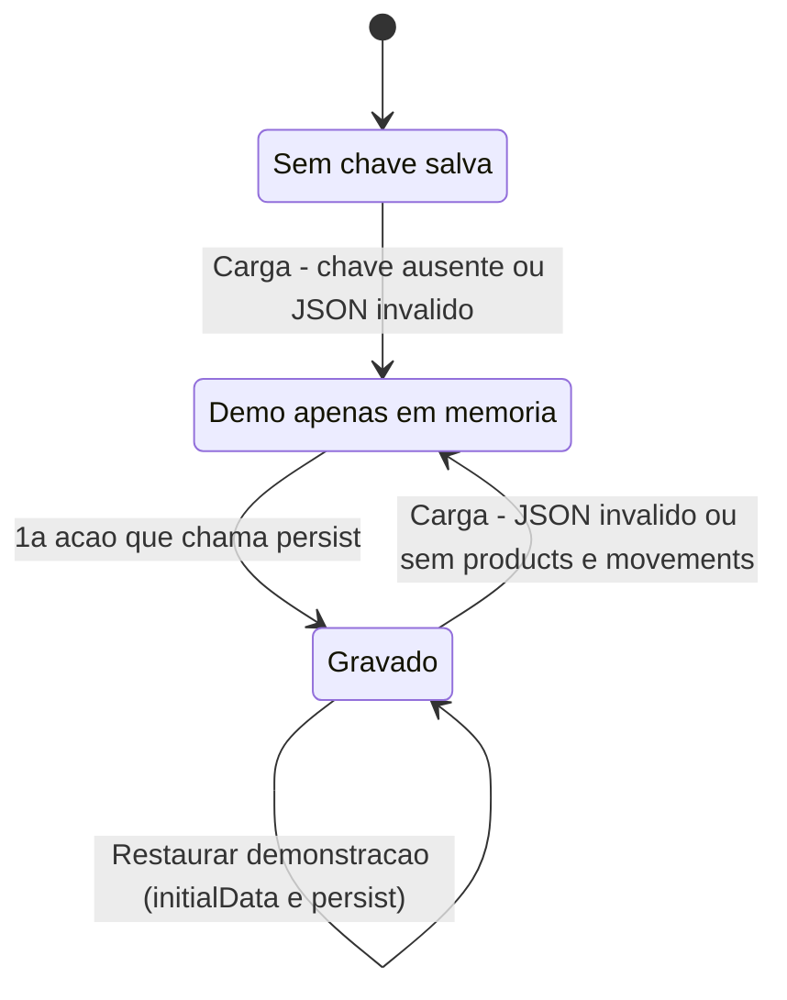
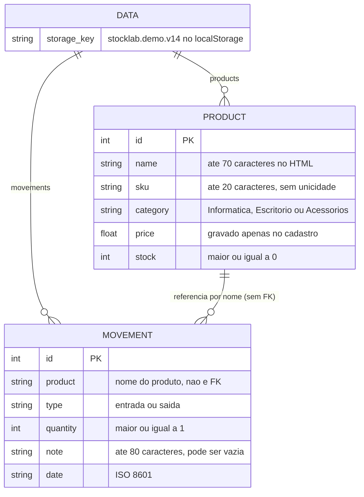
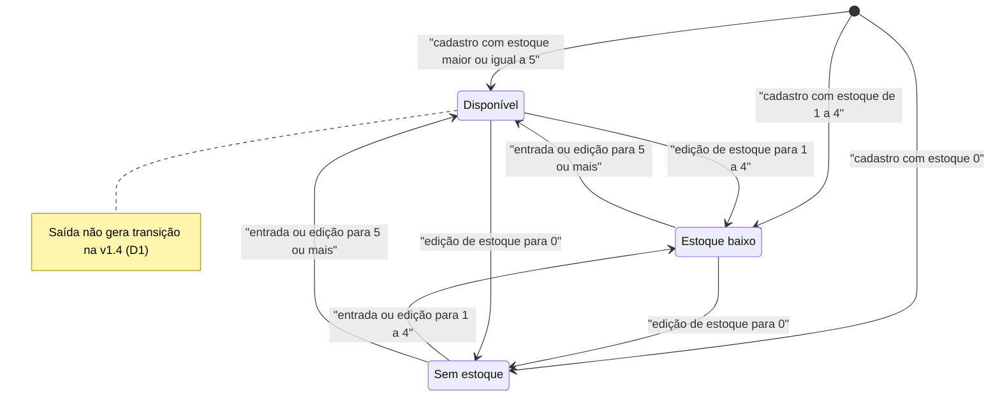

# Modelo de dados

Versão documentada: StockLab v1.4 (app.js 65 linhas, index.html 54 linhas, styles.css minificado)

Voltar para o [README](README.md).

## 1. Visão geral

Todo o estado da aplicação é um único objeto em memória, `data`, com duas listas (`app.js` L26):

```text
data = { products: Product[], movements: Movement[] }
```

- Na carga, `data` vem do `localStorage` ou, se não houver dado utilizável, de `initialData()` (`app.js` L27–L28).
- A cada `persist()`, o objeto inteiro é serializado com `JSON.stringify` e gravado sob uma única chave (`app.js` L29).
- Não há banco de dados, servidor, API nem outro armazenamento. A aba "Sobre" informa "Local neste navegador" (`index.html` L46).
- Os formatos de moeda e número usados na exibição (`money`, `number`, `app.js` L23–L24) não alteram o dado armazenado: preços ficam como números JS.

## 2. Armazenamento

| Item | Valor | Fonte |
|---|---|---|
| Chave | `stocklab.demo.v14` | `app.js` L4 |
| Conteúdo | JSON de `{products, movements}` | `app.js` L29 |
| Escopo | `localStorage` da origem do navegador: cada navegador/perfil tem a sua cópia. Em `file://` o escopo depende do navegador | `app.js` L27, L29 |
| Leitura | somente uma vez, na carga do script | `app.js` L27 |
| Gravação | `persist()`, chamada por `saveProduct` (L50), `removeProduct` (L51), `saveMovement` (L53) e pelo reset (L63) | `app.js` L29 |
| Gravação na carga | não ocorre (a chamada de carga L64 é só `render()`) | `app.js` L64 |

Tratamento de erros:

- **Leitura** (`app.js` L27–L28): `JSON.parse(localStorage.getItem(KEY))` dentro de `try`. Se o valor não existe (`null`), se `products` ou `movements` faltam, ou se o JSON é inválido (exceção), usa-se `initialData()` sem aviso ao usuário.
- **Gravação** (`app.js` L29): se `setItem` lançar exceção (por exemplo, cota excedida ou armazenamento bloqueado), mostra o toast "O navegador não conseguiu salvar os dados localmente." e a alteração permanece apenas em memória.



> [!NOTE]
> **Comportamento atual**
> `app.js` L64 apenas chama `render()`: a carga nunca grava. A demonstração só passa a existir no `localStorage` depois da primeira ação que chama `persist()` (R03). Enquanto isso, recarregar a página recria a demo em memória.

> [!NOTE]
> **Comportamento atual**
> A carga aceita qualquer objeto que tenha `products` e `movements` "verdadeiros" (`saved?.products && saved?.movements`, `app.js` L27). Tipos e conteúdo dos itens não são validados; listas vazias são aceitas, pois um array vazio é verdadeiro em JS.

## 3. Entidade Product

Cada produto é um objeto com seis campos armazenados (`app.js` L7–L14; criação em `app.js` L50).

| Campo | Tipo JS | Obrigatório | Origem no formulário | Validação JS | Validação HTML (`index.html` L51) | Quem altera |
|---|---|---|---|---|---|---|
| `id` | number (inteiro) | sim | `#product-id` (hidden); no cadastro é gerado | gerado como `Math.max(0,...ids)+1` (L50); na edição, `Number(...)` e `if(id)` decidem entre editar e cadastrar | campo oculto, sem regra | cadastro (cria); nunca é alterado depois |
| `name` | string | sim | `#input-name` | `trim()` e não vazio (L50) | `required`, `maxlength="70"` | cadastro e edição |
| `sku` | string | sim | `#input-sku` | `trim()` e não vazio (L50); unicidade não verificada | `required`, `maxlength="20"` | cadastro e edição |
| `category` | string | sim (sempre vem do select) | `#input-category` | nenhuma: o valor do select é gravado como está (L50) | `<select>` com Informática, Escritório, Acessórios (L51); padrão "Informática" no JS (`app.js` L49) | cadastro e edição |
| `price` | number | sim | `#input-price` | `Number(...)` e `Number.isFinite` (L50) | `type="number"`, `step="0.01"`, `min="0"`, `required` | somente cadastro (ver D2) |
| `stock` | number (inteiro) | sim | `#input-stock` | `Number.isInteger` e `>= 0` (L50) | `type="number"`, `step="1"`, `min="0"`, `required` | cadastro, edição, entrada de movimentação (L53) |

Campo derivado (não armazenado): a **situação** do produto, calculada por `status(p)` (`app.js` L34):

| Condição | Rótulo | Classe |
|---|---|---|
| `stock === 0` | Sem estoque | `zero` |
| `stock < 5` | Estoque baixo | `low` |
| demais casos (`stock >= 5`) | Disponível | `good` |

O limite `5` é um literal repetido em L34, L39 e L40; não há constante nomeada.

> [!WARNING]
> **Comportamento atual / defeito conhecido — D2: Edição não grava o preço**
> `app.js` L50: no ramo de edição, só `p.name`, `p.sku`, `p.category` e `p.stock` são atribuídos; `price` é lido e validado, mas descartado.
> Efeito: o preço só pode ser definido no cadastro. Alterá-lo no diálogo de edição não tem efeito, e a mensagem de sucesso é exibida mesmo assim. Tratado no plano v1.5, cartão #3.

> [!WARNING]
> **Comportamento atual / defeito conhecido — D8: SKU duplicado permitido**
> `app.js` L50: não há busca por SKU existente antes de gravar.
> Efeito: dois produtos podem ter o mesmo `sku`. Sem cartão no plano v1.5.

> [!WARNING]
> **Comportamento atual / defeito conhecido — D10: IDs por `max+1` podem ser reutilizados**
> `app.js` L50: `Math.max(0,...data.products.map(p=>p.id))+1`.
> Efeito: se o produto de maior id for excluído, o próximo cadastro reaproveita esse id. Sem cartão no plano v1.5.

> [!WARNING]
> **Comportamento atual / defeito conhecido — D1: Saída não reduz o estoque**
> `app.js` L53: `if(type==='entrada')p.stock+=quantity;` — não existe ramo para `saida`.
> Efeito: `stock` só sobe com entradas; uma saída registrada não altera o saldo. Tratado no plano v1.5, cartão #1.

## 4. Entidade Movement

Cada movimentação é criada em `app.js` L53 e nunca mais é alterada.

| Campo | Tipo JS | Obrigatório | Origem no formulário | Validação JS | Validação HTML (`index.html` L52) | Quem altera |
|---|---|---|---|---|---|---|
| `id` | number (inteiro) | sim | gerado | `Math.max(0,...ids)+1` (L53) | sem campo | só a criação |
| `product` | string: o **nome** do produto, não o id | sim | `#move-product` entrega o id (`value`), mas o código grava `p.name` | produto precisa existir: `!p` bloqueia (L53) | `<select required>` (L52) | só a criação |
| `type` | string: `'entrada'` ou `'saida'` | sim | `#move-type` | nenhuma: o valor é copiado como está (L53) | `<select>` com `entrada` e `saida` | só a criação |
| `quantity` | number (inteiro) | sim | `#move-quantity` | `Number.isInteger` e `>= 1` (L53); em saída, não pode superar o estoque (L53) | `type="number"`, `min="1"`, `step="1"`, `required`, `value="1"` | só a criação |
| `note` | string (pode ser vazia) | não | `#move-note` | `trim()` (L53) | `maxlength="80"` | só a criação |
| `date` | string ISO 8601 | sim | gerado | `new Date().toISOString()` (L53) | sem campo | só a criação |

Na exibição, `note` vazia vira "—" (`app.js` L48: `escape(m.note||'—')`).

> [!WARNING]
> **Comportamento atual / defeito conhecido — D5: Movimentação referencia o produto pelo nome**
> `app.js` L53: `product:p.name`; `app.js` L51: a exclusão não toca em `data.movements`; `app.js` L50: a edição altera `p.name` sem atualizar movimentações antigas.
> Efeito: renomear ou excluir um produto deixa o histórico com o nome antigo (desatualizado ou órfão), e produtos com o mesmo nome se confundem no histórico. Tratado no plano v1.5, cartão #5.

> [!WARNING]
> **Comportamento atual / defeito conhecido — D7: Tipo de movimentação não validado no JS**
> `app.js` L53 copia `type` sem checar a lista; a exibição trata qualquer valor diferente de `'saida'` como "Entrada" no painel (`app.js` L43) e qualquer valor diferente de `'entrada'` como "Saída" no histórico (`app.js` L48).
> Efeito: com o HTML atual só `entrada` e `saida` são oferecidos (`index.html` L52), então o problema só aparece se o formulário for manipulado. Sem cartão no plano v1.5.

> [!NOTE]
> **Comportamento atual**
> Existem dois formatos de data no mesmo campo. As movimentações da demonstração não têm fuso (`'2026-11-18T10:05:00'`, `app.js` L17–L19), e `new Date(...)` as interpreta como hora local do navegador. As movimentações novas usam `toISOString()` (`app.js` L53), com sufixo `Z` (UTC). A exibição converte ambas para o fuso local com `toLocaleDateString`/`toLocaleString('pt-BR')` (`app.js` L43, L48). O campo `date` não é usado para ordenação: o histórico é mostrado na ordem de inserção invertida (`app.js` L42, L48).

## 5. Diagrama entidade-relacionamento



A relação entre `PRODUCT` e `MOVEMENT` é **lógica**: existe apenas pela igualdade entre `Movement.product` e `Product.name`. O código não impõe essa ligação: não há chave estrangeira, não há verificação de existência após a criação, e o vínculo se perde ao renomear ou excluir o produto (D5). A entidade `DATA` representa o objeto raiz (L26); a "chave de armazenamento" no diagrama é só uma anotação, não um campo do objeto.

## 6. Exemplo de JSON armazenado

Valor gravado em `localStorage['stocklab.demo.v14']` logo após "Restaurar demonstração" (`app.js` L63), com os dados de `initialData()` (`app.js` L7–L19). A serialização do JS escreve `2899.90` como `2899.9`, `27.50` como `27.5` e `829.00` como `829`; abaixo está o valor serializado, formatado para leitura (o navegador grava em uma linha).

```json
{
  "products": [
    {"id": 1, "name": "Notebook Slim 14",     "sku": "INF-101", "category": "Informática", "price": 2899.9, "stock": 7},
    {"id": 2, "name": "Mouse sem fio Pro",    "sku": "ACE-202", "category": "Acessórios",  "price": 89.9,   "stock": 3},
    {"id": 3, "name": "Teclado compacto",     "sku": "ACE-203", "category": "Acessórios",  "price": 159.9,  "stock": 12},
    {"id": 4, "name": "Caderno executivo A5", "sku": "ESC-104", "category": "Escritório",  "price": 27.5,   "stock": 4},
    {"id": 5, "name": "Monitor LED 24",       "sku": "INF-105", "category": "Informática", "price": 829,    "stock": 2},
    {"id": 6, "name": "Caneta gel azul",      "sku": "ESC-106", "category": "Escritório",  "price": 7.9,    "stock": 28},
    {"id": 7, "name": "Hub USB-C",            "sku": "ACE-207", "category": "Acessórios",  "price": 119,    "stock": 5},
    {"id": 8, "name": "Webcam Full HD",       "sku": "INF-108", "category": "Informática", "price": 249,    "stock": 0}
  ],
  "movements": [
    {"id": 1, "product": "Mouse sem fio Pro", "type": "saida",   "quantity": 2,  "note": "Venda balcão", "date": "2026-11-18T10:05:00"},
    {"id": 2, "product": "Caneta gel azul",   "type": "entrada", "quantity": 12, "note": "Reposição",    "date": "2026-11-18T11:20:00"},
    {"id": 3, "product": "Monitor LED 24",    "type": "saida",   "quantity": 1,  "note": "Pedido 387",   "date": "2026-11-19T14:40:00"}
  ]
}
```

Exemplo ilustrativo de uma movimentação nova, como `saveMovement` a criaria (`app.js` L53) para uma entrada de 5 unidades do "Hub USB-C" (o valor de `date` é apenas um exemplo; o real é o instante do registro):

```json
{"id": 4, "product": "Hub USB-C", "type": "entrada", "quantity": 5, "note": "Reposição do fornecedor", "date": "2026-11-26T13:00:00.000Z"}
```

## 7. Dados de demonstração

Produtos (`app.js` L7–L14):

| id | Nome | SKU | Categoria | Preço (R$) | Estoque | Situação |
|---|---|---|---|---|---|---|
| 1 | Notebook Slim 14 | INF-101 | Informática | 2.899,90 | 7 | Disponível |
| 2 | Mouse sem fio Pro | ACE-202 | Acessórios | 89,90 | 3 | Estoque baixo |
| 3 | Teclado compacto | ACE-203 | Acessórios | 159,90 | 12 | Disponível |
| 4 | Caderno executivo A5 | ESC-104 | Escritório | 27,50 | 4 | Estoque baixo |
| 5 | Monitor LED 24 | INF-105 | Informática | 829,00 | 2 | Estoque baixo |
| 6 | Caneta gel azul | ESC-106 | Escritório | 7,90 | 28 | Disponível |
| 7 | Hub USB-C | ACE-207 | Acessórios | 119,00 | 5 | Disponível (limite exato) |
| 8 | Webcam Full HD | INF-108 | Informática | 249,00 | 0 | Sem estoque |

Movimentações (`app.js` L17–L19):

| id | Produto (nome) | Tipo | Quantidade | Observação | Data |
|---|---|---|---|---|---|
| 1 | Mouse sem fio Pro | saida | 2 | Venda balcão | 2026-11-18T10:05:00 |
| 2 | Caneta gel azul | entrada | 12 | Reposição | 2026-11-18T11:20:00 |
| 3 | Monitor LED 24 | saida | 1 | Pedido 387 | 2026-11-19T14:40:00 |

Valores derivados exibidos pelo painel (`render`, `app.js` L36–L39):

| Métrica | Cálculo no código | Valor com a demo |
|---|---|---|
| Produtos | `products.length` (L36) | 8 |
| Unidades | soma de `stock` (L37) | 61 |
| Valor em estoque | v1.5: Σ `price × stock` em centavos, por `calcularValorEmEstoque` (`regras.js`); v1.4: soma de `price` (L38) | R$ 25.072,00 (v1.4: R$ 4.382,10) |
| Alertas | produtos com `stock < 5` (L39) | 4 (Webcam 0, Monitor 2, Mouse 3, Caderno 4) |

Composição do valor da demonstração (preço × estoque, R$ 25.072,00): 20.299,30 + 269,70 + 1.918,80 + 110,00 + 1.658,00 + 221,20 + 595,00 + 0,00.

> [!NOTE]
> **Corrigido na v1.5 (issue #2) — D3: "Valor em estoque" soma preço × quantidade**
> O painel mostra R$ 25.072,00 com os dados da demonstração (v1.4: R$ 4.382,10). Itens com `price` ou `stock` inválidos (negativos, não finitos, `null` e também strings, mesmo numéricas como `'89.9'`) não entram no card; a tabela de produtos pode exibi-los mesmo assim. O saneamento de dados corrompidos é a issue #5.

> [!NOTE]
> **Comportamento atual — D13: dados de demonstração inconsistentes**
> Os estoques iniciais (`app.js` L7–L14) são valores fixos e não resultam das movimentações de exemplo (L17–L19): por exemplo, o histórico registra uma entrada de 12 canetas e o estoque inicial de canetas é 28, sem qualquer saldo de partida que explique a diferença. Os dois conjuntos são independentes.

## 8. Ciclo de vida das entidades

### 8.1 Situação de um produto

A situação é derivada de `stock` (`status`, `app.js` L34). As transições abaixo ocorrem quando `stock` muda por cadastro, edição de estoque (`app.js` L50) ou entrada de movimentação (`app.js` L53).



A única forma de o estoque diminuir na v1.4 é a edição manual do campo "Quantidade" (`app.js` L50). Uma saída válida registra a movimentação, mas deixa o produto no mesmo estado (D1).

### 8.2 Operações por entidade

| Entidade | Criar | Ler | Atualizar | Excluir |
|---|---|---|---|---|
| Product | sim: `saveProduct` sem id (`app.js` L50) | sim: tabela (L47), painel (L36–L41), CSV (L54) | sim, parcial: `saveProduct` com id altera nome, SKU, categoria e estoque; não o preço (L50) | sim, sem confirmação (`removeProduct`, `app.js` L51) |
| Movement | sim: `saveMovement` (`app.js` L53) | sim: histórico (L48) e painel (L42–L43) | não | não: só "Restaurar demonstração" apaga o histórico, substituindo todo `data` (`app.js` L63) |

## 9. Integridade e restrições ausentes

Lista factual do que o código não garante:

- **Unicidade de SKU:** não verificada (D8, `app.js` L50).
- **Chave estrangeira:** `Movement.product` guarda texto; nada impede ou detecta histórico órfão (D5, `app.js` L51, L53).
- **Versão de esquema:** a única marca de versão é o sufixo `v14` da chave (`app.js` L4); não há campo de versão dentro do JSON.
- **Migração:** não existe. Dados salvos com outra chave não são lidos.
- **Validação na carga:** só se checa a existência de `products` e `movements` (`app.js` L27); tipos, campos obrigatórios e valores não são validados.
- **Tipo de movimentação:** não validado no JS (D7, `app.js` L53).
- **Preço:** o JS aceita qualquer número finito, inclusive zero ou negativo, se o `min="0"` do HTML for contornado (`app.js` L50; `index.html` L51). Categoria também não é validada contra a lista (`app.js` L50).
- **Identificadores:** gerados por maior id + 1, podendo ser reutilizados após exclusão (D10, `app.js` L50, L53).
- **Consistência estoque x histórico:** o estoque é um valor armazenado, não calculado a partir das movimentações; saídas não o reduzem (D1) e os dados de demo não fecham entre si (D13).
- **Limite de tamanho:** o código não limita a quantidade de registros; o limite é o do `localStorage` do navegador, e a falha de gravação gera apenas o toast descrito na seção 2 (`app.js` L29).
- **Concorrência:** não há tratamento. Duas abas do mesmo navegador mantêm cópias separadas em memória e a última gravação vence, pois a leitura só ocorre na carga (`app.js` L27, L29).

## 10. Referência cruzada

O plano v1.5, cartão #5, propõe vincular movimentações por `produtoId` e usar uma nova chave, `stocklab.demo.v15`; isso é apenas planejado e não existe na v1.4. Ver [plano-v1.5.md](../plano-v1.5.md), [regras-de-negocio.md](regras-de-negocio.md) (R01 a R04, R09 a R12, R14 a R19) e [app-js.md](app-js.md).
