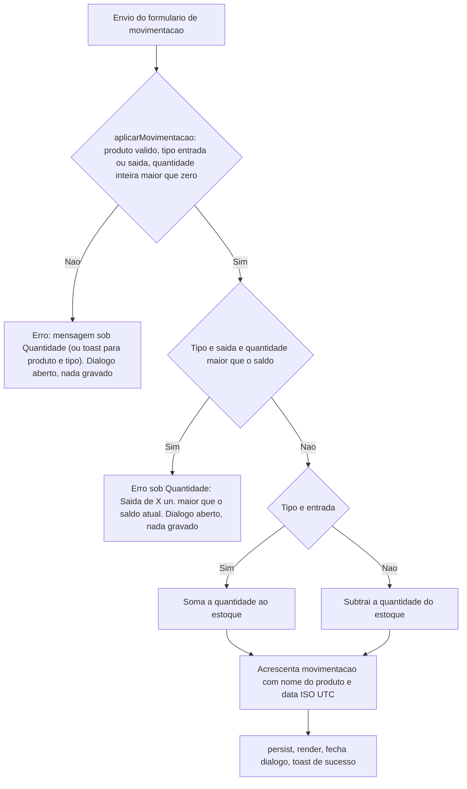
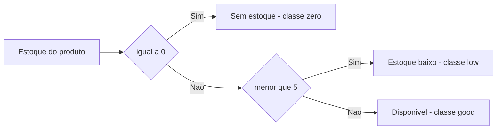

# Regras de negócio e catálogo de defeitos

Versão documentada: StockLab v1.4 (app.js 65 linhas, index.html 54 linhas, styles.css minificado)

[Voltar ao README](README.md)

> **Nota de versão (v1.5).** Este documento descreve a v1.4, exceto onde marcado "v1.5". A issue #1 corrigiu D1: R15 e R17 e o fluxo da
> seção 3.3 foram atualizados. A issue #2 corrigiu D3: R22 e a seção D3 foram atualizadas (o card "Valor em estoque" agora soma preço × quantidade
> com `calcularValorEmEstoque`, em `regras.js`). As referências `Lnn` são da v1.4 original (commit `ceb1b68`), pois o `app.js` foi reformatado com Prettier.

Este documento é o ponto único de verdade das regras de negócio e dos defeitos do StockLab v1.4. Os demais
documentos de `docs/codigo/` apenas referenciam os IDs `R..` (regras) e `D..` (defeitos) definidos aqui.

## 1. Como ler este documento

"Regra" significa **a regra como o código a aplica hoje**, não o que deveria acontecer. Onde o comportamento
esperado e o implementado divergem, a divergência aparece como defeito (`D..`). Referências de linha usam o
formato `app.js L53` e `index.html L51`; para o CSS (uma linha só) usa-se o seletor, por exemplo `styles.css .searchbox input`.

**Status da regra**

| Status | Significado |
|---|---|
| Correto | Faz o que se espera dela. |
| Defeituoso | O código contradiz o comportamento esperado; liga a um `D..`. |
| Limitação | Funciona, mas com restrição que o leitor precisa conhecer. |
| Ausente | Regra esperada que não existe no código. |

**Gravidade do defeito**

| Gravidade | Significado |
|---|---|
| Alta | Produz informação errada nos dados ou indicadores principais. |
| Média | Risco operacional ou inconsistência de dados. |
| Baixa | Impacto restrito, ou só alcançável fora do uso normal da interface. |
| Informativo | Observação sobre os dados de demonstração. |

## 2. Resumo

| Status | Quantidade | Regras |
|---|---|---|
| Correto | 17 | R01, R05, R07, R13, R14, R15, R16, R17, R20, R21, R22, R23, R25, R26, R27, R28, R29 |
| Defeituoso | 3 | R11, R12, R18 |
| Limitação | 8 | R02, R03, R04, R06, R08, R10, R19, R24 |
| Ausente | 1 | R09 |
| **Total** | **29** | |

Observações de classificação: R26 carrega ressalva ("correto / limitação por D12") e foi contada como Correto.
Na v1.5 (issue #1), R15 passou a efetiva e R17 passou de Defeituoso a Correto (D1 corrigido). Na v1.5 (issue #2), R22 passou de Defeituoso a Correto (D3 corrigido).

Defeitos com cartão no plano v1.5 (ver [plano-v1.5.md](../plano-v1.5.md)):

| Defeito | Título | Cartão |
|---|---|---|
| D1 | Saída não reduz o estoque | #1 (**corrigido na v1.5**) |
| D2 | Edição não grava o preço | #3 |
| D3 | "Valor em estoque" soma só os preços unitários | #2 (**corrigido na v1.5**) |
| D4 | Exclusão de produto sem confirmação | #4 |
| D5 | Movimentação referencia o produto pelo nome | #5 |

D6 é citado no cartão #3. D7 a D14 não têm cartão (o plano os deixa fora do escopo ou não os menciona).

## 3. Regras por domínio

### 3.1 Armazenamento

### R01 — Persistência em `localStorage`

**Regra implementada:** os dados ficam em `localStorage['stocklab.demo.v14']`, serializados como JSON `{products, movements}`.

**Código:** `app.js` L4 e L29.

```js
const KEY = 'stocklab.demo.v14';
const persist = () => {try {localStorage.setItem(KEY,JSON.stringify(data));}catch {notify('O navegador não conseguiu salvar os dados localmente.');}};
```

**Status:** Correto. **Defeito relacionado:** nenhum. **UC afetado:** UC-12 (e todos que o incluem: UC-04, UC-05, UC-06, UC-07, UC-10).

### R02 — Carga: usa o salvo ou recai na demonstração

**Regra implementada:** na carga, usa o objeto salvo se `products` e `movements` existirem (verificação de valor "truthy").
Se não existir, ou se o `JSON.parse` falhar, usa `initialData()` sem avisar o usuário. O conteúdo não tem os tipos validados.

**Código:** `app.js` L27–L28.

```js
try { const saved = JSON.parse(localStorage.getItem(KEY)); data = saved?.products && saved?.movements ? saved : initialData(); }
catch { data = initialData(); }
```

**Status:** Limitação. **Defeito relacionado:** nenhum. **UC afetado:** UC-01, UC-12.

> [!NOTE]
> **Comportamento atual**
> `app.js` L27: um JSON válido com `products` e `movements` de formato errado (por exemplo, texto em vez de lista) é aceito
> como está; o erro só apareceria depois, ao renderizar. Dados corrompidos que não são JSON válido caem silenciosamente na demonstração.

### R03 — A carga não grava

**Regra implementada:** abrir a aplicação só lê. A demonstração só é gravada no `localStorage` depois da primeira ação que chama `persist()`.

**Código:** `app.js` L64 (a carga termina em `render()`, sem `persist()`).

```js
render();
```

**Status:** Limitação. **Defeito relacionado:** nenhum. **UC afetado:** UC-01, UC-12.

### R04 — Falha ao gravar só avisa

**Regra implementada:** se `setItem` lançar erro (cota cheia, armazenamento bloqueado), `persist()` mostra um toast de erro. A alteração
permanece apenas em memória e se perde ao recarregar.

**Código:** `app.js` L29 (bloco `catch`) e, por exemplo, L50.

```js
persist();render();$('product-dialog').close();notify(id?'Produto atualizado.':'Produto cadastrado.');
```

**Status:** Limitação. **Defeito relacionado:** nenhum. **UC afetado:** UC-12 e seus incluidores.

> [!NOTE]
> **Comportamento atual**
> Em todos os fluxos (`app.js` L50, L51, L53, L63) `persist()` é seguido de um `notify(...)` de sucesso. Como `notify`
> (L32) substitui o texto do mesmo elemento `#toast`, a mensagem de erro de gravação é sobrescrita imediatamente pela mensagem de sucesso,
> e o usuário praticamente não a vê. A mensagem de sucesso é exibida mesmo quando a gravação falhou.

### 3.2 Produto

### R05 — Nome e SKU obrigatórios

**Regra implementada:** nome e SKU são lidos com `trim()` e não podem ficar vazios. O HTML limita o nome a 70 e o SKU a 20 caracteres.

**Código:** `app.js` L50; `index.html` L51.

```js
const name=$('input-name').value.trim(),sku=$('input-sku').value.trim(), ... if(!name||!sku||...){notify('Revise os campos do produto.');return;}
```

**Status:** Correto. **Defeito relacionado:** nenhum. **UC afetado:** UC-04, UC-05.

### R06 — Preço: número finito

**Regra implementada:** o preço precisa ser um número finito. O HTML exige `min="0" step="0.01" required` (`index.html` L51), mas o JS
não repete o limite inferior: zero ou negativo passam se o HTML for contornado (por exemplo, pelo DevTools).

**Código:** `app.js` L50.

```js
price=Number($('input-price').value) ... !Number.isFinite(price)
```

**Status:** Limitação. **Defeito relacionado:** nenhum. **UC afetado:** UC-04 (no UC-05 o preço é validado, mas descartado: ver R11 e D2).

### R07 — Estoque: inteiro maior ou igual a zero

**Regra implementada:** o estoque precisa ser inteiro e não negativo. O HTML também usa `min="0" step="1" required` (`index.html` L51).

**Código:** `app.js` L50.

```js
!Number.isInteger(stock)||stock<0
```

**Status:** Correto. **Defeito relacionado:** nenhum. **UC afetado:** UC-04, UC-05.

### R08 — Categoria vem de uma lista fixa no HTML

**Regra implementada:** a categoria é o valor do select `#input-category` (Informática, Escritório, Acessórios). Ao abrir um novo cadastro,
o valor padrão é "Informática". O JS não valida se a categoria pertence à lista.

**Código:** `app.js` L49 e L50; `index.html` L51 (opções) e L41 (filtro, segunda lista).

```js
$('input-category').value=p?.category??'Informática';
```

**Status:** Limitação. **Defeito relacionado:** nenhum. **UC afetado:** UC-04, UC-05, UC-03.

### R09 — SKU não precisa ser único

**Regra implementada:** não existe verificação de duplicidade. Dois produtos podem ter o mesmo SKU.

**Código:** `app.js` L50 (nenhuma comparação de `sku` com os produtos existentes).

**Status:** Ausente. **Defeito relacionado:** D8. **UC afetado:** UC-04, UC-05.

### R10 — Novo id é o maior id atual mais 1

**Regra implementada:** produtos (L50) e movimentações (L53) recebem `max(id) + 1`; lista vazia gera id 1.

**Código:** `app.js` L50 e L53.

```js
id:Math.max(0,...data.products.map(p=>p.id))+1
id:Math.max(0,...data.movements.map(m=>m.id))+1
```

**Status:** Limitação. **Defeito relacionado:** D10. **UC afetado:** UC-04, UC-07.

### R11 — Edição não grava o preço

**Regra implementada:** na edição, o código atualiza nome, SKU, categoria e estoque. O preço é lido e validado, mas não é copiado para o produto.

**Código:** `app.js` L50.

```js
if(p){p.name=name;p.sku=sku;p.category=category;p.stock=stock;}
```

**Status:** Defeituoso. **Defeito relacionado:** D2. **UC afetado:** UC-05.

> [!WARNING]
> **Comportamento atual / defeito conhecido — D2: Edição não grava o preço**
> `app.js` L50: `if(p){p.name=name;p.sku=sku;p.category=category;p.stock=stock;}` — não há `p.price=price`.
> Efeito: o usuário altera o preço, vê "Produto atualizado." e o valor antigo permanece. Tratado no plano v1.5, cartão #3.

### R12 — Exclusão imediata, sem confirmação, sem tocar nas movimentações

**Regra implementada:** clicar em "Excluir" remove o produto na hora, persiste e re-renderiza. As movimentações não são alteradas.

**Código:** `app.js` L51 e L59.

```js
function removeProduct(id){data.products=data.products.filter(p=>p.id!==id);persist();render();notify('Produto excluído.');}
```

**Status:** Defeituoso. **Defeito relacionado:** D4, D5. **UC afetado:** UC-06.

> [!WARNING]
> **Comportamento atual / defeito conhecido — D4: Exclusão de produto sem confirmação**
> `app.js` L51 e L59: `removeProduct(Number(remove.dataset.remove))` é chamado direto no clique, sem `confirm` nem diálogo.
> Efeito: um clique acidental apaga o produto de forma irreversível. Tratado no plano v1.5, cartão #4.

### 3.3 Movimentação

O diagrama resume as decisões de `saveMovement` (v1.4 L53) e, desde a v1.5, de `aplicarMovimentacao` (`regras.js`), na ordem em que são avaliadas.



### R13 — Só abre movimentação com produto cadastrado

**Regra implementada:** o diálogo de movimentação só abre se existir ao menos um produto.

**Código:** `app.js` L52.

```js
if(!data.products.length){notify('Cadastre um produto antes de movimentar.');return;}
```

**Status:** Correto. **Defeito relacionado:** nenhum. **UC afetado:** UC-07.

### R14 — Produto existente e quantidade inteira maior ou igual a 1

**Regra implementada:** a movimentação exige que o produto escolhido exista e que a quantidade seja inteira e maior ou igual a 1.
O HTML também usa `min="1" step="1" required` (`index.html` L52).

**v1.5 (issue #1):** a validação passou para `aplicarMovimentacao` (`regras.js`), que recusa quantidade que não seja número inteiro seguro maior que zero, com a mensagem `Informe uma quantidade inteira maior que zero.` exibida sob o campo Quantidade. O `#movement-form` agora tem `novalidate`, então 0, negativo, decimal e vazio chegam ao JS e recebem essa mensagem em qualquer navegador. O texto e o código abaixo são da v1.4.

**Código (v1.4):** `app.js` L53.

```js
if(!p||!Number.isInteger(quantity)||quantity<1){notify('Verifique os dados da movimentação.');return;}
```

**Status:** Correto. **Defeito relacionado:** nenhum. **UC afetado:** UC-07.

### R15 — Saída maior que o estoque é bloqueada

**Regra implementada:** se o tipo for `saida` e a quantidade for maior que o estoque registrado do produto, a operação é recusada e o diálogo continua aberto.

**Código:** `app.js` L53.

```js
if(type==='saida'&&quantity>p.stock){notify('A quantidade solicitada supera o estoque disponível.');return;}
```

**Status:** Correto (v1.5: agora efetiva, porque a saída reduz o saldo, R17).
**Defeito relacionado:** D1 (corrigido). **UC afetado:** UC-07.

**v1.5 (issue #1):** a checagem passou para `aplicarMovimentacao` (`regras.js`) e a mensagem agora é específica e aparece sob o campo Quantidade:
`Saída de X un. maior que o saldo atual (Y un.) de <produto>.` (ex.: `Saída de 7 un. maior que o saldo atual (6 un.) de Mouse sem fio Pro.`). O diálogo continua aberto e nada é gravado. A mensagem antiga (`A quantidade solicitada supera o estoque disponível.`) foi removida.

### R16 — Entrada soma ao estoque

**Regra implementada:** em movimentação de entrada, a quantidade é somada a `p.stock`.

**Código:** `app.js` L53.

```js
if(type==='entrada')p.stock+=quantity;
```

**Status:** Correto. **Defeito relacionado:** nenhum. **UC afetado:** UC-07.

### R17 — Saída subtrai do estoque

**Regra implementada (v1.5):** em movimentação de saída, a quantidade é subtraída de `p.stock` (`p.stock = result.estoque`, com `result` vindo de `aplicarMovimentacao`). Na v1.4 não existia ramo para `saida`: o registro entrava no histórico e o saldo ficava igual.

**Código:** `regras.js` (`aplicarMovimentacao`) e `saveMovement` em `app.js`.

**Status:** Correto (v1.5). **Defeito relacionado:** D1 (corrigido). **UC afetado:** UC-07.

> [!NOTE]
> **Corrigido na v1.5 (issue #1) — D1: Saída não reduzia o estoque**
> Histórico do defeito na v1.4: `app.js` L53 só tinha `if(type==='entrada')p.stock+=quantity;`, sem ramo para `saida`; unidades e alertas ficavam acima do real e o bloqueio de R15 não funcionava na prática.
> Ver a seção D1 do catálogo, com a correção e os testes.

### R18 — A movimentação guarda o nome do produto, não o id

**Regra implementada:** o registro grava `product: p.name` (texto) e `date: new Date().toISOString()` (UTC, com sufixo `Z`).

**Código:** `app.js` L53.

```js
data.movements.push({id:Math.max(0,...data.movements.map(m=>m.id))+1,product:p.name,type,quantity,note,date:new Date().toISOString()});
```

**Status:** Defeituoso. **Defeito relacionado:** D5. **UC afetado:** UC-07, UC-08, UC-05, UC-06.

> [!WARNING]
> **Comportamento atual / defeito conhecido — D5: Movimentação referencia o produto pelo nome**
> `app.js` L53: `product:p.name` — o vínculo é um texto, não o id; renomear (L50) ou excluir (L51) não atualiza o histórico.
> Efeito: histórico desatualizado, órfão ou confundido entre produtos de mesmo nome. Tratado no plano v1.5, cartão #5.

### R19 — Tipo de movimentação não é validado no JS

**Regra implementada:** o JS aceita qualquer texto em `type`. Só `entrada` soma ao estoque; qualquer outro valor é gravado sem alterar o saldo.
O HTML só oferece `entrada` e `saida` (`index.html` L52).

**Código:** `app.js` L53.

```js
type=$('move-type').value
```

**Status:** Limitação. **Defeito relacionado:** D7. **UC afetado:** UC-07, UC-08, UC-01.

### 3.4 Indicadores e situação

A situação do produto é função do estoque (`status`, `app.js` L34).



### R20 — Situação do produto

**Regra implementada:** estoque 0 vira "Sem estoque" (`zero`); estoque menor que 5 vira "Estoque baixo" (`low`); caso contrário "Disponível" (`good`).
O limite 5 é um literal repetido em três lugares (L34, L39, L40).

**Código:** `app.js` L34.

```js
const status = p => p.stock===0 ? ['Sem estoque','zero'] : p.stock<5 ? ['Estoque baixo','low'] : ['Disponível','good'];
```

**Status:** Correto. **Defeito relacionado:** nenhum. **UC afetado:** UC-03 (coluna Situação), UC-01.

### R21 — Alertas de estoque

**Regra implementada:** o indicador de alertas e a lista "Estoque em atenção" contam os produtos com estoque menor que 5, inclusive os zerados.
A lista é ordenada por estoque crescente.

**Código:** `app.js` L39–L41.

```js
$('metric-alerts').textContent=number(data.products.filter(p=>p.stock<5).length);
const low=data.products.filter(p=>p.stock<5).sort((a,b)=>a.stock-b.stock);
```

**Status:** Correto. **Defeito relacionado:** nenhum (mas depende de D1 para refletir saídas). **UC afetado:** UC-01.

### R22 — "Valor em estoque" soma preço × quantidade

**Regra implementada (v1.5):** o indicador mostra a soma de `price × stock` de todos os produtos, calculada em centavos inteiros por `calcularValorEmEstoque(data.products)` (`regras.js`) e formatada por `money()`.
Itens inválidos (`price` não finito ou negativo, `stock` que não seja inteiro seguro ≥ 0, qualquer valor que não seja número — inclusive strings numéricas — e elementos que não sejam objetos) são ignorados, sem coerção de tipo; lista vazia ou entrada que não seja array vale R$ 0,00. A legenda do card é "Soma de preço × quantidade em estoque.".

**Código (v1.5):** `render` em `app.js` (linha do `metric-value`) e `calcularValorEmEstoque` em `regras.js`.

```js
$('metric-value').textContent = money(calcularValorEmEstoque(data.products));
```

**Status:** Correto (v1.5). **Defeito relacionado:** D3 (corrigido). **UC afetado:** UC-01.

> [!NOTE]
> **Corrigido na v1.5 (issue #2) — D3: "Valor em estoque" soma preço × quantidade**
> Com a demonstração, o card mostra R$ 25.072,00 (antes: R$ 4.382,10). Cobertura: `test/unit/regras.test.js` (V1–V16) e `test/e2e/valor.e2e.test.js` (EV1–EV13).

**Histórico (v1.4):**

- **Regra implementada:** o indicador somava `price` de cada produto, sem multiplicar por `stock`.
- **Código:** `app.js` L38.

```js
$('metric-value').textContent=money(data.products.reduce((sum,p)=>sum+p.price,0));
```

- **Status:** Defeituoso. **Defeito relacionado:** D3.

### R23 — Painel mostra as 4 movimentações mais recentes

**Regra implementada:** o painel copia a lista, inverte a ordem de inserção e mantém as 4 primeiras. A ordem é a de inserção, não a ordenação por data.

**Código:** `app.js` L42.

```js
const latest=[...data.movements].reverse().slice(0,4);
```

**Status:** Correto. **Defeito relacionado:** nenhum. **UC afetado:** UC-01.

### 3.5 Consulta e exportação

### R24 — Busca por texto e categoria

**Regra implementada:** a busca é substring (`includes`) em nome OU SKU, combinada (E) com a categoria escolhida. O texto da busca passa por `trim()`, mas a
comparação é sensível a maiúsculas e a acentos.

**Código:** `app.js` L46.

```js
return data.products.filter(p=>(!cat||p.category===cat)&&(!query||p.name.includes(query)||p.sku.includes(query)));
```

**Status:** Limitação. **Defeito relacionado:** D9. **UC afetado:** UC-03, UC-09.

### R25 — Filtros afetam só a tabela e o CSV

**Regra implementada:** os filtros alimentam `renderProducts` (L47) e `exportCsv` (L54). As métricas e os alertas do painel (L36–L41) usam `data.products` inteiro e não mudam.

**Código:** `app.js` L47, L54 e L60.

```js
$('search-input').addEventListener('input',renderProducts);$('category-filter').addEventListener('change',renderProducts);
```

**Status:** Correto. **Defeito relacionado:** nenhum. **UC afetado:** UC-03, UC-09, UC-01.

### R26 — Exportação CSV

**Regra implementada:** exporta os produtos filtrados com as colunas Código, Nome, Categoria, Preço, Estoque. Separador `;`, quebra de linha CRLF,
BOM UTF-8 no início, todas as células entre aspas (aspas internas duplicadas). Nome do arquivo `stocklab-produtos.csv`.

**Código:** `app.js` L54.

```js
const header=['Código','Nome','Categoria','Preço','Estoque'];const lines=filtered().map(p=>[p.sku,p.name,p.category,p.price,p.stock]);
const csv=[header,...lines].map(a=>a.map(value=>'"'+String(value).replace(/"/g,'""')+'"').join(';')).join('\r\n');
const blob=new Blob([''+csv],{type:'text/csv;charset=utf-8'});
```

**Status:** Correto, com a limitação do formato do preço (D12). **Defeito relacionado:** D12. **UC afetado:** UC-09.

### 3.6 Sistema e interface

### R27 — Restaurar a demonstração exige confirmação

**Regra implementada:** pede `confirm`; se aceito, recria `initialData()`, grava, limpa busca e categoria, re-renderiza e avisa. Não troca de aba.

**Código:** `app.js` L63.

```js
if(confirm('Restaurar os dados iniciais da demonstração? As alterações feitas neste navegador serão perdidas.')){data=initialData();persist();$('search-input').value='';$('category-filter').value='';render();notify('Dados da demonstração restaurados.');}
```

**Status:** Correto. **Defeito relacionado:** nenhum. **UC afetado:** UC-10.

### R28 — Escape de texto do usuário

**Regra implementada:** textos de produto e movimentação inseridos via `innerHTML` passam por `escape` (troca `& < > " '` por entidades), o que impede injeção de HTML.
O `escape` é definido em L25 e usado em L41, L43, L47, L48 e L52.

**Código:** `app.js` L25.

```js
const escape = value => String(value).replace(/[&<>"']/g, ch => ({'&':'&amp;','<':'&lt;','>':'&gt;','"':'&quot;',"'":'&#39;'}[ch]));
```

**Status:** Correto. **Defeito relacionado:** nenhum. **UC afetado:** UC-01, UC-03, UC-07, UC-08.

### R29 — Duração do toast

**Regra implementada:** o toast some após 3500 ms; uma nova mensagem cancela o temporizador anterior e reinicia a contagem.

**Código:** `app.js` L32.

```js
clearTimeout(notificationTimer); notificationTimer=setTimeout(()=>el.classList.remove('visible'),3500);
```

**Status:** Correto. **Defeito relacionado:** nenhum. **UC afetado:** todos que exibem mensagem.

## 4. Catálogo de defeitos

Os cenários abaixo partem dos dados de demonstração (`app.js` L5–L21) e foram derivados da leitura do código, não de execução.

### D1 — Saída não reduz o estoque (corrigido na v1.5, issue #1)

**Histórico (v1.4):**

- **Onde:** `app.js` L53. **Gravidade:** Alta. **Plano v1.5:** cartão #1.
- **Código:**

```js
if(type==='saida'&&quantity>p.stock){notify('A quantidade solicitada supera o estoque disponível.');return;}if(type==='entrada')p.stock+=quantity;
```

- **Comportamento atual:** o registro de saída entra no histórico, mas `p.stock` só é alterado no ramo `entrada`.
- **Cenário de reprodução:**
  1. Abra Movimentações e clique em "Registrar movimentação".
  2. Escolha "Mouse sem fio Pro · ACE-202" (estoque 3), tipo "Saída", quantidade 2, e registre.
  3. Em Produtos, o Mouse continua com estoque 3 e situação "Estoque baixo".
  4. Repita quantas vezes quiser: a verificação `quantity>p.stock` compara sempre com 3, então saídas de 2 nunca são bloqueadas.
- **Efeito:** saldo, indicador de unidades (`app.js` L37), alertas (L39–L41) e a situação (L34) ficam acima do real; o bloqueio de R15 só age para quantidades maiores que o saldo original.

**Correção (v1.5, issue #1):**

- `regras.js` expõe a função pura `aplicarMovimentacao(produto, tipo, quantidade)`, que não altera o produto e valida na ordem produto, tipo, quantidade, saldo. Retorna `{ ok: true, estoque }` no sucesso (entrada soma, saída subtrai) ou `{ ok: false, estoque, campo, erro }`.
- Mensagens: `Selecione um produto válido.`, `Tipo de operação inválido.`, `Informe uma quantidade inteira maior que zero.` e `Saída de X un. maior que o saldo atual (Y un.) de <produto>.`. Quantidade aceita: número inteiro seguro maior que zero (texto não é aceito; a interface converte com `Number`).
- `saveMovement` grava `p.stock = result.estoque` só quando `ok`; em erro o diálogo permanece aberto e nada é gravado. O diálogo mostra a prévia `Saldo atual: X un. · Após a saída: Y un.` e o erro sob Quantidade (`#move-quantity-error`).
- **Decisão registrada:** o saldo nunca fica negativo (saída maior que o saldo é bloqueada). A pergunta ao cliente ("a saída pode deixar o saldo negativo?") continua pendente; o padrão adotado é não.
- **Testes:** `test/unit/regras.test.js` (regra pura, `npm run test:unit`) e `test/e2e/movimentacao.e2e.test.js` (T1.1 a T1.6 no navegador, `npm run test:e2e`).
- **Atenção:** saldos já gravados no navegador pela v1.4 (chave `stocklab.demo.v14`) permanecem inflados; usar "Restaurar dados" (ver `LEIA-ME.txt`). Não há migração (escopo da issue #5).

### D2 — Edição não grava o preço

- **Onde:** `app.js` L50. **Gravidade:** Alta. **Plano v1.5:** cartão #3.
- **Código:**

```js
if(id){const p=data.products.find(x=>x.id===id);if(p){p.name=name;p.sku=sku;p.category=category;p.stock=stock;}}
```

- **Comportamento atual:** o campo `#input-price` é preenchido na abertura (L49) e validado como número finito (L50), mas o valor não é copiado para o produto.
- **Cenário de reprodução:**
  1. Em Produtos, clique em "Editar" no "Mouse sem fio Pro" (preço R$ 89,90).
  2. Mude o preço para 99,90 e clique em "Salvar produto".
  3. Aparece o toast "Produto atualizado." e a tabela continua mostrando R$ 89,90.
- **Efeito:** edição de preço é perdida em silêncio; o painel (R22) e o CSV também seguem com o preço antigo.

### D3 — "Valor em estoque" soma só os preços unitários (corrigido na v1.5, issue #2)

> [!NOTE]
> **Corrigido na v1.5 (issue #2) — D3.** O card passou a mostrar Σ preço × quantidade (R$ 25.072,00 na demonstração), calculado por `calcularValorEmEstoque` (`regras.js`) em centavos inteiros, e a legenda agora é "Soma de preço × quantidade em estoque.".
> A issue #2 cita "D2" por engano; o defeito do indicador é D3 (D2 = edição não grava o preço, issue #3).

**Histórico (v1.4):**

- **Onde:** `app.js` L38. **Gravidade:** Alta. **Plano v1.5:** cartão #2.
- **Código:**

```js
$('metric-value').textContent=money(data.products.reduce((sum,p)=>sum+p.price,0));
```

- **Comportamento atual:** soma `price` de cada produto, sem multiplicar por `stock`.
- **Cenário de reprodução:** abra a Visão geral com a demonstração: o card mostra R$ 4.382,10. A conta preço × estoque dá R$ 25.072,00:

| Produto | Preço (R$) | Estoque | Preço × estoque (R$) |
|---|---|---|---|
| Notebook Slim 14 | 2.899,90 | 7 | 20.299,30 |
| Mouse sem fio Pro | 89,90 | 3 | 269,70 |
| Teclado compacto | 159,90 | 12 | 1.918,80 |
| Caderno executivo A5 | 27,50 | 4 | 110,00 |
| Monitor LED 24 | 829,00 | 2 | 1.658,00 |
| Caneta gel azul | 7,90 | 28 | 221,20 |
| Hub USB-C | 119,00 | 5 | 595,00 |
| Webcam Full HD | 249,00 | 0 | 0,00 |
| **Soma dos preços (exibido)** | **4.382,10** | | |
| **Soma de preço × estoque** | | **61 unidades** | **25.072,00** |

- **Efeito:** o valor exibido não muda ao entrar ou sair estoque e subestima o patrimônio da demonstração em cerca de 83%.

**Correção (v1.5):** `calcularValorEmEstoque(produtos)` soma `Math.round(price * 100) * stock` em centavos inteiros e divide por 100 no fim (sem erro de ponto flutuante), ignorando itens inválidos. `render` usa `money(calcularValorEmEstoque(data.products))`.
**Testes:** `test/unit/regras.test.js` (V1–V16, U20) e `test/e2e/valor.e2e.test.js` (EV1–EV13). Pendência relacionada: editar só o preço ainda não altera o card, porque a edição não grava o preço (D2, issue #3).

### D4 — Exclusão de produto sem confirmação

- **Onde:** `app.js` L51 e L59. **Gravidade:** Média. **Plano v1.5:** cartão #4.
- **Código:**

```js
if(remove)removeProduct(Number(remove.dataset.remove));
```

- **Comportamento atual:** o clique em "Excluir" chama `removeProduct` diretamente.
- **Cenário de reprodução:** em Produtos, clique em "Excluir" em qualquer linha: o produto some na hora, com o toast "Produto excluído.". A única forma de recuperá-lo
  é "Restaurar dados" (R27), que apaga também todas as outras alterações feitas no navegador.
- **Efeito:** perda acidental de dados, sem desfazer.

### D5 — Movimentação referencia o produto pelo nome

- **Onde:** `app.js` L53 (grava `product:p.name`) e L51 (excluir não toca em `movements`). **Gravidade:** Média. **Plano v1.5:** cartão #5.
- **Código:**

```js
product:p.name,type,quantity,note,date:new Date().toISOString()
```

- **Comportamento atual:** o histórico exibe o texto gravado (L43, L48), sem consultar `data.products`.
- **Cenário de reprodução:**
  1. Edite "Monitor LED 24" e renomeie para "Monitor LED 27". O histórico continua exibindo "Monitor LED 24" (movimentação 3 de exemplo).
  2. Exclua o produto: a movimentação continua no histórico com o nome antigo, sem produto correspondente.
  3. Cadastre um novo produto chamado "Monitor LED 24": as movimentações antigas passam a parecer dele, pois o vínculo é só o texto.
- **Efeito:** histórico desatualizado, órfão ou ambíguo.

### D6 — "Produto atualizado." mesmo se o id não for encontrado

- **Onde:** `app.js` L50. **Gravidade:** Baixa. **Plano v1.5:** citado no cartão #3 ("Produto não encontrado").
- **Código:**

```js
const p=data.products.find(x=>x.id===id);if(p){...}}else{...}persist();render();$('product-dialog').close();notify(id?'Produto atualizado.':'Produto cadastrado.');
```

- **Comportamento atual:** se `find` não achar o produto, nada é alterado, mas o fluxo segue, grava e mostra o toast de sucesso.
- **Cenário de reprodução:** pela interface normal não é alcançável (o id vem de uma linha existente, e o diálogo é modal); só com alteração manual do campo oculto `#product-id` (`index.html` L51) por DevTools.
- **Efeito:** mensagem de sucesso enganosa.

### D7 — Tipo de movimentação não validado; divergência entre painel e histórico

- **Onde:** `app.js` L53, L43 e L48. **Gravidade:** Baixa (o HTML só oferece `entrada` e `saida`, `index.html` L52).
- **Código:**

```js
m.type==='saida'?'Saída':'Entrada'        // L43 (painel)
m.type==='entrada'?'Entrada':'Saída'      // L48 (histórico)
```

- **Comportamento atual:** o painel trata qualquer valor diferente de `saida` como Entrada (e prefixa `+`); o histórico trata qualquer valor diferente de `entrada` como Saída.
  Um tipo desconhecido aparece como "Entrada" no painel e "Saída" no histórico, sem alterar o saldo (L53).
- **Cenário de reprodução:** só alcançável alterando o HTML ou o DevTools, por exemplo mudando o `value` da opção "Saída" no select `#move-type` para `ajuste`, e registrando.
- **Efeito:** a mesma movimentação aparece com rótulos contraditórios. Sem cartão no plano v1.5.

### D8 — SKU duplicado permitido

- **Onde:** `app.js` L50. **Gravidade:** Média. **Plano v1.5:** fora do escopo ("SKU único").
- **Código:** não há comparação do `sku` com `data.products` em L50 (ver R09).
- **Cenário de reprodução:** cadastre "Teste" com SKU `INF-101`, já usado pelo Notebook Slim 14: o cadastro é aceito. A busca por `INF-101` (R24) mostra os dois.
- **Efeito:** código deixa de identificar o item de forma única.

### D9 — Busca sensível a maiúsculas e acentos

- **Onde:** `app.js` L46. **Gravidade:** Baixa. **Plano v1.5:** fora do escopo.
- **Código:**

```js
(!query||p.name.includes(query)||p.sku.includes(query))
```

- **Cenário de reprodução:** digite `notebook` (minúsculas): nenhum resultado, pois o nome é "Notebook Slim 14". Digite `informatica` na busca: não encontra por categoria (a categoria só filtra via select) e SKU/nome sem acento não casam com texto acentuado. Para acentos, busque `Teclado compacto` por `compácto`: não encontra.
- **Efeito:** busca pouco tolerante; o usuário pode achar que o produto não existe.

### D10 — IDs por `max+1` podem ser reutilizados

- **Onde:** `app.js` L50 e L53. **Gravidade:** Baixa. **Plano v1.5:** fora do escopo.
- **Código:**

```js
id:Math.max(0,...data.products.map(p=>p.id))+1
```

- **Cenário de reprodução:** exclua o produto de maior id ("Webcam Full HD", id 8) e cadastre um novo: ele recebe o id 8. Como as movimentações usam o nome (D5), hoje isso não vincula nada de forma indevida, mas
  o id é reaproveitado. Para movimentações o efeito é só teórico, pois a interface não exclui movimentações (apenas "Restaurar dados" recria tudo).
- **Efeito:** risco futuro se algo passar a referenciar o id (por exemplo, o cartão #5).

### D11 — `tab()` com nome inexistente lança `TypeError`

- **Onde:** `app.js` L33. **Gravidade:** Baixa. **Plano v1.5:** não tratado.
- **Código:**

```js
const [crumb,title,desc]=titles[name];
```

- **Comportamento atual:** `tab` atribui `currentTab`, alterna as classes dos botões e das seções, e só depois desestrutura `titles[name]`. Para nome fora de `inicio`, `produtos`, `movimentacoes`, `sobre`,
  o valor é `undefined` e a desestruturação lança `TypeError`, antes de `render()`. Nesse ponto todas as seções já ficaram ocultas.
- **Cenário de reprodução:** só alcançável se um elemento com `data-tab` ou `data-open-tab` inválido for adicionado ao HTML (os listeners estão em L55 e L56). Com o HTML atual não ocorre.
- **Efeito:** tela em branco na área de conteúdo até uma navegação válida.

### D12 — CSV exporta preço bruto com ponto decimal

- **Onde:** `app.js` L54. **Gravidade:** Baixa. **Plano v1.5:** fora do escopo ("melhorias do CSV").
- **Código:**

```js
const lines=filtered().map(p=>[p.sku,p.name,p.category,p.price,p.stock]);
```

- **Exemplo de linha real (Notebook Slim 14):**

```text
"INF-101";"Notebook Slim 14";"Informática";"2899.9";"7"
```

- **Comportamento atual:** `String(2899.9)` gera `2899.9` (ponto decimal, sem zero final, sem símbolo); todas as células entre aspas.
- **Efeito:** em planilha com configuração pt-BR e separador `;`, o ponto pode não ser lido como decimal e a célula pode ser tratada como texto.

### D13 — Dados de demonstração inconsistentes

- **Onde:** `app.js` L7–L19. **Gravidade:** Informativo. **Plano v1.5:** não tratado.
- **Comportamento atual:** o estoque de cada produto é um literal; não é derivado das movimentações de exemplo. Por exemplo, o Mouse tem estoque 3 e uma saída de 2 registrada (L8, L17), sem relação calculada entre os dois.
- **Efeito:** o histórico de demonstração não "fecha" com os saldos. É um dado de exemplo, não um erro de lógica.

### D14 — Foco da busca sem indicador e variáveis CSS sem uso

- **Onde:** `styles.css .searchbox input` e `:root`. **Gravidade:** Baixa. **Plano v1.5:** fora do escopo ("reestruturação do CSS e acessibilidade").
- **Código:**

```css
.searchbox input{width:100%;border:0;outline:none;height:40px;font:inherit;color:var(--text)}
:root{--navy:#0d1730;...;--purple:#e9e7fd;...;--white:#fff;--green:#167e59;--red:#be4a42;...}
```

- **Comportamento atual:** `outline:none` remove o contorno de foco do campo de busca. Em `styles.css` não há uso de `var(--purple)`, `var(--white)`, `var(--green)` nem `var(--red)`: as variáveis são declaradas e não consumidas.
- **Efeito:** usuários de teclado perdem a indicação de foco nesse campo; o CSS carrega valores mortos.

## 5. Matriz de rastreabilidade

| Regra | Defeito | UC | Linha |
|---|---|---|---|
| R01 | — | UC-12 | `app.js` L4, L29 |
| R02 | — | UC-01, UC-12 | `app.js` L27–L28 |
| R03 | — | UC-01, UC-12 | `app.js` L64 |
| R04 | — | UC-12 | `app.js` L29 |
| R05 | — | UC-04, UC-05 | `app.js` L50; `index.html` L51 |
| R06 | — | UC-04 | `app.js` L50; `index.html` L51 |
| R07 | — | UC-04, UC-05 | `app.js` L50; `index.html` L51 |
| R08 | — | UC-03, UC-04, UC-05 | `app.js` L49, L50; `index.html` L41, L51 |
| R09 | D8 | UC-04, UC-05 | `app.js` L50 |
| R10 | D10 | UC-04, UC-07 | `app.js` L50, L53 |
| R11 | D2, D6 | UC-05 | `app.js` L50 |
| R12 | D4, D5 | UC-06 | `app.js` L51, L59 |
| R13 | — | UC-07 | `app.js` L52 |
| R14 | — | UC-07 | `app.js` L53 |
| R15 | D1 | UC-07 | `app.js` L53 |
| R16 | — | UC-07 | `app.js` L53 |
| R17 | D1 | UC-07 | `app.js` L53 |
| R18 | D5 | UC-07, UC-08 | `app.js` L53 |
| R19 | D7 | UC-07, UC-08, UC-01 | `app.js` L53, L43, L48 |
| R20 | — | UC-01, UC-03 | `app.js` L34, L39, L40 |
| R21 | — | UC-01 | `app.js` L39–L41 |
| R22 | D3 (corrigido) | UC-01 | `render` (`app.js`) e `calcularValorEmEstoque` (`regras.js`); v1.4: `app.js` L38 |
| R23 | — | UC-01 | `app.js` L42–L43 |
| R24 | D9 | UC-03, UC-09 | `app.js` L46 |
| R25 | — | UC-03, UC-09, UC-01 | `app.js` L47, L54, L60 |
| R26 | D12 | UC-09 | `app.js` L54 |
| R27 | — | UC-10 | `app.js` L63 |
| R28 | — | UC-01, UC-03, UC-07, UC-08 | `app.js` L25, L41, L43, L47, L48, L52 |
| R29 | — | todos com mensagem | `app.js` L32 |

Defeitos sem regra própria: D11 (`app.js` L33, UC-02), D13 (`app.js` L7–L19, UC-10 e UC-01), D14 (`styles.css`, UC-03).

## 6. Constantes de negócio embutidas

| Constante | Valor | Onde | Observação |
|---|---|---|---|
| Limite de alerta de estoque | 5 | `app.js` L34, L39, L40 | Três ocorrências do literal; mudar o limite exige alterar as três. |
| Categorias | Informática, Escritório, Acessórios | `index.html` L41 (filtro), L51 (cadastro) | Duas listas a manter em paralelo; o JS não as valida. |
| Categoria padrão | "Informática" | `app.js` L49 | Usada ao abrir um novo cadastro. |
| Duração do toast | 3500 ms | `app.js` L32 | |
| Movimentações recentes no painel | 4 | `app.js` L42 | `slice(0,4)` |
| Nome do arquivo CSV | `stocklab-produtos.csv` | `app.js` L54 | |
| Chave do armazenamento | `stocklab.demo.v14` | `app.js` L4 | O plano v1.5 (cartão #5) prevê nova chave `stocklab.demo.v15`. |
